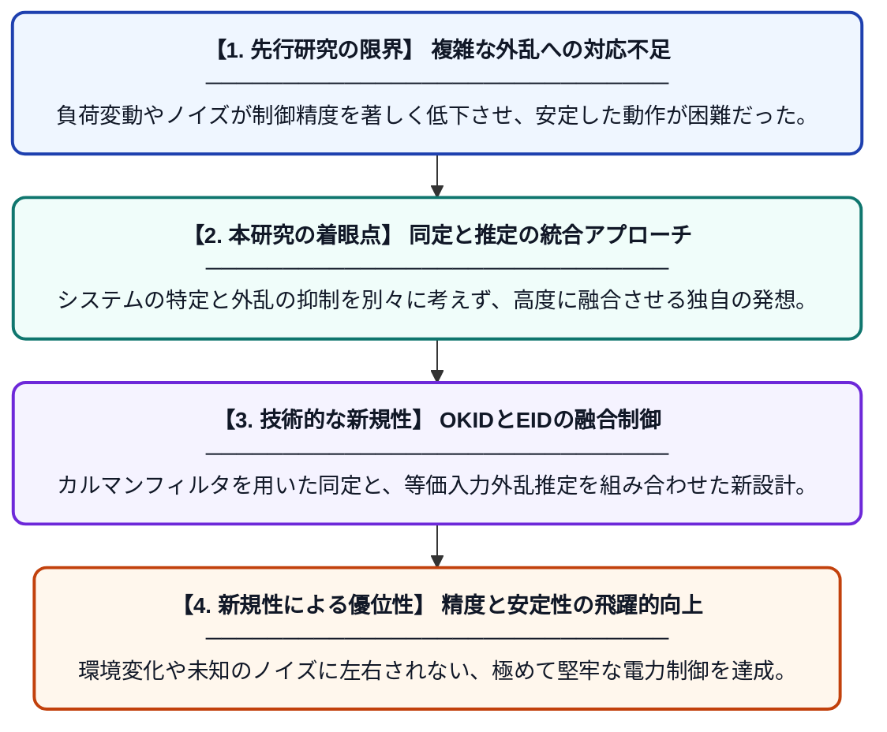

# ACバッテリ応用における3相4線式インバータのための、等価入力外乱推定とオブザーバ・カルマンフィルタ同定の統合手法

**Original Title**: *Equivalent Input Disturbance Estimation Combined with Observer Kalman Filter Identification for Three-Phase Four-Leg Inverters in an AC Battery Application*

> **💡 一言要約**: 外乱に強い高精度ACバッテリ制御の新手法

| 項目 | 内容 |
|---|---|
| **著者** | P Vu, QD Nguyen, VN Giap, TA Do |
| **掲載誌** | Engineering Research Express 2026 |
| **アラートキーワード** | kalman filter |
| **原文リンク** | [https://iopscience.iop.org/article/10.1088/2631-8695/aebff9/meta](https://iopscience.iop.org/article/10.1088/2631-8695/aebff9/meta) |
| **PDF版要約** | [README.pdf](./README.pdf) |

---

## 📊 新規性の図解（先行研究との違いと本研究のブレークスルー）

## 📝 要約

本論文は、ACバッテリシステムに用いられる3相4線式（3P4L）コンバータの性能向上のため、等価入力外乱（EID）推定とオブザーバ・カルマンフィルタ同定（OKID）を組み合わせた制御手法を提案しています。システムの正確なモデル特定と未知の外乱補償を同時に行うことで、変動の激しい環境下でも高精度な電力変換を実現します。

## ❓ どんな問題に取り組んだか

3相4線式インバータは非線形負荷や外部ノイズの影響を受けやすく、従来の制御手法では動的な環境変化に対して十分な精度と安定性を維持することが困難でした。特に、システムの数学的モデルの不確かさとリアルタイムでの外乱抑制をいかに両立させるかが大きな課題でした。

## ✨ 何が新しい？何がすごい？（新規性）

本研究の核心は、データ駆動型で高精度なモデルを構築するOKIDアルゴリズムと、推定されたモデルに基づき未知の外乱を相殺するEID推定器を統合した点にあります。この組み合わせにより、先行研究では難しかった「モデルの自動同定」と「高度な外乱補償」を一つのフレームワークで実現しました。結果として、複雑なパラメータ調整を必要とせずに、システムのロバスト性を飛躍的に高めることに成功しています。

## 🎓 大学1年生向けの解説

蓄電池などの電気を変換する「インバータ」という装置を、より賢く、正確に動かすための研究です。装置を動かすときには、部品の個体差や外からのノイズが原因で、出力される電気が乱れてしまうことがあります。この論文では、数学的なテクニックを使って装置の「クセ」と「ノイズ」をリアルタイムで見つけ出し、それを打ち消す方法を開発しました。これにより、どんな状況でも安定してきれいな電気を供給できるようになります。
