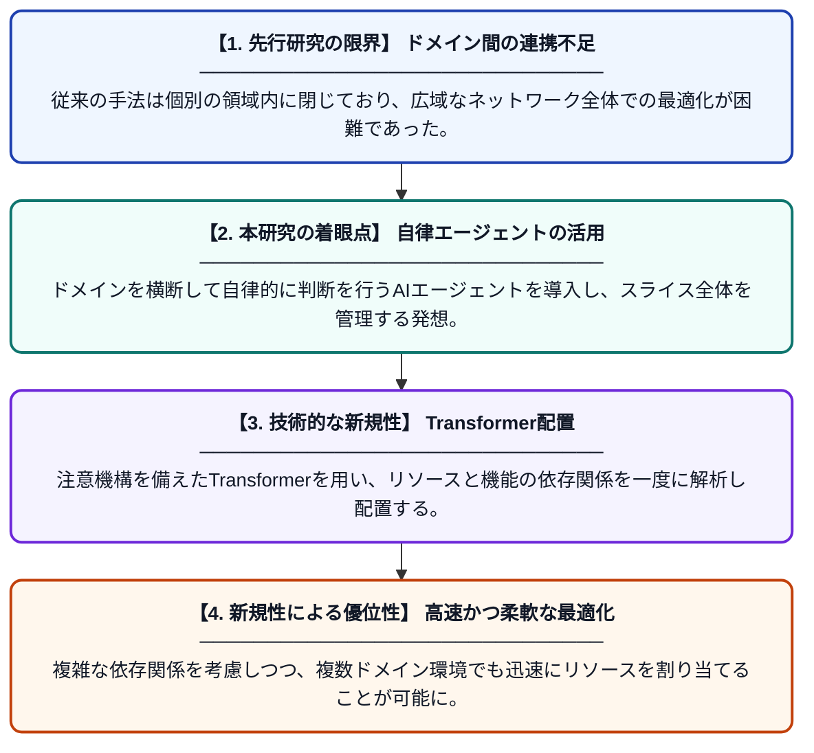

# ドメイン内調整から複数ドメインのオーケストレーションへ：エージェント型スライス認識リソース管理

**Original Title**: *From Intra-Domain Coordination to Multi-Domain Orchestration: Agentic Slice-Aware Resource Management*

> **💡 一言要約**: AIがドメインを跨ぎ5Gリソースを最適化

| 項目 | 内容 |
|---|---|
| **著者** | R Sahraoui, F Bannour, B Jouaber, D Zeghlache |
| **掲載誌** | The 22nd International Conference … 2026 |
| **アラートキーワード** | one shot |
| **原文リンク** | [https://hal.science/hal-05845979/](https://hal.science/hal-05845979/) |
| **PDF版要約** | [README.pdf](./README.pdf) |

---

## 📊 新規性の図解（先行研究との違いと本研究のブレークスルー）

## 📝 要約

5Gコアネットワークにおいて、単一ドメイン内のリソース調整から複数ドメインにわたるオーケストレーションへの進化を提案する研究です。Transformerを活用したワンショット配置手法により、物理リソースと仮想ネットワーク機能（VNF）の間の複雑な依存関係を効率的に把握し最適化します。

## ❓ どんな問題に取り組んだか

従来の5Gリソース管理は特定のドメイン内に限定されており、複数のドメインにまたがる複雑なネットワークスライスの最適化が困難でした。また、物理的なインフラと仮想化された機能の間の動的な依存関係を、高い精度かつ低遅延で処理する手法が不足していました。

## ✨ 何が新しい？何がすごい？（新規性）

本研究の最大の新規性は、Transformerモデルを応用した「ワンショット配置」アルゴリズムの導入にあります。これにより、物理リソースとVNFの相互依存関係を一括で捉え、従来手法よりも迅速かつ正確に最適な配置を決定できます。さらに、AIエージェントがスライスの状態を認識し、ドメインを横断して自律的にリソースをオーケストレーションする体系的なアプローチを実現しました。

## 🎓 大学1年生向けの解説

5Gのネットワークは、用途に合わせて仮想的な専用線（スライス）を作ることができます。これまでは1つの会社や地域の中だけで管理していましたが、この論文では複数の領域をまたいでAIが自動で管理する方法を考えました。Transformerという最新のAI技術を使うことで、パズルのように複雑なネットワークの部品をどこに置けば一番効率が良いかを瞬時に判断します。これにより、どこにいても快適で途切れない通信サービスが提供しやすくなります。
