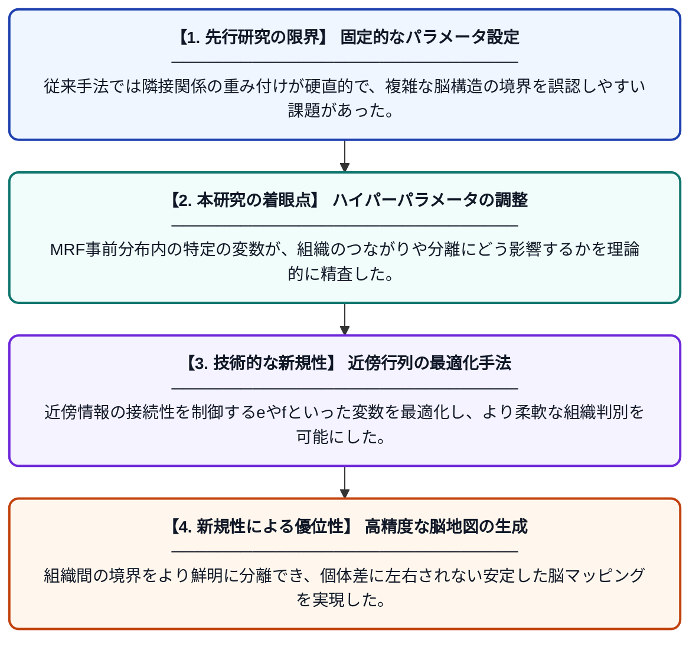

# 脳マッピングにおけるマルコフ確率場事前分布を用いた構造解析手法の進展

**Original Title**: *Within the past few decades, advances in imaging acquisition have given rise to a large number of in vivo techniques for brain mapping. This wide range of structural …*

> **💡 一言要約**: MRFの最適化で脳の構造をより精密に描き出す

| 項目 | 内容 |
|---|---|
| **著者** | S Chiang |
| **アラートキーワード** | MRFs Markov |
| **原文リンク** | [https://repository.rice.edu/server/api/core/bitstreams/ca12eb80-cb7c-4238-aff3-9dffa2a486a8/content](https://repository.rice.edu/server/api/core/bitstreams/ca12eb80-cb7c-4238-aff3-9dffa2a486a8/content) |
| **PDF版要約** | [README.pdf](./README.pdf) |

---

## 📊 新規性の図解（先行研究との違いと本研究のブレークスルー）

## 📝 要約

近年の画像取得技術の向上に伴い、生体内での脳マッピング手法が多様化しています。本研究では、統計モデルであるマルコフ確率場（MRF）の事前分布に含まれるハイパーパラメータが、脳構造の抽出精度に与える影響を詳細に分析しています。

## ❓ どんな問題に取り組んだか

脳の画像データから正確な構造情報を抽出するには高度な統計モデルが必要ですが、従来のモデルでは隣接する組織の関係性を決めるパラメータ設定が困難でした。特に、複雑な組織境界においてノイズと実データを区別するための最適なハイパーパラメータの調整が大きな課題となっていました。

## ✨ 何が新しい？何がすごい？（新規性）

本研究は、MRF事前分布における複数のハイパーパラメータ（eやf）がクラスタリングや近傍行列の接続性に与える影響を数学的に整理しました。従来の画一的なモデルとは異なり、近傍情報が組織間の識別にどのように寄与するかを具体的に定義し、推定の安定性を高める手法を提示しています。これにより、個別のデータセットに依存しないより頑健な脳マッピングの枠組みを提供しました。

## 🎓 大学1年生向けの解説

脳の写真を撮る技術は進歩していますが、その画像から「どこが何の組織か」を自動で判断するのは難しい作業です。この研究では、隣り合う細胞や組織が似た性質を持つというルール（マルコフ確率場）を数学的に工夫しました。そのルールを調整するための「重み」を最適化することで、より正確でノイズの少ない脳の地図を作れるようになります。
