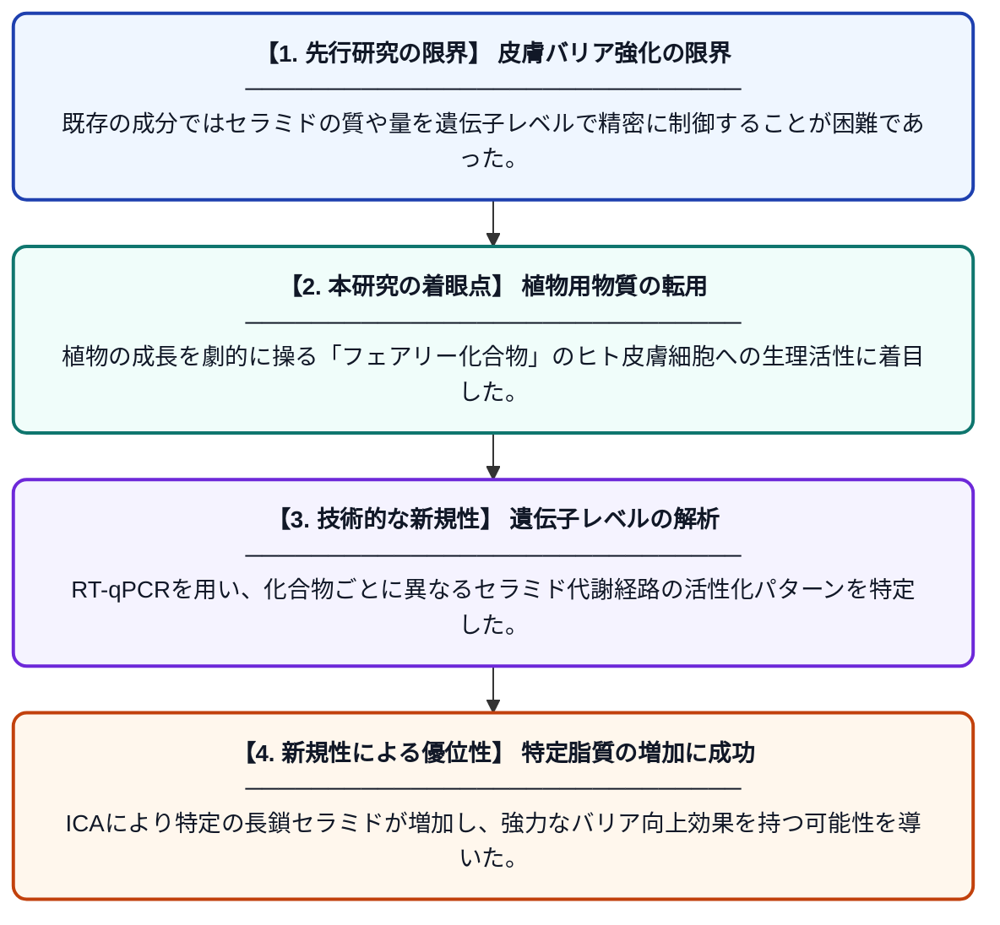

# フェアリー化合物がHaCaT角化細胞におけるセラミド代謝とバリア関連遺伝子の発現を特異的に調節する

**Original Title**: *Fairy chemicals differentially modulate ceramide metabolism and barrier-related gene expression in HaCaT keratinocytes*

> **💡 一言要約**: 妖精の化合物が肌のバリア機能を高める可能性を発見

| 項目 | 内容 |
|---|---|
| **著者** | K Mizukami, Z Wang, JH Choi, T Suzuki, H Kawagishi… |
| **掲載誌** | Bioscience, Biotechnology … 2026 |
| **アラートキーワード** | ICA |
| **PDF** | [https://academic.oup.com/bbb/advance-article-pdf/doi/10.1093/bbb/zbag173/73964172/zbag173.pdf](https://academic.oup.com/bbb/advance-article-pdf/doi/10.1093/bbb/zbag173/73964172/zbag173.pdf) |
| **原文リンク** | [https://academic.oup.com/bbb/advance-article-pdf/doi/10.1093/bbb/zbag173/73964172/zbag173.pdf](https://academic.oup.com/bbb/advance-article-pdf/doi/10.1093/bbb/zbag173/73964172/zbag173.pdf) |
| **PDF版要約** | [README.pdf](./README.pdf) |

---

## 📊 新規性の図解（先行研究との違いと本研究のブレークスルー）

## 📝 要約

キノコの「フェアリーリング」から発見された化合物（AOH、ICA、AHX）が、ヒトの皮膚細胞においてセラミド合成やバリア機能に関わる遺伝子発現を変化させることを解明しました。特にICAが総セラミド量および特定の長鎖セラミドを最も増加させることが示され、新しいスキンケア成分としての可能性が示唆されました。

## ❓ どんな問題に取り組んだか

皮膚のバリア機能維持に不可欠なセラミドの代謝メカニズムは複雑であり、外部から効率的にこれらを制御・向上させる新たな天然由来成分の探索が求められていました。また、植物成長調節物質として知られる「フェアリー化合物」がヒトの皮膚細胞に与える詳細な影響は未解明でした。

## ✨ 何が新しい？何がすごい？（新規性）

植物の成長を制御する物質として知られていたAOH、ICA、AHXが、ヒトの角化細胞において異なる遺伝子サブセットを標的にすることを発見しました。特にICAが長鎖セラミド（C22–C24）を特異的に増加させることを突き止めた点が、本研究の主要な貢献です。これにより、単なる保湿剤ではなく、遺伝子レベルで皮膚バリアを強化する新しいアプローチが提示されました。

## 🎓 大学1年生向けの解説

私たちの肌には、水分の蒸発を防ぐ「セラミド」という大切な脂質があります。この研究では、キノコが円を描いて生える不思議な現象から見つかった「フェアリー化合物」という物質を肌の細胞に与えてみました。すると、細胞の中にあるセラミドを作るスイッチが入り、肌のバリア機能が強まることが分かりました。自然界の不思議な物質が、将来の化粧品や薬に役立つかもしれないというワクワクする発見です。
