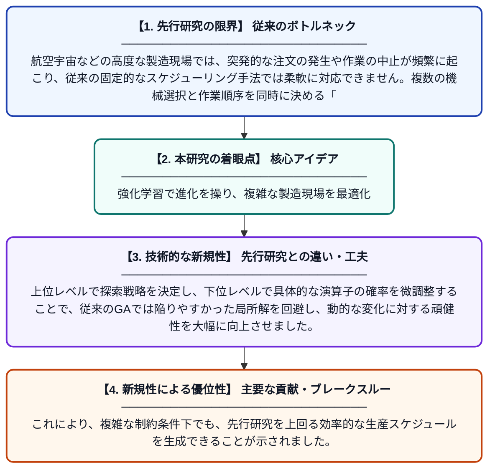

# 複雑製品製造における動的フレキシブルジョブショップスケジューリングのための2段階強化学習駆動型適応的遺伝的アルゴリズム

**Original Title**: *A bi-level reinforcement learning-driven adaptive genetic algorithm for dynamic flexible job shop scheduling in complex product manufacturing*

> **💡 一言要約**: 強化学習で進化を操り、複雑な製造現場を最適化

| 項目 | 内容 |
|---|---|
| **著者** | Q Jia, J Li, Y Dou, Z Chen, L Xing, K Yang |
| **掲載誌** | Swarm and Evolutionary Computation 2026 |
| **アラートキーワード** | reinforcement |
| **原文リンク** | [https://www.sciencedirect.com/science/article/pii/S2210650226002968](https://www.sciencedirect.com/science/article/pii/S2210650226002968) |
| **PDF版要約** | [README.pdf](./README.pdf) |

---

## 📊 新規性の図解（先行研究との違いと本研究のブレークスルー）

## 📝 要約

航空エンジンや人工衛星といった複雑な製品の製造現場で発生する、新規ジョブの追加やキャンセルといった動的な変化に対応するスケジューリング手法を提案しています。2段階の強化学習を遺伝的アルゴリズムに組み込むことで、現場の状況に合わせてアルゴリズムの挙動をリアルタイムに最適化し、効率的な生産計画を実現します。

## ❓ どんな問題に取り組んだか

航空宇宙などの高度な製造現場では、突発的な注文の発生や作業の中止が頻繁に起こり、従来の固定的なスケジューリング手法では柔軟に対応できません。複数の機械選択と作業順序を同時に決める「フレキシブルジョブショップ」問題は計算負荷が非常に高く、変化の激しい環境で即座に最適な計画を出し続けることは困難でした。

## ✨ 何が新しい？何がすごい？（新規性）

本研究の最大の特徴は、遺伝的アルゴリズム（GA）のパラメータを2段階の強化学習（Bi-level RL）で適応的に制御する仕組みを導入した点にあります。上位レベルで探索戦略を決定し、下位レベルで具体的な演算子の確率を微調整することで、従来のGAでは陥りやすかった局所解を回避し、動的な変化に対する頑健性を大幅に向上させました。これにより、複雑な制約条件下でも、先行研究を上回る効率的な生産スケジュールを生成できることが示されました。

## 🎓 大学1年生向けの解説

工場で「どの機械を使って、どの順番で部品を作るか」というパズルを解くAIの研究です。飛行機のエンジンを作るような大きな工場では、急に新しい仕事が入ったり、逆にキャンセルになったりと、パズルの条件が常に変わってしまいます。この論文では、AIに「パズルの解き方そのもの」を練習させることで、どんな急な変化が起きても、即座に一番効率の良いスケジュールを作れるようにしました。これは、製造現場の無駄を減らし、ものづくりをスムーズにするための魔法のような技術です。
