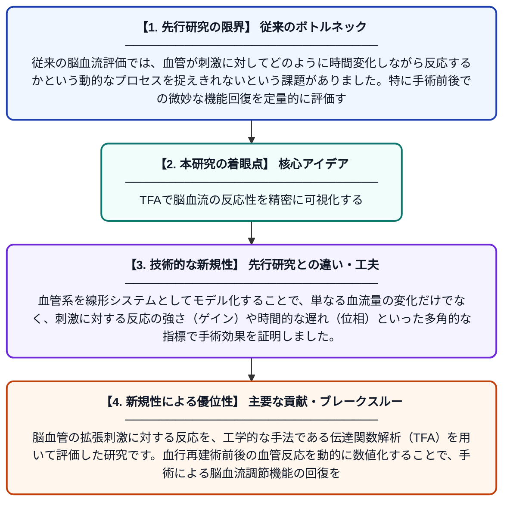

# 伝達関数解析と血行再建術

**Original Title**: *Transfer Function Analysis and Revascularization Surgery*

> **💡 一言要約**: TFAで脳血流の反応性を精密に可視化する

| 項目 | 内容 |
|---|---|
| **著者** | PDJ Duffin, PDES Sayin, PDO Sobczyk, PDS Ayyash… |
| **掲載誌** | NeuroImage Stroke 2026 |
| **アラートキーワード** | ICA |
| **原文リンク** | [https://www.sciencedirect.com/science/article/pii/S3117574026000109](https://www.sciencedirect.com/science/article/pii/S3117574026000109) |
| **PDF版要約** | [README.pdf](./README.pdf) |

---

## 📊 新規性の図解（先行研究との違いと本研究のブレークスルー）

## 📝 要約

脳血管の拡張刺激に対する反応を、工学的な手法である伝達関数解析（TFA）を用いて評価した研究です。血行再建術前後の血管反応を動的に数値化することで、手術による脳血流調節機能の回復を精密に測定することを目指しています。

## ❓ どんな問題に取り組んだか

従来の脳血流評価では、血管が刺激に対してどのように時間変化しながら反応するかという動的なプロセスを捉えきれないという課題がありました。特に手術前後での微妙な機能回復を定量的に評価するための、より信頼性の高い指標が求められていました。

## ✨ 何が新しい？何がすごい？（新規性）

この研究は、制御工学などで使われる伝達関数解析を脳血管の反応評価に導入した点が画期的です。血管系を線形システムとしてモデル化することで、単なる血流量の変化だけでなく、刺激に対する反応の強さ（ゲイン）や時間的な遅れ（位相）といった多角的な指標で手術効果を証明しました。

## 🎓 大学1年生向けの解説

脳の血管が詰まった患者さんに行う手術の効果を、数学的な手法を使って詳しく調べる研究です。スピーカーの性能を測るような方法を応用して、血管が刺激に対して「どれくらい強く」「どれくらい素早く」反応するかを数字で表しました。これにより、手術によって脳の健康状態がどれだけ改善したかを、これまで以上に正確に確認できるようになります。
