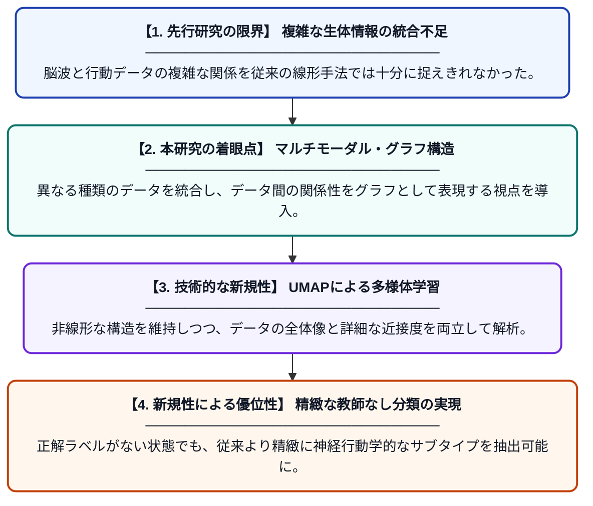

# EPG-SD：脳波と行動表現型から教師なしで神経行動学的サブタイプを発見するためのマルチモーダル・スペクトラル・グラフ・フレームワーク

**Original Title**: *EPG-SD: A Multimodal Spectral Graph Framework for Unsupervised Neurobehavioral Subtype Discovery from EEG and Behavioral Phenotypes*

> **💡 一言要約**: 脳波と行動を統合し、隠れた精神疾患の型を暴く

| 項目 | 内容 |
|---|---|
| **著者** | SV Rajashree, S Radha, S Shridevi |
| **掲載誌** | IEEE Access 2026 |
| **アラートキーワード** | manifold learning |
| **PDF** | [https://ieeexplore.ieee.org/iel8/6287639/6514899/11793571.pdf](https://ieeexplore.ieee.org/iel8/6287639/6514899/11793571.pdf) |
| **原文リンク** | [https://ieeexplore.ieee.org/iel8/6287639/6514899/11793571.pdf](https://ieeexplore.ieee.org/iel8/6287639/6514899/11793571.pdf) |
| **PDF版要約** | [README.pdf](./README.pdf) |

---

## 📊 新規性の図解（先行研究との違いと本研究のブレークスルー）

## 📝 要約

脳波（EEG）データと行動特性データを統合し、スペクトラル・グラフ理論を用いて個人の神経行動学的な分類（サブタイプ）を自動で見つけ出す新しい枠組みを提案しています。線形な手法と非線形な多様体学習を組み合わせることで、データの全体的な構造と局所的な特徴の両方を維持した高精度な分類を可能にしました。

## ❓ どんな問題に取り組んだか

精神疾患や神経発達障害の診断は画一的な基準で行われがちですが、実際には同じ診断名でも脳活動や行動が異なる「サブタイプ」が存在します。既存の分析手法ではデータの全体像か細部の構造かのどちらか一方が犠牲になりやすく、複雑な生体情報を正確に捉えて分類することが困難でした。

## ✨ 何が新しい？何がすごい？（新規性）

本研究は、脳波と行動データを統合する「EPG-SD」という独自のスペクトラル・グラフ・フレームワークを開発しました。UMAP等の非線形多様体学習を活用し、データの「局所的な近接関係」と「全体的な分散」を同時に保存する点が画期的です。これにより、ラベルなし（教師なし）で、従来手法では埋もれていた微妙なサブタイプの差異を高精度に抽出できる点が大きな貢献です。

## 🎓 大学1年生向けの解説

私たちの脳の働きや行動の癖は一人ひとり違いますが、似た特徴を持つグループに分けることができます。この論文では、脳波計で測ったデータと普段の行動のデータを組み合わせて、コンピュータが自動で「この人たちは似ている」と分類する新しい方法を作りました。これまでの方法よりもデータの歪みが少なく、より正確にグループ分けができます。将来的に、一人ひとりの脳のタイプに合わせた最適な治療法を見つけるのに役立ちます。
