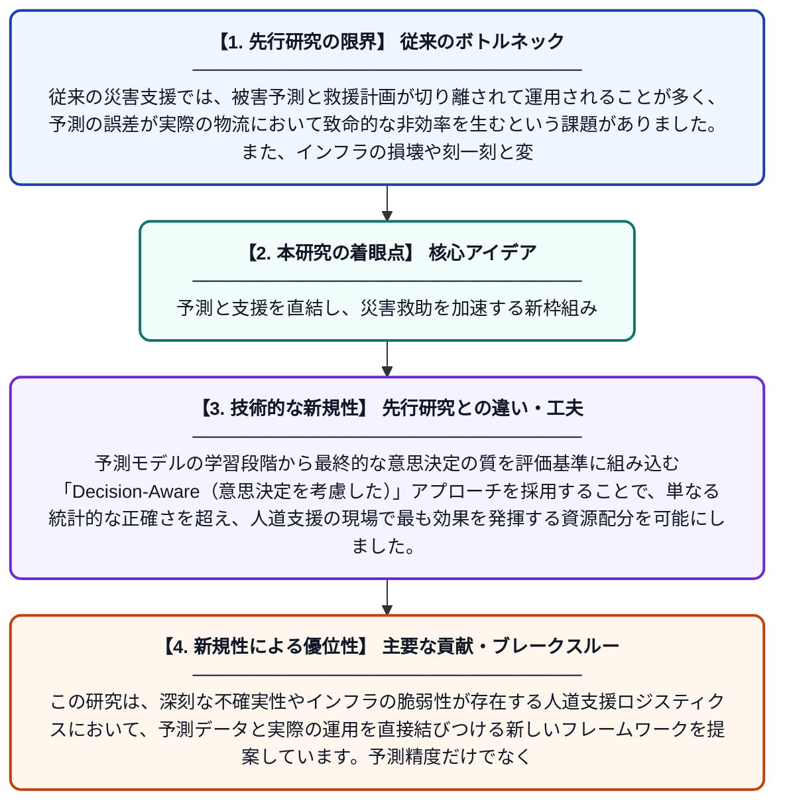

# 予測から意思決定へ：先駆的人道支援ロジスティクスのためのクローズドループ型意思決定配慮型予測・処方的フレームワーク

**Original Title**: *From Prediction to Decision: A Closed-Loop Decision-Aware Predictive-Prescriptive Framework for Anticipatory Humanitarian Logistics*

> **💡 一言要約**: 予測と支援を直結し、災害救助を加速する新枠組み

| 項目 | 内容 |
|---|---|
| **著者** | LS de Carvalho, CCR Santos |
| **掲載誌** | Socio-Economic Planning Sciences 2026 |
| **アラートキーワード** | logistics |
| **原文リンク** | [https://www.sciencedirect.com/science/article/pii/S0038012126002107](https://www.sciencedirect.com/science/article/pii/S0038012126002107) |
| **PDF版要約** | [README.pdf](./README.pdf) |

---

## 📊 新規性の図解（先行研究との違いと本研究のブレークスルー）

## 📝 要約

この研究は、深刻な不確実性やインフラの脆弱性が存在する人道支援ロジスティクスにおいて、予測データと実際の運用を直接結びつける新しいフレームワークを提案しています。予測精度だけでなく、その予測が実際の支援物資の配布などの意思決定に及ぼす影響を考慮した「クローズドループ型」の仕組みを構築し、迅速な支援を実現します。

## ❓ どんな問題に取り組んだか

従来の災害支援では、被害予測と救援計画が切り離されて運用されることが多く、予測の誤差が実際の物流において致命的な非効率を生むという課題がありました。また、インフラの損壊や刻一刻と変わる現地の状況といった深い不確実性に対応できる柔軟な意思決定支援が不足していました。

## ✨ 何が新しい？何がすごい？（新規性）

本論文の革新性は、予測と意思決定を独立したステップではなく、相互に影響し合う「クローズドループ」として統合した点にあります。予測モデルの学習段階から最終的な意思決定の質を評価基準に組み込む「Decision-Aware（意思決定を考慮した）」アプローチを採用することで、単なる統計的な正確さを超え、人道支援の現場で最も効果を発揮する資源配分を可能にしました。

## 🎓 大学1年生向けの解説

災害が起きたとき、「どこにどれだけの物資が必要か」を完璧に当てるのは不可能です。これまでは予測が外れると支援が遅れてしまっていましたが、この研究は「予測が外れる可能性」も最初から計算に入れて、最も効率的な助け方を導き出すAIの仕組みを作りました。予測と実際の行動をセットで考えることで、混乱した現場でも迷わずに、一人でも多くの人を助けるためのルートや量を決められるようになります。
