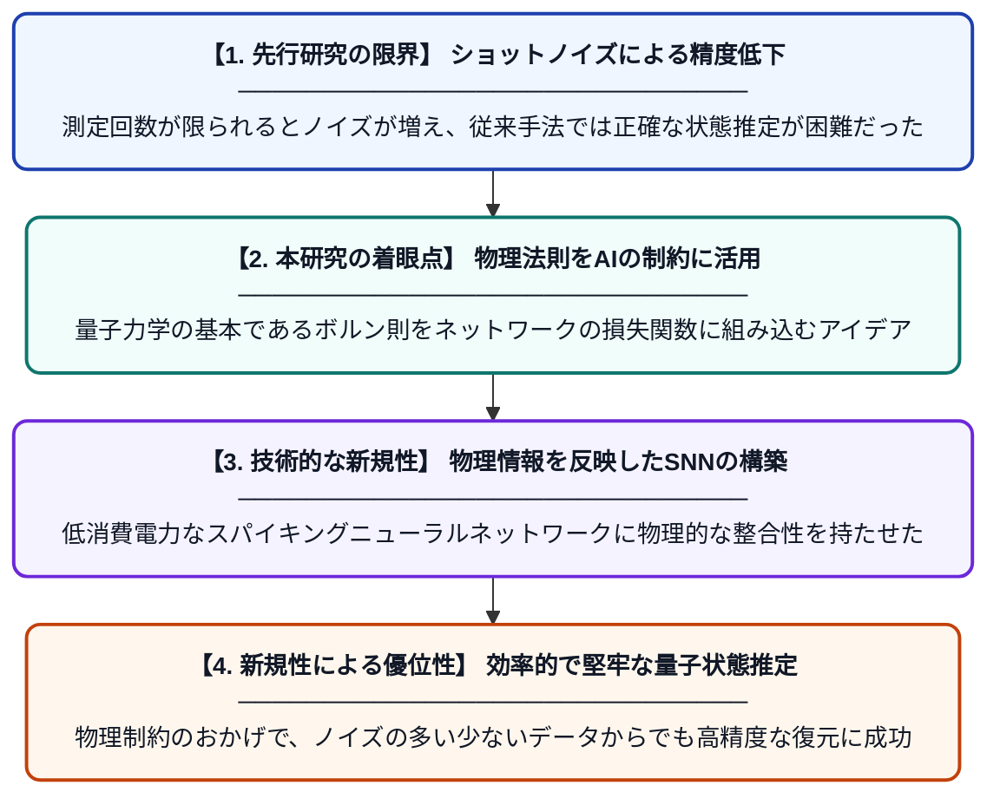

# ボルン則に基づく物理情報駆動型スパイキングニューラルネットワークによるショットノイズを考慮した量子状態トモグラフィー

**Original Title**: *Born-Rule Physics-Informed Spiking Neural Networks for Shot-Noise-Aware Quantum State Tomography*

> **💡 一言要約**: ボルン則とSNNでノイズに強い量子状態推定を実現

| 項目 | 内容 |
|---|---|
| **著者** | NT Luu, DT Luu, TC Truong |
| **アラートキーワード** | one shot |
| **PDF** | [https://www.researchgate.net/profile/Nhan-Luu-7/publication/417136291_Born-rule_physics-informed_spiking_neural_networks_for_shot-noise-aware_quantum_state_tomography/links/6ae369fa3e7df118bc691f0c/Born-rule-physics-informed-spiking-neural-networks-for-shot-noise-aware-quantum-state-tomography.pdf](https://www.researchgate.net/profile/Nhan-Luu-7/publication/417136291_Born-rule_physics-informed_spiking_neural_networks_for_shot-noise-aware_quantum_state_tomography/links/6ae369fa3e7df118bc691f0c/Born-rule-physics-informed-spiking-neural-networks-for-shot-noise-aware-quantum-state-tomography.pdf) |
| **原文リンク** | [https://www.researchgate.net/profile/Nhan-Luu-7/publication/417136291_Born-rule_physics-informed_spiking_neural_networks_for_shot-noise-aware_quantum_state_tomography/links/6ae369fa3e7df118bc691f0c/Born-rule-physics-informed-spiking-neural-networks-for-shot-noise-aware-quantum-state-tomography.pdf](https://www.researchgate.net/profile/Nhan-Luu-7/publication/417136291_Born-rule_physics-informed_spiking_neural_networks_for_shot-noise-aware_quantum_state_tomography/links/6ae369fa3e7df118bc691f0c/Born-rule-physics-informed-spiking-neural-networks-for-shot-noise-aware-quantum-state-tomography.pdf) |
| **PDF版要約** | [README.pdf](./README.pdf) |

---

## 📊 新規性の図解（先行研究との違いと本研究のブレークスルー）

## 📝 要約

この論文は、量子状態トモグラフィー（QST）において、ショットノイズの影響を抑えつつ高精度に量子状態を推定する新しい手法を提案しています。物理法則であるボルン則を組み込んだ物理情報駆動型スパイキングニューラルネットワーク（SNN）を用いることで、計算効率と推定精度の両立を実現しました。

## ❓ どんな問題に取り組んだか

量子状態を推定する際、測定回数が有限であるために生じる「ショットノイズ」が推定精度を著しく低下させる課題があります。また、従来のディープラーニング手法は計算資源の消費が激しく、量子力学的な物理制約を十分に反映できていないという問題がありました。

## ✨ 何が新しい？何がすごい？（新規性）

脳の神経回路を模した低消費電力なスパイキングニューラルネットワーク（SNN）に、量子力学の基本原則である「ボルン則」を直接学習プロセスに組み込んだ点が革新的です。これにより、物理的な整合性を保ちながら、ノイズの多いデータから効率的に真の量子状態を復元することが可能になりました。先行研究と比較して、ハードウェア効率の高いSNNを用いて物理制約を明示的に課すことで、より少ない測定データで高い堅牢性を実現しています。

## 🎓 大学1年生向けの解説

量子コンピュータの中身（量子状態）を調べるには何度も実験を繰り返す必要がありますが、どうしても「測定のばらつき（ノイズ）」が出てしまいます。この研究では、人間の脳の仕組みをヒントにした「スパイキングニューラルネットワーク」に、量子力学のルールである「ボルン則」を教え込みました。その結果、少ない実験データからでも、ノイズに惑わされず正しく量子状態を当てることができるようになりました。これは、将来の量子コンピュータの診断をより速く正確にする技術です。
