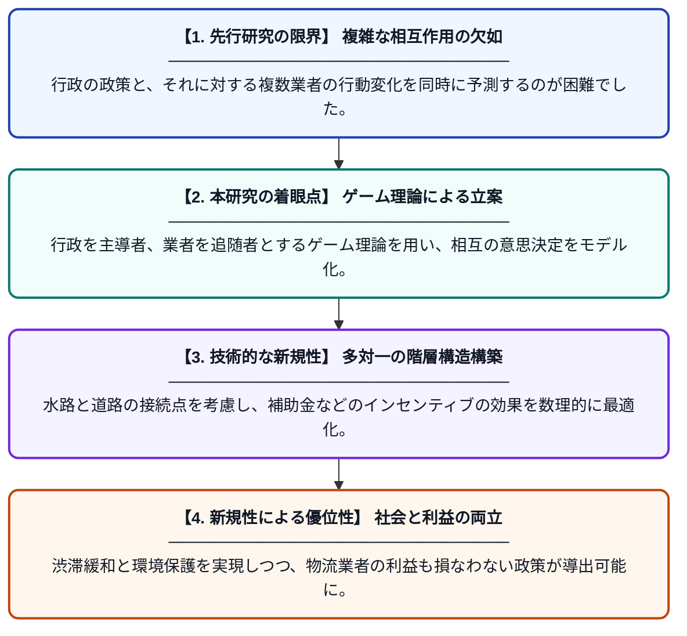

# 道路と水路を組み合わせた都市物流のためのインセンティブ戦略：単一リーダー・複数フォロワーのゲーム理論的枠組み

**Original Title**: *Incentive-based strategies for road–waterway city logistics: A single-leader multi-follower game-theoretic framework*

> **💡 一言要約**: 渋滞解消へ！水上輸送への転換を促すゲーム理論モデル

| 項目 | 内容 |
|---|---|
| **著者** | M Luan, B Atasoy |
| **掲載誌** | … Research Part E: Logistics and Transportation Review 2026 |
| **アラートキーワード** | logistics |
| **原文リンク** | [https://www.sciencedirect.com/science/article/pii/S1366554526006885](https://www.sciencedirect.com/science/article/pii/S1366554526006885) |
| **PDF版要約** | [README.pdf](./README.pdf) |

---

## 📊 新規性の図解（先行研究との違いと本研究のブレークスルー）

## 📝 要約

都市物流におけるトラック輸送から水上輸送への転換（モーダルシフト）を促すため、インセンティブを活用した新たな管理フレームワークを提案しています。自治体などの政策決定者がリーダーとなり、複数の物流業者がその政策に反応して輸送経路を選択する「ゲーム理論」に基づいた数理モデルを構築しました。

## ❓ どんな問題に取り組んだか

都市部の道路混雑や排出ガスを減らすため、トラックから船へのモーダルシフトが期待されていますが、コストや手間の面で普及が進んでいません。行政がどのようなインセンティブを与えれば、自律的に動く民間業者が水上輸送を選んでくれるのかという、政策決定の難しさが課題でした。

## ✨ 何が新しい？何がすごい？（新規性）

本研究の最大の特徴は、政策決定者（リーダー）と複数の物流業者（フォロワー）の相互作用を「単一リーダー・複数フォロワー」ゲームとして定式化した点にあります。従来の研究では見落とされがちだった、複数の業者が競争・反応し合う動的な状況下での最適政策を導き出せる点が画期的です。さらに、道路と水路が混在する都市独自のインフラ構造を詳細にモデルに組み込み、実効性の高いインセンティブ設計を可能にしました。

## 🎓 大学1年生向けの解説

街の道路がトラックで渋滞するのを防ぐために、川や運河を使った「船の運び屋さん」をもっと増やそうという研究です。市役所が「船を使ったらお礼（補助金）を出すよ」というルールを決めた時、各運送会社がどう動くかを数学的なシミュレーション（ゲーム理論）で予測します。街全体の環境を良くすることと、運送会社がしっかり利益を出すことの両方を叶える「魔法のバランス」を見つけ出しました。
