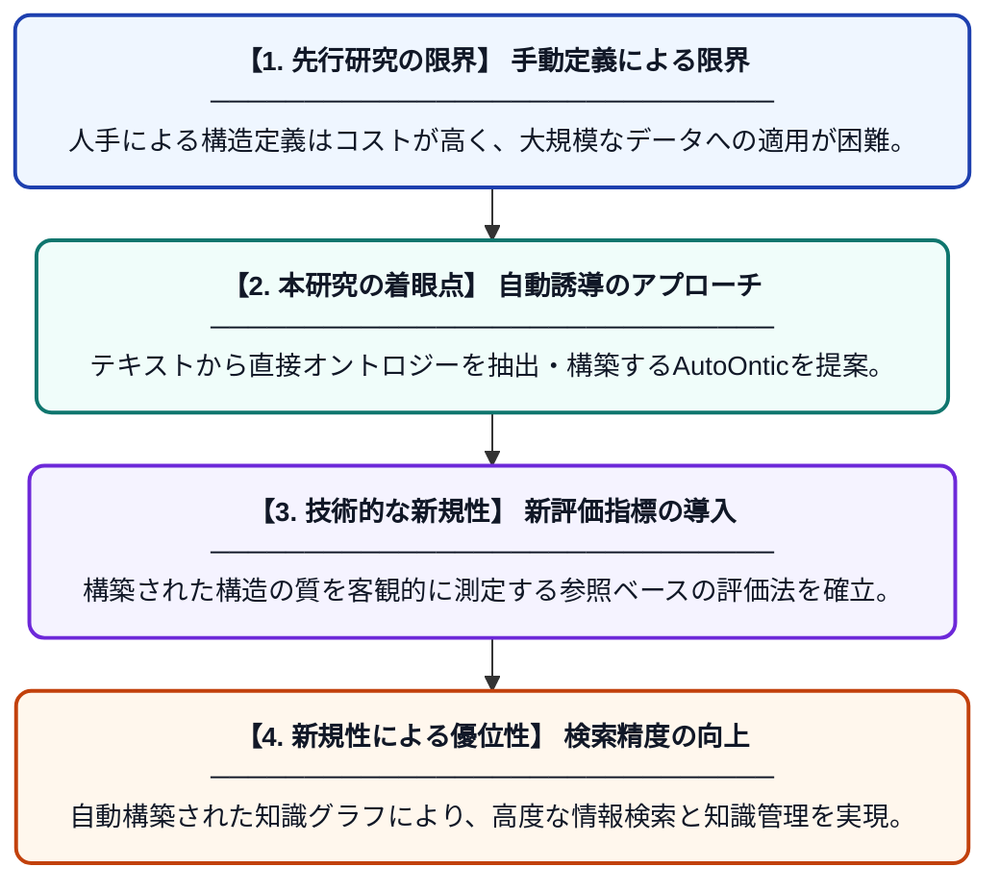

# AutoOntic: 知識グラフ構築のためのテキストからの自動オントロジー誘導

**Original Title**: *AutoOntic: Automatic Ontology Induction from Text for Knowledge Graph Construction*

> **💡 一言要約**: テキストから知識の構造を自動生成する新技術

| 項目 | 内容 |
|---|---|
| **著者** | A Chepurova, A Bulatov, M Burtsev, Y Kuratov |
| **掲載誌** | arXiv preprint arXiv:2611.15467 2026 |
| **アラートキーワード** | Ontology |
| **PDF** | [https://arxiv.org/pdf/2611.15467](https://arxiv.org/pdf/2611.15467) |
| **Git リポジトリ** | [https://github.com/screemix/AutoOntic.1](https://github.com/screemix/AutoOntic.1) |
| **原文リンク** | [https://arxiv.org/pdf/2611.15467](https://arxiv.org/pdf/2611.15467) |
| **PDF版要約** | [README.pdf](./README.pdf) |

---

## 📊 新規性の図解（先行研究との違いと本研究のブレークスルー）

## 📝 要約

テキストデータから自動的にオントロジー（概念間の体系的な関係）を構築するパイプライン「AutoOntic」を提案した研究です。生成されたオントロジーの質を評価するための新しい参照ベースのプロトコルを導入し、知識グラフを用いた情報検索における有効性を実証しました。

## ❓ どんな問題に取り組んだか

膨大なテキストから知識グラフを構築する際、その骨組みとなるオントロジーを手作業で定義するには膨大な労力と専門知識が必要です。既存の自動化手法は精度が不十分なことが多く、生成された構造の妥当性を客観的に評価する手法も確立されていませんでした。

## ✨ 何が新しい？何がすごい？（新規性）

テキストから概念や関係性を直接抽出・整理するAutoOnticパイプラインを開発した点が最大の特徴です。さらに、生成されたオントロジーを評価するための参照ベースの新たなプロトコルを導入し、主観を排除した評価を可能にしました。MINEデータセットを用いた検証では、AutoOnticで整理された知識グラフが既存手法を上回る検索性能を示すことを証明しました。

## 🎓 大学1年生向けの解説

インターネット上にある膨大な文章を、コンピューターが理解しやすい「知識の地図」として整理するのはとても大変な作業です。この研究では、AIを使って文章の中から自動的に重要な言葉とそのつながりを見つけ出し、整理された図（オントロジー）を作る方法を開発しました。これにより、人間が手助けしなくても、バラバラな情報から整理整頓された知識ベースを素早く作れるようになります。例えるなら、散らかった本棚をAIが自動で完璧に分類してくれるような技術です。
