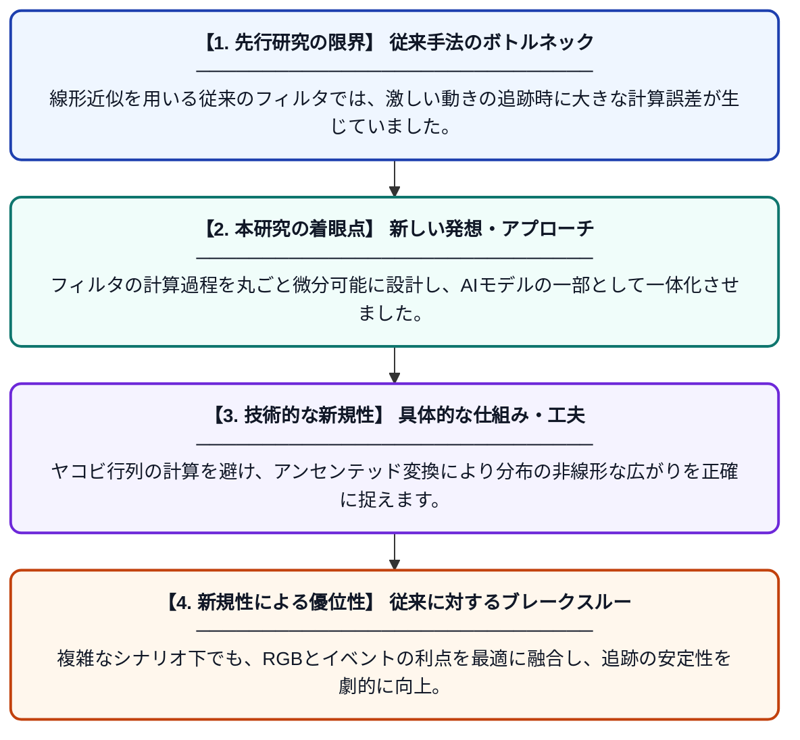

# SiamDUKF：微分可能なアンセンテッド・カルマンフィルタを用いたRGBEシャム追跡

**Original Title**: *SiamDUKF: RGBE Siamese tracking with a differentiable unscented Kalman filter*

> **💡 一言要約**: RGBとイベントを融合し、非線形な動きを精密に追跡

| 項目 | 内容 |
|---|---|
| **著者** | Y Zhang, J Qiu, P Li, Y Lu, Y Fang, K Zheng |
| **掲載誌** | Scientific Reports 2026 |
| **アラートキーワード** | kalman filter |
| **PDF** | [https://www.nature.com/articles/s41598-026-78993-2_reference.pdf](https://www.nature.com/articles/s41598-026-78993-2_reference.pdf) |
| **Git リポジトリ** | [https://github.com/Jee-King/AFNet](https://github.com/Jee-King/AFNet) |
| **原文リンク** | [https://www.nature.com/articles/s41598-026-78993-2_reference.pdf](https://www.nature.com/articles/s41598-026-78993-2_reference.pdf) |
| **PDF版要約** | [README.pdf](./README.pdf) |

---

## 📊 新規性の図解（先行研究との違いと本研究のブレークスルー）

## 📝 要約

RGB画像とイベントカメラのデータを融合し、物体の状態を高度に推定する新しい追跡フレームワーク「SiamDUKF」を提案しました。微分可能なアンセンテッド・カルマンフィルタ（DUKF）を組み込むことで、非線形な物体の動きをエンドツーエンドで学習し、高精度な追跡を実現しています。

## ❓ どんな問題に取り組んだか

従来のRGBE追跡（可視光とイベントデータの融合）では、複雑な動きを線形近似する際に大きな誤差が生じ、追跡の安定性が欠如していました。また、フィルタリングとニューラルネットワークの学習が分離しており、システム全体の最適化が困難という課題がありました。

## ✨ 何が新しい？何がすごい？（新規性）

アンセンテッド・カルマンフィルタ（UKF）を微分可能な形式でニューラルネットワークに統合し、エンドツーエンドの学習を可能にしました。従来の拡張カルマンフィルタ（EKF）のような一次線形化を必要とせず、アンセンテッド変換（UT）を用いることで、非線形な状態分布をより正確に伝播させることができます。これにより、急激な動きや環境変化に対しても、RGBとイベント情報の相補的な利点を最大限に引き出すことに成功しました。

## 🎓 大学1年生向けの解説

カメラの映像（RGB）と、光の動きだけを高速に捉える特殊なセンサー（イベントカメラ）を組み合わせて、動く物体を追いかける最新のAI技術です。これまでは物体の複雑な動きを計算する際、計算を楽にするために「単純な直線」として扱っていましたが、それではズレが生じていました。この研究では、その計算を精密なままAIに学習させることに成功し、夜間や激しい動きの中でも正確に追い続けられるようになりました。
