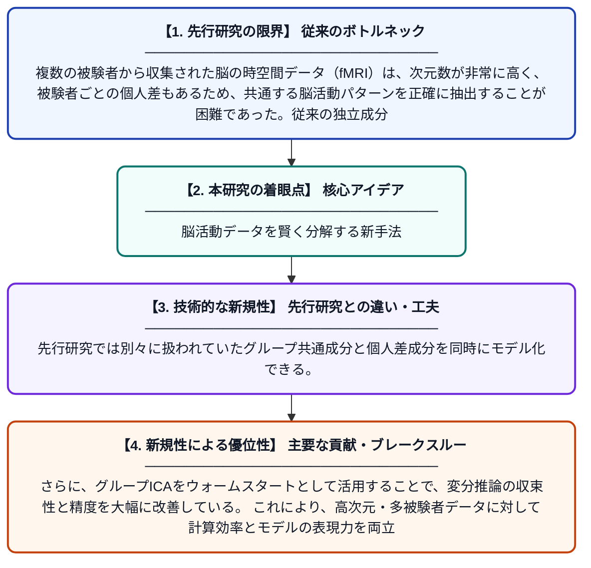

# 多被験者時空間データ解析のための変分低ランクテンソル分解

**Original Title**: *Variational Low-rank Tensor Decomposition for Multisubject Spatiotemporal Data Analysis*

> **💡 一言要約**: 脳活動データを賢く分解する新手法

| 項目 | 内容 |
|---|---|
| **著者** | LM Montaldo, RA Borsoi, S Miron, T Adali |
| **掲載誌** | arXiv preprint arXiv:2607.22262 2026 |
| **アラートキーワード** | independent component ... |
| **PDF** | [https://arxiv.org/pdf/2607.22262](https://arxiv.org/pdf/2607.22262) |
| **Git リポジトリ** | [https://github.com/lmontaldo/stvtd](https://github.com/lmontaldo/stvtd) |
| **原文リンク** | [https://arxiv.org/pdf/2607.22262](https://arxiv.org/pdf/2607.22262) |
| **PDF版要約** | [README.pdf](./README.pdf) |

---

## 📊 新規性の図解（先行研究との違いと本研究のブレークスルー）

## 📝 要約

本論文は、複数の被験者から得られた機能的MRI（fMRI）データを効率的に解析するための変分低ランクテンソル分解フレームワークを提案している。グループ独立成分分析（ICA）に基づくウォームスタート戦略を採用し、最適化性能を向上させる工夫がなされている。リアルな合成fMRIデータセットを用いた実験により、提案手法の有効性が検証されている。

## ❓ どんな問題に取り組んだか

複数の被験者から収集された脳の時空間データ（fMRI）は、次元数が非常に高く、被験者ごとの個人差もあるため、共通する脳活動パターンを正確に抽出することが困難であった。従来の独立成分分析などの手法は、データの多次元構造を十分に活用できず、ノイズや個人差に対してロバストでない場合があった。

## ✨ 何が新しい？何がすごい？（新規性）

本研究は、多被験者fMRIデータを多次元配列（テンソル）として扱い、変分ベイズ推論と低ランク分解を組み合わせた統一的なフレームワークを構築した点が新しい。先行研究では別々に扱われていたグループ共通成分と個人差成分を同時にモデル化できる。さらに、グループICAをウォームスタートとして活用することで、変分推論の収束性と精度を大幅に改善している。これにより、高次元・多被験者データに対して計算効率とモデルの表現力を両立させることに成功している。

## 🎓 大学1年生向けの解説

脳のMRI検査では、時間とともに変化する脳の活動を3D画像として記録できます。複数の人のデータをまとめて解析すると、「共通する脳の働き方」を見つけられるのですが、データが巨大すぎて普通の方法では難しいです。この論文では、データを『テンソル』という多次元の箱として整理し、うまく圧縮・分解することで共通パターンを効率よく取り出す新しい方法を提案しています。さらに、最初の計算のスタート地点を賢く設定することで、より正確な結果が得られるようにしています。
