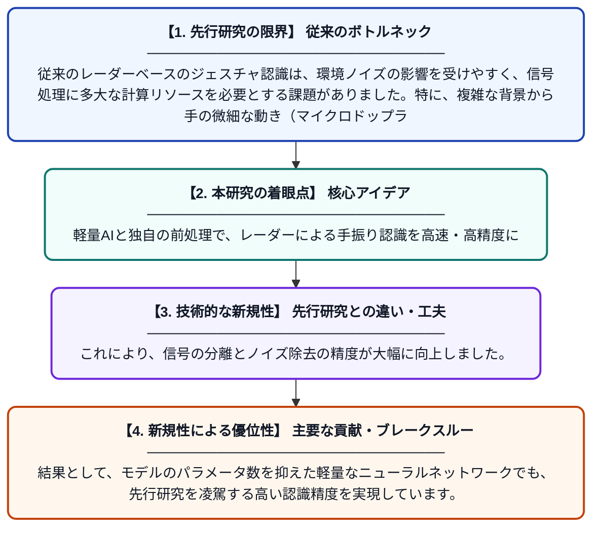

# RFMマイクロドップラー信号前処理を用いた超広帯域（UWB）レーダー・ジェスチャ認識のための軽量ニューラルネットワーク

**Original Title**: *Lightweight Neural Networks for Ultra-Wideband Radar Gesture Recognition via RFM Micro-Doppler Signal Preprocessing*

> **💡 一言要約**: 軽量AIと独自の前処理で、レーダーによる手振り認識を高速・高精度に

| 項目 | 内容 |
|---|---|
| **著者** | L Huang, J Wang, L Qiu, Q Zhou, P Han |
| **掲載誌** | IEEE Sensors Journal 2026 |
| **アラートキーワード** | independent component ... |
| **原文リンク** | [https://ieeexplore.ieee.org/abstract/document/11751730/](https://ieeexplore.ieee.org/abstract/document/11751730/) |
| **PDF版要約** | [README.pdf](./README.pdf) |

---

## 📊 新規性の図解（先行研究との違いと本研究のブレークスルー）

## 📝 要約

超広帯域（UWB）レーダーを用いたジェスチャ認識において、計算負荷を抑えた軽量なニューラルネットワークと高度な信号前処理技術を組み合わせた手法を提案しています。独自の前処理フレームワーク「RFM」により、ノイズの多いレーダー信号から手の動きの特徴を効率的に抽出することに成功しました。

## ❓ どんな問題に取り組んだか

従来のレーダーベースのジェスチャ認識は、環境ノイズの影響を受けやすく、信号処理に多大な計算リソースを必要とする課題がありました。特に、複雑な背景から手の微細な動き（マイクロドップラー成分）だけを低負荷で抽出することは困難でした。

## ✨ 何が新しい？何がすごい？（新規性）

本研究の最大の特徴は、RPCA（ロバスト主成分分析）とFastICA（高速独立成分分析）を組み合わせた「FIRPCA」を含む、3段階のRFM前処理フレームワークを開発した点です。これにより、信号の分離とノイズ除去の精度が大幅に向上しました。結果として、モデルのパラメータ数を抑えた軽量なニューラルネットワークでも、先行研究を凌駕する高い認識精度を実現しています。

## 🎓 大学1年生向けの解説

目に見えない電波（レーダー）を使って、人間がどんな手振りをしているかを当てる技術の研究です。電波のデータには雑音がたくさん混ざっていますが、この研究では「データの掃除（前処理）」を工夫することで、手の動きの特徴だけをきれいに取り出すことに成功しました。掃除が完璧なので、その後のAI（ニューラルネットワーク）は複雑なものでなくても正解を出せるようになり、スマホのような小さな機械でもサクサク動くようになります。
