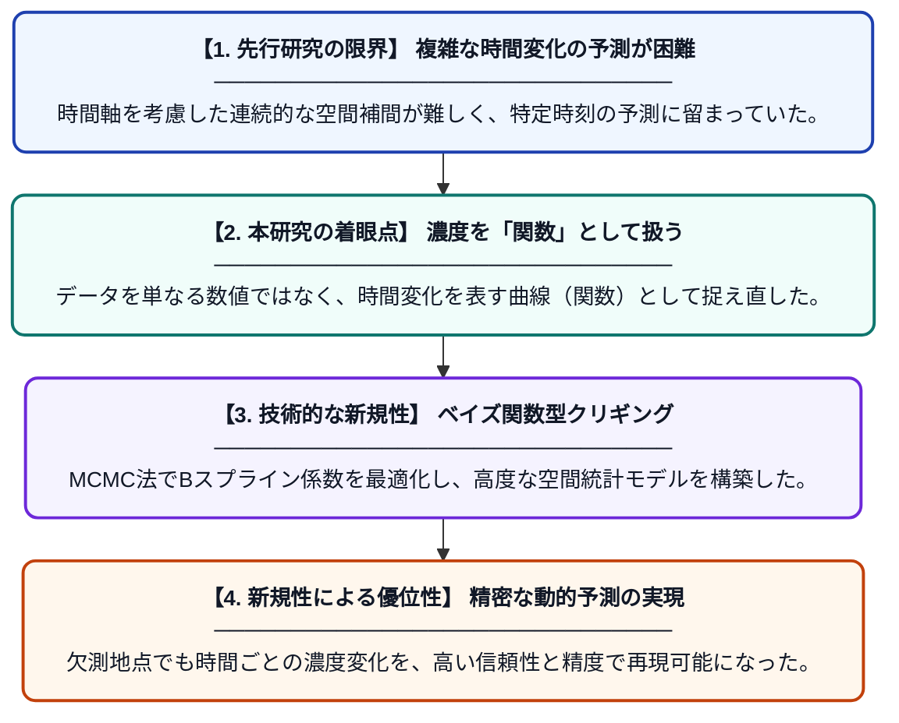

# PM2.5濃度プロファイルの空間補間のためのベイズ関数型クリギング・フレームワーク

**Original Title**: *A Bayesian Functional Kriging framework for spatial interpolation of PM2. 5 concentration profiles*

> **💡 一言要約**: ベイズ統計でPM2.5の分布を精密に予測

| 項目 | 内容 |
|---|---|
| **著者** | A Baseer, MAE Khalefa, WAA Ismael, I Hussain… |
| **掲載誌** | Scientific Reports 2026 |
| **アラートキーワード** | MCMC |
| **PDF** | [https://www.nature.com/articles/s41598-026-78049-5_reference.pdf](https://www.nature.com/articles/s41598-026-78049-5_reference.pdf) |
| **原文リンク** | [https://www.nature.com/articles/s41598-026-78049-5_reference.pdf](https://www.nature.com/articles/s41598-026-78049-5_reference.pdf) |
| **PDF版要約** | [README.pdf](./README.pdf) |

---

## 📊 新規性の図解（先行研究との違いと本研究のブレークスルー）

## 📝 要約

この研究は、大気汚染物質であるPM2.5の濃度変化を空間的に予測するための新しいベイズ関数型クリギング手法を提案しています。MCMCサンプリングを用いてBスプライン係数を推定することで、観測データのない地点でも時間的な濃度変化を高い精度で復元可能にしました。

## ❓ どんな問題に取り組んだか

従来の空間補間手法では、時間とともに複雑に変化するPM2.5の濃度プロファイルを連続的なデータとして扱うことが困難でした。また、観測地点が限られる中で、予測の不確実性を統計的に正しく評価する手法が求められていました。

## ✨ 何が新しい？何がすごい？（新規性）

本研究の最大の特徴は、関数データ解析とベイズ統計学を融合させた「ベイズ関数型クリギング」を開発した点にあります。Bスプライン曲線を利用して濃度変化を関数化し、40,000回のMCMCイテレーションを通じてパラメータを最適化することで、先行研究よりも頑健な推定を実現しました。これにより、単なる点としての予測ではなく、時間軸を含んだ連続的な「動き」としての空間補間が可能になりました。

## 🎓 大学1年生向けの解説

空気中のPM2.5の量は、場所だけでなく時間によっても細かく変化します。この研究は、限られた観測所のデータから、装置がない場所の空気の汚れ具合を「1日の変化グラフ」として丸ごと予測する新しい計算方法を編み出しました。ベイズ統計という高度な数学を使うことで、予測がどれくらい当たっていそうかという信頼性も一緒に計算できるのがすごいところです。これにより、これまで見えなかった地域の空気の汚れ具合がより鮮明に分かるようになります。
