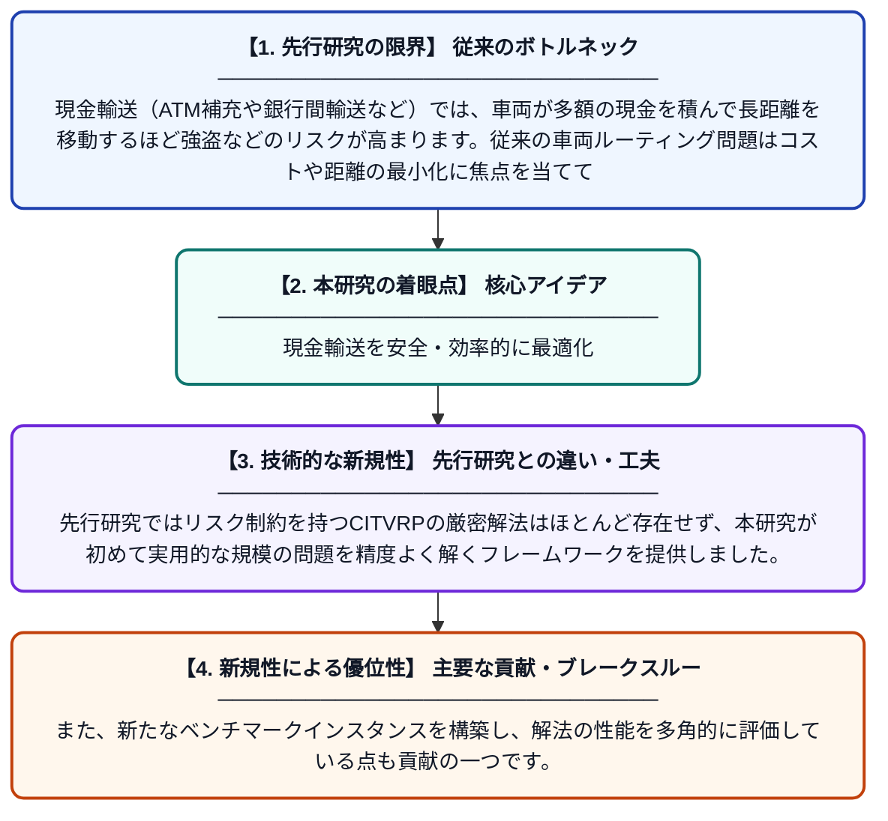

# リスク制約付き現金輸送車両ルーティング問題に対する厳密解法とヒューリスティック解法

**Original Title**: *Exact and heuristic methods for the risk-constrained cash-in-transit vehicle routing problem*

> **💡 一言要約**: 現金輸送を安全・効率的に最適化

| 項目 | 内容 |
|---|---|
| **著者** | M Roboredo, B Oliveira, S Lichau, A Pessoa, E Uchoa |
| **掲載誌** | Kuwait Journal of Science 2026 |
| **アラートキーワード** | VRP |
| **原文リンク** | [https://www.sciencedirect.com/science/article/pii/S2307410826001185](https://www.sciencedirect.com/science/article/pii/S2307410826001185) |
| **PDF版要約** | [README.pdf](./README.pdf) |

---

## 📊 新規性の図解（先行研究との違いと本研究のブレークスルー）

## 📝 要約

本論文では、現金輸送車両が各顧客を訪問して現金を回収する際のリスクを最小化する車両ルーティング問題（RCTVRP）を研究しています。リスクはルートの走行距離と車両が積載する現金量の積として定義され、このリスクに上限制約を設けることで安全な輸送計画を立案します。厳密解法（分枝限定法）とヒューリスティック解法の両方を開発し、その有効性を計算実験により検証しています。

## ❓ どんな問題に取り組んだか

現金輸送（ATM補充や銀行間輸送など）では、車両が多額の現金を積んで長距離を移動するほど強盗などのリスクが高まります。従来の車両ルーティング問題はコストや距離の最小化に焦点を当てており、このような輸送リスクを明示的に制約として組み込んだ定式化と効率的な解法が十分に研究されていませんでした。

## ✨ 何が新しい？何がすごい？（新規性）

本研究は、ルートリスク（走行距離×積載現金量）に上限を設けたRCTVRPに対し、列生成法を用いた分枝価格限定法という厳密解法と、メタヒューリスティックに基づく近似解法の両方を同時に提案している点が新しいです。先行研究ではリスク制約を持つCITVRPの厳密解法はほとんど存在せず、本研究が初めて実用的な規模の問題を精度よく解くフレームワークを提供しました。また、新たなベンチマークインスタンスを構築し、解法の性能を多角的に評価している点も貢献の一つです。

## 🎓 大学1年生向けの解説

銀行やATMへの現金を運ぶトラックは、たくさんのお金を積んでいるため、強盗に狙われるリスクがあります。このリスクは「どれだけ遠くを走るか」と「どれだけ現金を積んでいるか」を掛け合わせたもので表せます。この論文では、そのリスクが一定以下になるように制限しながら、効率よく全ての顧客を回るルートを求める方法を研究しています。コンピュータで確実に最良の答えを求める方法と、素早く良い答えを見つける方法の両方を開発しました。これにより、現金輸送の安全性とコスト効率を同時に高めることが可能になります。
