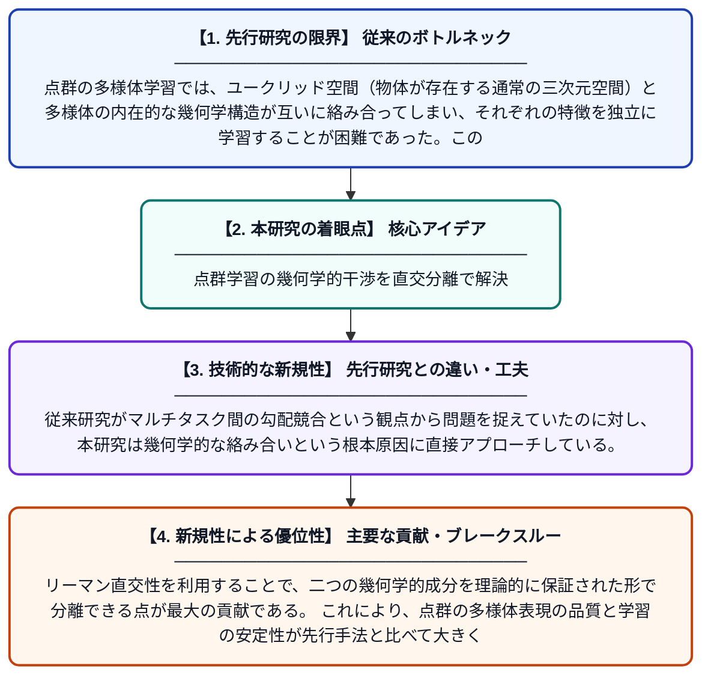

# 分離されたマニフォールド表現のためのリーマン直交分離正則化

**Original Title**: *RODR: Riemannian Orthogonally Decoupled Regularization for Disentangled Manifold Representation*

> **💡 一言要約**: 点群学習の幾何学的干渉を直交分離で解決

| 項目 | 内容 |
|---|---|
| **著者** | J Zhu, W Zhao |
| **掲載誌** | arXiv preprint arXiv:2607.23958 2026 |
| **アラートキーワード** | manifold learning |
| **PDF** | [https://arxiv.org/pdf/2607.23958](https://arxiv.org/pdf/2607.23958) |
| **原文リンク** | [https://arxiv.org/pdf/2607.23958](https://arxiv.org/pdf/2607.23958) |
| **PDF版要約** | [README.pdf](./README.pdf) |

---

## 📊 新規性の図解（先行研究との違いと本研究のブレークスルー）

## 📝 要約

点群の多様体学習において、ユークリッド空間の幾何学と多様体固有の幾何学が絡み合うことで生じる干渉問題を解決する新しい手法「RODR」を提案している。リーマン幾何学を活用した直交分離正則化により、二つの幾何学的空間の表現を効果的に分離することを実現した。これにより、点群の多様体学習タスクにおける精度と安定性が向上する。

## ❓ どんな問題に取り組んだか

点群の多様体学習では、ユークリッド空間（物体が存在する通常の三次元空間）と多様体の内在的な幾何学構造が互いに絡み合ってしまい、それぞれの特徴を独立に学習することが困難であった。この絡み合いは、一般的なマルチタスク学習における勾配競合とは本質的に異なる構造的な問題であり、既存の手法では十分に対処できていなかった。

## ✨ 何が新しい？何がすごい？（新規性）

本研究では、リーマン幾何学の枠組みを用いてユークリッド空間と多様体固有空間の表現を直交的に分離する「RODR」という正則化手法を新たに提案した。従来研究がマルチタスク間の勾配競合という観点から問題を捉えていたのに対し、本研究は幾何学的な絡み合いという根本原因に直接アプローチしている。リーマン直交性を利用することで、二つの幾何学的成分を理論的に保証された形で分離できる点が最大の貢献である。これにより、点群の多様体表現の品質と学習の安定性が先行手法と比べて大きく改善される。

## 🎓 大学1年生向けの解説

3Dスキャナーで取得した点の集まり（点群）から物体の形を学習するとき、「物体がある三次元空間の性質」と「物体の表面そのものの形の性質」が混ざってしまう問題があります。これは、球の表面のような曲がった空間（多様体）を、普通の三次元空間（ユークリッド空間）の中で同時に扱おうとするために起きます。この論文では、リーマン幾何学という数学の道具を使って、この二種類の性質をきれいに「直交（互いに独立）」に分離する方法を考案しました。料理で例えると、塩と砂糖が混ざったものをきれいに分ける技術を開発したようなイメージです。これにより、点群から形を学習するAIがより正確に物体の形を理解できるようになります。
