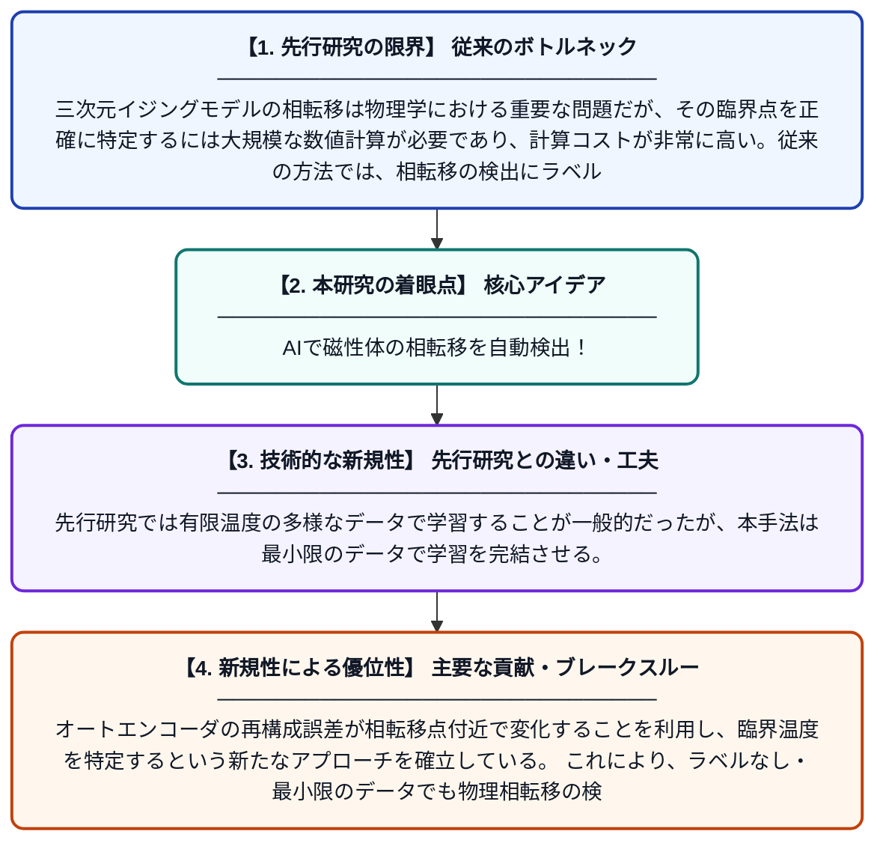

# 基底状態で学習したオートエンコーダによる三次元イジングモデルの相転移検出

**Original Title**: *Detecting the three-dimensional Ising model phase transition with a ground-state-trained autoencoder*

> **💡 一言要約**: AIで磁性体の相転移を自動検出！

| 項目 | 内容 |
|---|---|
| **著者** | A Abuali, DA Clarke, M Hjorth-Jensen, I Konstantinidis |
| **掲載誌** | APS Open Science 2026 |
| **アラートキーワード** | MCMC |
| **PDF** | [https://link.aps.org/pdf/10.1103/h8n4-94g4](https://link.aps.org/pdf/10.1103/h8n4-94g4) |
| **原文リンク** | [https://link.aps.org/pdf/10.1103/h8n4-94g4](https://link.aps.org/pdf/10.1103/h8n4-94g4) |
| **PDF版要約** | [README.pdf](./README.pdf) |

---

## 📊 新規性の図解（先行研究との違いと本研究のブレークスルー）

## 📝 要約

本研究では、三次元イジングモデルの相転移を検出するために、基底状態のデータのみで事前学習したオートエンコーダを活用する手法を提案している。マルコフ連鎖モンテカルロ（MCMC）シミュレーションで生成した磁性体の配置データを用い、機械学習モデルが相転移点を自動的に識別できるかを検証している。ラベルなしの教師なし学習アプローチにより、物理的な相転移の臨界点を効率的に推定することを目指している。

## ❓ どんな問題に取り組んだか

三次元イジングモデルの相転移は物理学における重要な問題だが、その臨界点を正確に特定するには大規模な数値計算が必要であり、計算コストが非常に高い。従来の方法では、相転移の検出にラベル付きデータや専門知識に基づく特徴量の設計が必要とされることが多く、汎用性に課題があった。

## ✨ 何が新しい？何がすごい？（新規性）

本研究の新規性は、相転移が起きていない基底状態のデータだけでオートエンコーダを学習させ、未知の温度域における相転移を教師なしで検出できることを示した点にある。先行研究では有限温度の多様なデータで学習することが一般的だったが、本手法は最小限のデータで学習を完結させる。オートエンコーダの再構成誤差が相転移点付近で変化することを利用し、臨界温度を特定するという新たなアプローチを確立している。これにより、ラベルなし・最小限のデータでも物理相転移の検出が可能であることを実証した。

## 🎓 大学1年生向けの解説

鉄などの磁石は温度が高くなると突然磁性を失います。この「相転移」と呼ばれる変化がどの温度で起きるかを正確に調べることは物理学の重要な課題です。本研究では、AIの一種である「オートエンコーダ」というモデルを使い、磁石が完全に磁化した状態（基底状態）のデータだけで学習させます。すると、そのAIは学習していない高温域のデータを入力したとき、相転移点付近でうまく再現できなくなることが分かりました。つまり、少ないデータでAIに相転移を「感知」させることができるという画期的な方法を提案しています。
