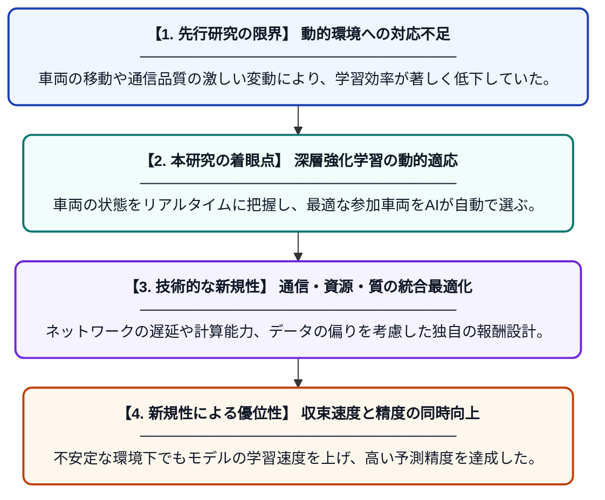

# 深層強化学習を用いた車載エッジコンピューティングにおける連合学習のクライアント選択最適化

**Original Title**: *Optimizing Client Selection in Vehicular Edge Computing-Based Federated Learning with Deep Reinforcement Learning*

> **💡 一言要約**: AIで車両を厳選し、高速・安全な分散学習を実現

| 項目 | 内容 |
|---|---|
| **著者** | J Wu, Z Fan, F Yan, L Liu |
| **掲載誌** | Journal of Network and Systems Management 2027 |
| **アラートキーワード** | Federated Learning |
| **原文リンク** | [https://link.springer.com/article/10.1007/s10922-026-10109-7](https://link.springer.com/article/10.1007/s10922-026-10109-7) |
| **PDF版要約** | [README.pdf](./README.pdf) |

---

## 📊 新規性の図解（先行研究との違いと本研究のブレークスルー）

## 📝 要約

車載エッジコンピューティング(VEC)環境において、データのプライバシーを保ちつつ効率的に学習を行う「連合学習」の最適化に関する研究です。深層強化学習(DRL)を活用することで、車両の移動性や通信状況、データの質を考慮した最適なクライアント選択を実現しています。

## ❓ どんな問題に取り組んだか

車両が高速で移動するVEC環境では、通信が不安定で計算リソースも変動しやすいため、効率的なモデル学習が困難です。また、各車両が持つデータの質や量に偏りがある（Non-IIDデータ）ため、従来の連合学習では精度が上がりにくいという課題がありました。

## ✨ 何が新しい？何がすごい？（新規性）

本研究の核心は、深層強化学習（DRL）を用いて、ネットワークの動的な変化に即応するクライアント選択アルゴリズムを提案した点にあります。従来手法が考慮しきれなかった車両の移動パターンや不均質なデータの影響を、独自の報酬関数によってモデル化し、最適化プロセスに組み込みました。これにより、通信遅延を最小限に抑えつつ、データの多様性を活かした高精度なグローバルモデルの構築が可能となりました。

## 🎓 大学1年生向けの解説

街中を走るたくさんの車が、自分の持っているカメラ映像などのデータを外に出さず（プライバシーを守りながら）、みんなで協力して賢いAIを育てる仕組みの研究です。車は常に動いているため、通信が途切れたり、持っているデータの種類がバラバラだったりして、効率よく協力するのは簡単ではありません。そこで、この研究は「どの車が今、学習に一番役立つか」をAIが自動で見極める仕組みを作ることで、効率よく賢いAIを完成させることに成功しました。
