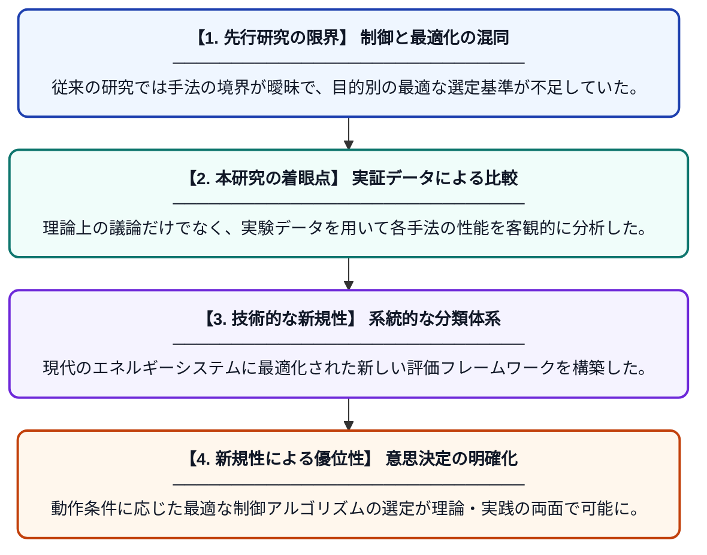

# 永久磁石DCモータ駆動のための高度な制御・最適化手法に関する系統的かつ比較的なレビュー

**Original Title**: *Systematic and Comparative Review of Advanced Control and Optimization Techniques for Permanent Magnet DC Motor Drives.*

> **💡 一言要約**: DCモータ制御と最適化の最前線を実証的に徹底比較

| 項目 | 内容 |
|---|---|
| **著者** | HJ Ali, HM Hebeb, QA Jawad |
| **掲載誌** | Journal Européen des Systèmes Automatisés 2026 |
| **アラートキーワード** | optimization |
| **原文リンク** | [https://openurl.ebsco.com/contentitem/gcd:198374453?sid=ebsco:plink:crawler-gcd&id=ebsco:gcd:198374453&crl=c&jrnl=12696935](https://openurl.ebsco.com/contentitem/gcd:198374453?sid=ebsco:plink:crawler-gcd&id=ebsco:gcd:198374453&crl=c&jrnl=12696935) |
| **PDF版要約** | [README.pdf](./README.pdf) |

---

## 📊 新規性の図解（先行研究との違いと本研究のブレークスルー）

## 📝 要約

本論文は、永久磁石DCモータ駆動における最新の制御技術と最適化手法を網羅的に比較・分析したレビュー研究です。制御手法と最適化手法の定義を明確に区別し、実験データを用いて現代のエネルギーシステムへの応用可能性を詳細に検討しています。

## ❓ どんな問題に取り組んだか

永久磁石DCモータは多くの産業で不可欠ですが、複雑な動作環境下で高効率かつ精密な制御を実現することが依然として課題です。特に、従来の制御理論と新しい最適化アルゴリズムが混同されがちで、各手法の具体的な優位性が不明確でした。

## ✨ 何が新しい？何がすごい？（新規性）

本研究は、既存の制御技術と最新の最適化ベースの手法を明確に定義し直し、それらの差異を実験データに基づいて実証的に比較した点が画期的です。単なる理論の整理に留まらず、現代のエネルギーシステムという実用的な文脈で各手法の性能を評価しています。これにより、特定の用途においてどのアルゴリズムを採用すべきかの具体的な選択基準を提示しました。

## 🎓 大学1年生向けの解説

ロボットや電気自動車に使われるモータを「思い通りに動かす」には、非常に高度な計算技術が必要です。この論文は、世界中の科学者が考え出した「モータの動かし方」をたくさん集めて、どれが一番優れているかを実験で調べたものです。難しい数学やAIを使った最新のテクニックが、実際のエネルギー問題にどう役立つのかを分かりやすくまとめています。これを読めば、モータ制御の未来の形が見えてきます。
