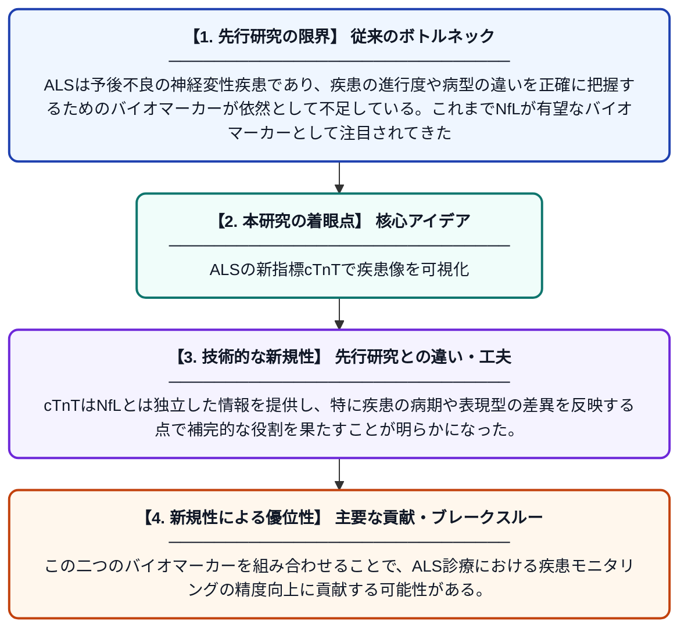

# 血漿心臓トロポニンTはALSにおける疾患の病期と表現型の多様性を反映し、ニューロフィラメント軽鎖を補完する

**Original Title**: *Plasma cardiac troponin T complements neurofilament light chain by reflecting disease phase and phenotypic variation in amyotrophic lateral sclerosis*

> **💡 一言要約**: ALSの新指標cTnTで疾患像を可視化

| 項目 | 内容 |
|---|---|
| **著者** | J Sellin, L Öijerstedt, J von der Gablentz, S Chamoun |
| **掲載誌** | Journal of Neurology 2026 |
| **アラートキーワード** | ALS |
| **原文リンク** | [https://link.springer.com/article/10.1007/s00415-026-14002-w](https://link.springer.com/article/10.1007/s00415-026-14002-w) |
| **PDF版要約** | [README.pdf](./README.pdf) |

---

## 📊 新規性の図解（先行研究との違いと本研究のブレークスルー）

## 📝 要約

本研究は、筋萎縮性側索硬化症（ALS）患者526名の集団ベースコホートにおいて、血漿中の心臓トロポニンT（cTnT）の臨床的・生物学的意義を検討した。cTnTは既存のバイオマーカーであるニューロフィラメント軽鎖（NfL）とは異なり、疾患の病期や表現型のバリエーションを反映することが示された。両マーカーを組み合わせることで、ALS患者のより包括的な疾患評価が可能となることが示唆されている。

## ❓ どんな問題に取り組んだか

ALSは予後不良の神経変性疾患であり、疾患の進行度や病型の違いを正確に把握するためのバイオマーカーが依然として不足している。これまでNfLが有望なバイオマーカーとして注目されてきたが、疾患の病期変化や表現型の多様性を十分に捉えられない側面があった。より多面的な疾患評価を可能にするバイオマーカーの探索が求められていた。

## ✨ 何が新しい？何がすごい？（新規性）

先行研究ではNfLがALSの主要バイオマーカーとして広く用いられてきたが、本研究は心臓マーカーとして知られるcTnTがALSにおいても意義を持つことを、526名という大規模な集団ベースコホートで初めて体系的に検証した。cTnTはNfLとは独立した情報を提供し、特に疾患の病期や表現型の差異を反映する点で補完的な役割を果たすことが明らかになった。この二つのバイオマーカーを組み合わせることで、ALS診療における疾患モニタリングの精度向上に貢献する可能性がある。

## 🎓 大学1年生向けの解説

ALS（筋萎縮性側索硬化症）は、全身の筋肉が動かせなくなっていく難病です。病気の進み具合を血液検査で調べるための「目印（バイオマーカー）」の研究が進んでいます。今回の研究では、心臓の異常を調べるときに使われる「トロポニンT」という物質が、ALS患者の血液中でも重要な情報を持っていることがわかりました。これまで使われてきた別の目印（NfL）と組み合わせることで、病気の状態をより詳しく把握できるようになることが示されました。この発見により、将来的にはより正確な診断や治療効果の評価につながることが期待されます。
