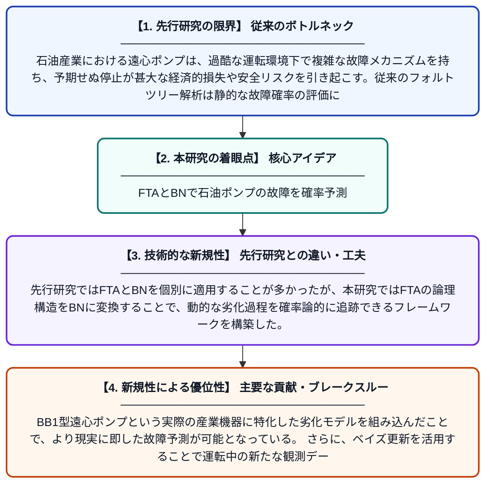

# BB1型遠心ポンプの確率論的故障解析と劣化モデリングのためのフォルトツリー解析とベイジアンネットワークの統合フレームワーク

**Original Title**: *A hybrid fault tree analysis and Bayesian network framework for probabilistic failure analysis and degradation modeling in BB1 centrifugal pumps*

> **💡 一言要約**: FTAとBNで石油ポンプの故障を確率予測

| 項目 | 内容 |
|---|---|
| **著者** | M Barouzeh, S Adibnazari, A Maghsoudpour |
| **掲載誌** | International Journal of System Assurance Engineering and Management 2026 |
| **アラートキーワード** | bayesian network |
| **原文リンク** | [https://link.springer.com/article/10.1007/s13198-026-03401-x](https://link.springer.com/article/10.1007/s13198-026-03401-x) |
| **PDF版要約** | [README.pdf](./README.pdf) |

---

## 📊 新規性の図解（先行研究との違いと本研究のブレークスルー）

## 📝 要約

本研究は、石油産業で使用されるBB1型遠心ポンプを対象に、フォルトツリー解析（FTA）とベイジアンネットワーク（BN）を統合した確率論的故障評価および劣化分析手法を提案している。この統合アプローチにより、ポンプの故障メカニズムを定量的に評価し、経時的な劣化挙動を確率論的に予測することが可能となる。従来の単独手法では困難だった不確実性の定量化や動的な劣化状態の推定を実現している。

## ❓ どんな問題に取り組んだか

石油産業における遠心ポンプは、過酷な運転環境下で複雑な故障メカニズムを持ち、予期せぬ停止が甚大な経済的損失や安全リスクを引き起こす。従来のフォルトツリー解析は静的な故障確率の評価に留まり、部品の劣化に伴う動的な故障リスクの変化を適切に捉えることが困難であった。また、不確実性を含む実際の運転データを効果的に取り込む手段が限られており、より精度の高い故障予測手法の開発が求められていた。

## ✨ 何が新しい？何がすごい？（新規性）

本研究の最大の新規性は、FTAの体系的な故障論理モデリング能力とBNの確率的推論・不確実性定量化能力を統合した点にある。先行研究ではFTAとBNを個別に適用することが多かったが、本研究ではFTAの論理構造をBNに変換することで、動的な劣化過程を確率論的に追跡できるフレームワークを構築した。BB1型遠心ポンプという実際の産業機器に特化した劣化モデルを組み込んだことで、より現実に即した故障予測が可能となっている。さらに、ベイズ更新を活用することで運転中の新たな観測データを逐次的にモデルへ反映できる点も従来手法との重要な差別化要素である。

## 🎓 大学1年生向けの解説

工場や石油施設では大量の液体を送り出すためにポンプが使われており、このポンプが壊れると大きな事故や損失につながります。この研究では、「故障の木（フォルトツリー）」という故障の原因を木の枝のように整理する方法と、「ベイジアンネットワーク」という確率を使って複雑な関係を計算する手法を組み合わせました。これにより、ポンプがいつ・どのように壊れやすくなるかを数値で予測できるようになります。まるで机の上で故障のシミュレーションができるようなもので、実際に壊れる前に対策を立てるための強力なツールです。
