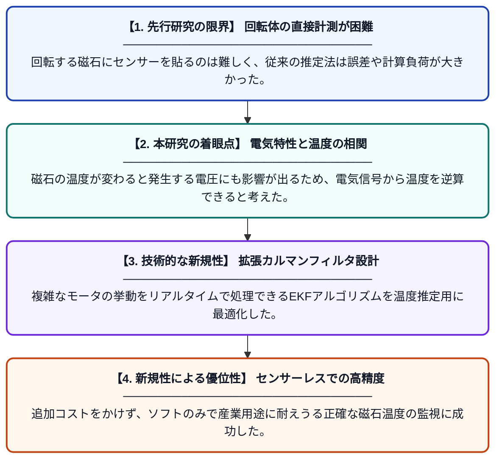

# 拡張カルマンフィルタを用いた産業用PMSMのロータ永久磁石温度推定

**Original Title**: *Rotor Permanent Magnet Temperature Estimation in Industrial PMSMs Using Extended Kalman Filters*

> **💡 一言要約**: EKFでモータ磁石の温度を非接触かつ高精度に推定

| 項目 | 内容 |
|---|---|
| **著者** | C Blechinger, D Walch, Q Yang, M Schellenberger… |
| **掲載誌** | Energy Conversion … 2026 |
| **アラートキーワード** | kalman filter |
| **原文リンク** | [https://ieeexplore.ieee.org/abstract/document/11737960/](https://ieeexplore.ieee.org/abstract/document/11737960/) |
| **PDF版要約** | [README.pdf](./README.pdf) |

---

## 📊 新規性の図解（先行研究との違いと本研究のブレークスルー）

## 📝 要約

産業用永久磁石同期電動機（PMSM）において、ロータ磁石の温度を正確に把握するための拡張カルマンフィルタ（EKF）を用いた観測器を提案しています。モータ内部の電圧や電流のデータから磁束の変化を捉えることで、センサーを追加することなく非接触で高精度な温度推定を実現しました。

## ❓ どんな問題に取り組んだか

産業用モータのロータ磁石は高温になると磁力が弱まり、故障や効率低下を招くリスクがありますが、回転体であるため直接温度を測ることが困難です。既存の推定手法では、計算の複雑さやパラメータの変動による精度の低下が課題となっていました。

## ✨ 何が新しい？何がすごい？（新規性）

非線形な挙動を示すモータモデルに対して拡張カルマンフィルタ（EKF）を適用し、動的な運転条件下でも安定して温度を導き出すアルゴリズムを構築しました。先行研究と比較して、より実用的な産業グレードのモータモデルに基づいた設計が行われており、追加のハードウェアを一切必要としない点が大きな貢献です。これにより、既存の制御システムへの組み込みが容易になっています。

## 🎓 大学1年生向けの解説

電気自動車や工場のロボットに使われる強力なモータは、中にある磁石が熱くなりすぎると壊れてしまいます。しかし、磁石は猛スピードで回転しているため、温度計を直接貼り付けることができません。そこでこの研究では、モータに流れる電気のわずかな変化を数学的に分析することで、外から磁石の温度をピタリと当てる計算テクニックを開発しました。これによって、モータを安全かつ長く使い続けることが可能になります。
