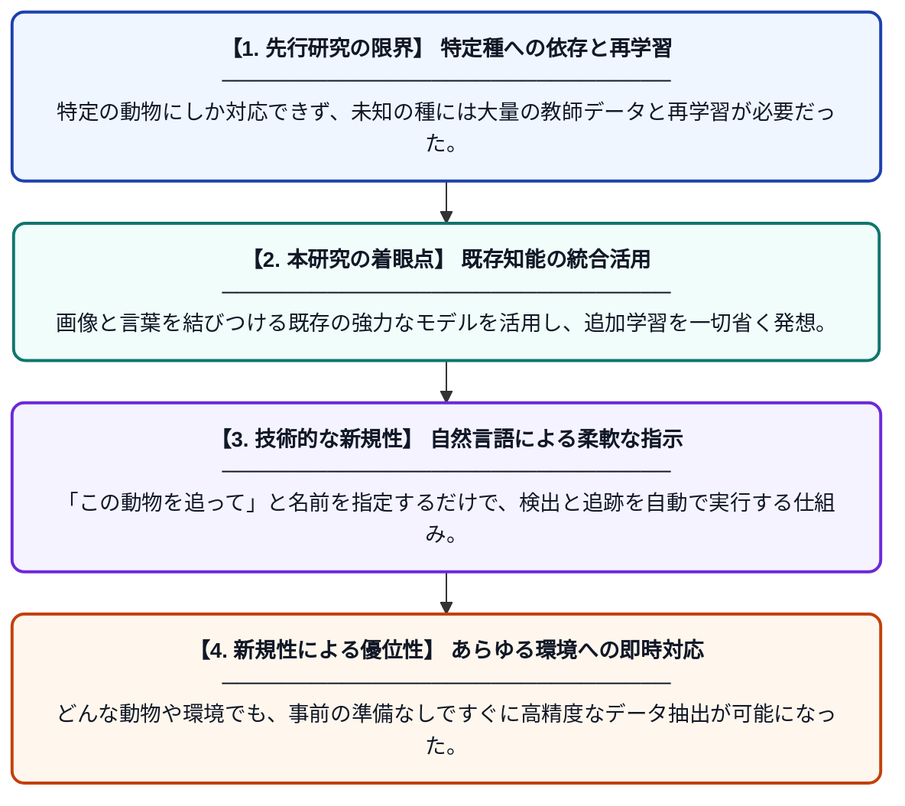

# ZOO：追加学習なしで多様な動物を検出・セグメンテーション・追跡するオープンボキャブラリ・フレームワーク

**Original Title**: *ZOO: A Training-Free Framework for Open-Vocabulary Animal Detection, Segmentation, and Tracking*

> **💡 一言要約**: 学習不要で未知の動物を捉える革新的AIシステム

| 項目 | 内容 |
|---|---|
| **著者** | B Han, J Ge, X Wu, L Wei, R Wang, X Wang, X Liu |
| **掲載誌** | Current Zoology 2026 |
| **アラートキーワード** | Multi Camera Tracking |
| **PDF** | [https://academic.oup.com/cz/advance-article-pdf/doi/10.1093/cz/zoag073/72551379/zoag073.pdf](https://academic.oup.com/cz/advance-article-pdf/doi/10.1093/cz/zoag073/72551379/zoag073.pdf) |
| **原文リンク** | [https://academic.oup.com/cz/advance-article-pdf/doi/10.1093/cz/zoag073/72551379/zoag073.pdf](https://academic.oup.com/cz/advance-article-pdf/doi/10.1093/cz/zoag073/72551379/zoag073.pdf) |
| **PDF版要約** | [README.pdf](./README.pdf) |

---

## 📊 新規性の図解（先行研究との違いと本研究のブレークスルー）

## 📝 要約

特定の動物種や環境に合わせた追加学習（アノテーション）を必要とせず、多様な生物を即座に検出・追跡できるAIフレームワーク「ZOO」を提案した研究です。既存の高度な視覚言語モデルを統合することで、未知の種に対しても自然言語による指示のみで高精度な解析を実現しています。

## ❓ どんな問題に取り組んだか

従来の動物解析AIは、特定の種や撮影環境ごとに大量のラベル付きデータを用意し、モデルを学習させる必要がありました。このため、新しい生物種や異なる環境に技術を転用するには多大な時間とコストがかかり、迅速な生物学研究の妨げとなっていました。

## ✨ 何が新しい？何がすごい？（新規性）

本研究の「ZOO」は、学習不要（Training-free）で動作する点が最大の特長です。最新の視覚と言語を紐付けるモデル（VLM）を基盤とし、画像内の物体を切り出す技術と組み合わせることで、どんな動物名（オープンボキャブラリ）でも即座に認識・追跡可能にしました。先行研究と異なり、事前に想定していない未知の生物に対してもゼロショットで高い汎用性を発揮する点に大きな貢献があります。

## 🎓 大学1年生向けの解説

これまでAIに新しい動物を覚えさせるには、人間が何千枚もの写真に名前を付ける「訓練」が必要でした。この研究で開発された「ZOO」というシステムは、AIがもともと持っている言葉と画像の知識をうまく組み合わせることで、初めて見る動物でも名前を教えるだけで見つけ出し、追いかけることができます。これにより、珍しい生き物の調査やジャングルでの観測が、AIの専門家でなくても驚くほど簡単にできるようになります。
