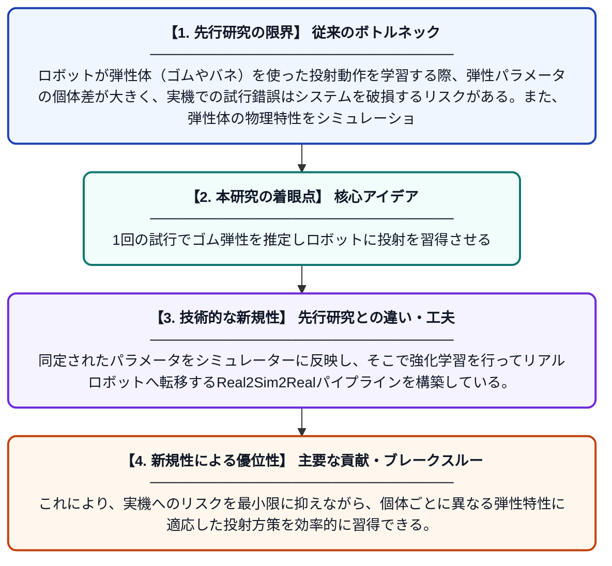

# Sling2Sim2Real: 非破壊的なパチンコ操作のためのワンショット弾性システム同定と方策学習

**Original Title**: *Sling2Sim2Real: One-Shot Elastic System Identification for Non-Destructive Slingshot Policy Learning*

> **💡 一言要約**: 1回の試行でゴム弾性を推定しロボットに投射を習得させる

| 項目 | 内容 |
|---|---|
| **著者** | W Kang, G Kim, M Song, D Park |
| **掲載誌** | arXiv preprint arXiv:2607.23268 2026 |
| **アラートキーワード** | one shot |
| **PDF** | [https://arxiv.org/pdf/2607.23268](https://arxiv.org/pdf/2607.23268) |
| **原文リンク** | [https://arxiv.org/pdf/2607.23268](https://arxiv.org/pdf/2607.23268) |
| **PDF版要約** | [README.pdf](./README.pdf) |

---

## 📊 新規性の図解（先行研究との違いと本研究のブレークスルー）

## 📝 要約

本論文では、ゴムやバネなどの弾性体を用いた「パチンコ型」の投射動作をロボットに学習させるフレームワーク「Sling2Sim2Real」を提案する。たった1回の非破壊的なインタラクションから弾性パラメータを同定し、シミュレーション上で方策を学習してリアルロボットへ転移するReal2Sim2Realアプローチを採用している。これにより、実機を傷つけることなく効率的に弾性体操作スキルを習得できる。

## ❓ どんな問題に取り組んだか

ロボットが弾性体（ゴムやバネ）を使った投射動作を学習する際、弾性パラメータの個体差が大きく、実機での試行錯誤はシステムを破損するリスクがある。また、弾性体の物理特性をシミュレーションに正確に反映するためには通常多数の計測試行が必要であり、コストや時間がかかるという課題がある。

## ✨ 何が新しい？何がすごい？（新規性）

従来手法では弾性パラメータの同定に多数の試行や破壊的な計測が必要だったが、本手法はわずか1回の非破壊的なインタラクションだけでパラメータを同定できる点が革新的である。同定されたパラメータをシミュレーターに反映し、そこで強化学習を行ってリアルロボットへ転移するReal2Sim2Realパイプラインを構築している。これにより、実機へのリスクを最小限に抑えながら、個体ごとに異なる弾性特性に適応した投射方策を効率的に習得できる。

## 🎓 大学1年生向けの解説

パチンコのように、ゴムを引っ張って物を飛ばす動作をロボットに覚えさせることを考えてみてください。ゴムの硬さや伸び方は製品ごとに少しずつ違うため、ロボットはまずゴムの性質を把握する必要があります。この研究では、ゴムを1回だけそっと引っ張るだけでその性質を推定し、コンピューター上のシミュレーションで練習させてから本物のロボットに応用する方法を開発しました。これによって、ロボットも人間と同じように少ない経験から道具の使い方を覚えられるようになります。
