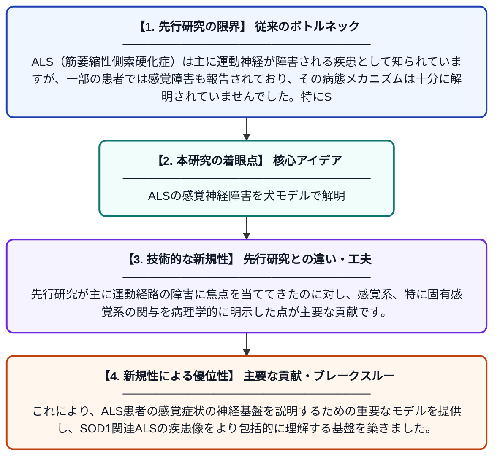

# 筋萎縮性側索硬化症の犬疾患モデルにおける全般的固有感覚の病理

**Original Title**: *Pathology of general proprioception in a canine disease model of amyotrophic lateral sclerosis*

> **💡 一言要約**: ALSの感覚神経障害を犬モデルで解明

| 項目 | 内容 |
|---|---|
| **著者** | BR Morgan-Jack, ML Katz, GR Kick, GC Johnson |
| **掲載誌** | Journal of the Neurological Sciences 2026 |
| **アラートキーワード** | ALS |
| **原文リンク** | [https://www.sciencedirect.com/science/article/pii/S0022510X26003904](https://www.sciencedirect.com/science/article/pii/S0022510X26003904) |
| **PDF版要約** | [README.pdf](./README.pdf) |

---

## 📊 新規性の図解（先行研究との違いと本研究のブレークスルー）

## 📝 要約

本研究は、SOD1遺伝子変異に関連する筋萎縮性側索硬化症（ALS）の犬モデルを用いて、固有感覚（身体の位置や動きを感知する感覚）の神経経路における病理変化を調べたものです。ALS研究では運動神経の障害が注目されてきましたが、本研究は感覚神経、特に固有感覚系の異常にも焦点を当てています。これにより、感覚障害を伴うALS症例の理解に新たな知見をもたらすことが期待されます。

## ❓ どんな問題に取り組んだか

ALS（筋萎縮性側索硬化症）は主に運動神経が障害される疾患として知られていますが、一部の患者では感覚障害も報告されており、その病態メカニズムは十分に解明されていませんでした。特にSOD1遺伝子変異に関連するALSにおける固有感覚経路の病理学的変化については、ほとんど研究が行われていませんでした。

## ✨ 何が新しい？何がすごい？（新規性）

本研究はSOD1関連ALSの犬疾患モデルという自然発症モデルを活用し、固有感覚神経経路の病理を体系的に解析した点が新しいアプローチです。先行研究が主に運動経路の障害に焦点を当ててきたのに対し、感覚系、特に固有感覚系の関与を病理学的に明示した点が主要な貢献です。これにより、ALS患者の感覚症状の神経基盤を説明するための重要なモデルを提供し、SOD1関連ALSの疾患像をより包括的に理解する基盤を築きました。

## 🎓 大学1年生向けの解説

ALS（筋萎縮性側索硬化症）は、筋肉を動かす神経が壊れていく怖い病気です。これまでは「動かす神経（運動神経）」の病気とされてきましたが、実は「体の位置を感じる感覚（固有感覚）」にも異常が起きることがあります。この研究では、人間のALSに似た病気を自然に発症する犬を使って、その感覚神経がどのように傷ついているかを詳しく調べました。犬は人間と体の仕組みが似ているため、良い研究モデルになります。この発見により、ALSで感覚障害が起きる理由の解明や、新しい治療法の開発につながることが期待されています。
