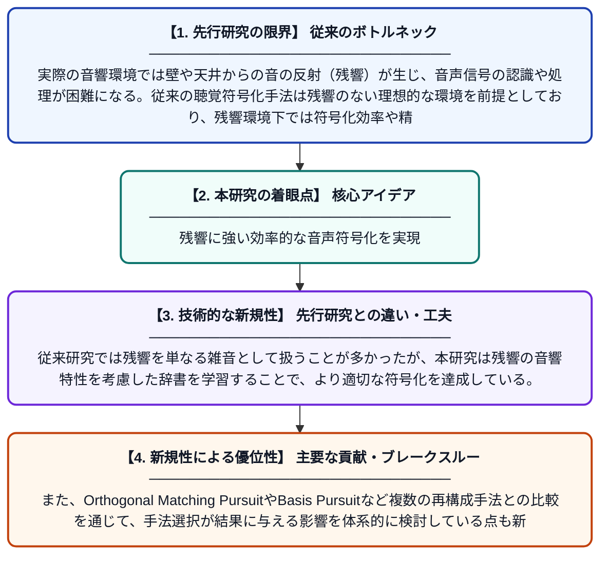

# 残響環境下における効率的な聴覚符号化

**Original Title**: *Efficient Auditory Coding Under Reverberation*

> **💡 一言要約**: 残響に強い効率的な音声符号化を実現

| 項目 | 内容 |
|---|---|
| **著者** | AR Patrut |
| **掲載誌** | 2026 |
| **アラートキーワード** | sparse coding |
| **PDF** | [https://repository.tudelft.nl/file/File_40d2c11c-5aef-45f9-b89f-c0e393b31e40](https://repository.tudelft.nl/file/File_40d2c11c-5aef-45f9-b89f-c0e393b31e40) |
| **原文リンク** | [https://repository.tudelft.nl/file/File_40d2c11c-5aef-45f9-b89f-c0e393b31e40](https://repository.tudelft.nl/file/File_40d2c11c-5aef-45f9-b89f-c0e393b31e40) |
| **PDF版要約** | [README.pdf](./README.pdf) |

---

## 📊 新規性の図解（先行研究との違いと本研究のブレークスルー）

## 📝 要約

本論文は、残響（エコー）が存在する音響環境において、聴覚信号を効率的に符号化する手法を研究している。スパース符号化や辞書学習を用いて、残響の影響を受けた音声をより少ない情報量で正確に表現する方法を探求している。辞書のカーネル数や最適化手法の選択が結果に与える影響についても考察されている。

## ❓ どんな問題に取り組んだか

実際の音響環境では壁や天井からの音の反射（残響）が生じ、音声信号の認識や処理が困難になる。従来の聴覚符号化手法は残響のない理想的な環境を前提としており、残響環境下では符号化効率や精度が低下するという問題があった。

## ✨ 何が新しい？何がすごい？（新規性）

本研究は残響環境に特化した聴覚符号化モデルを構築し、スパース符号化と辞書学習を組み合わせることで残響下での効率的な音声表現を実現している。従来研究では残響を単なる雑音として扱うことが多かったが、本研究は残響の音響特性を考慮した辞書を学習することで、より適切な符号化を達成している。また、Orthogonal Matching PursuitやBasis Pursuitなど複数の再構成手法との比較を通じて、手法選択が結果に与える影響を体系的に検討している点も新規性の一つである。

## 🎓 大学1年生向けの解説

私たちが部屋の中で話すと、声が壁に反射して「残響（エコー）」が生まれます。この残響があると、コンピュータが音声を正確に処理するのが難しくなります。この論文では、人間の耳の仕組みにヒントを得て、残響があっても音をうまく「圧縮・表現」できる方法を研究しています。少ない情報量で音の特徴を捉える「スパース符号化」という技術を使い、残響環境に適した音の辞書を自動的に学習させます。これにより、スマートスピーカーや補聴器など、日常生活で使われる音声処理技術の向上につながることが期待されます。
