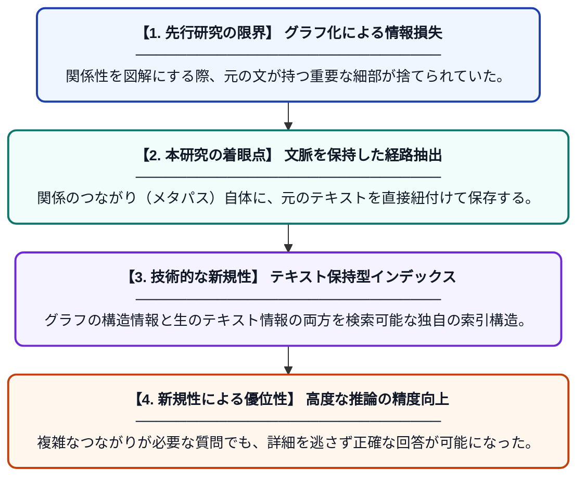

# StarGraph：RAG、エージェント、ツール活用型LLMシステムのためのテキスト保持型メタパスインデックス

**Original Title**: *StarGraph: Text-Preserving Meta-Path Indexes for RAG, Agents, and Tool-Grounded LLM Systems*

> **💡 一言要約**: テキストとグラフを融合し、AIの検索精度を極限まで高める

| 項目 | 内容 |
|---|---|
| **著者** | Y Yang, B Shi, Y Zhou, J Zhang, H Wu, T Wang, J Yang… |
| **掲載誌** | 2026 |
| **アラートキーワード** | graph rag |
| **PDF** | [https://ceur-ws.org/Vol-4312/short9.pdf](https://ceur-ws.org/Vol-4312/short9.pdf) |
| **Git リポジトリ** | [https://github.com/deepseek-ai/DeepSeek-V3.2-Exp](https://github.com/deepseek-ai/DeepSeek-V3.2-Exp) |
| **原文リンク** | [https://ceur-ws.org/Vol-4312/short9.pdf](https://ceur-ws.org/Vol-4312/short9.pdf) |
| **PDF版要約** | [README.pdf](./README.pdf) |

---

## 📊 新規性の図解（先行研究との違いと本研究のブレークスルー）

## 📝 要約

従来のグラフベースのRAG手法が抱えていた「テキスト情報の損失」という課題を解決するため、テキスト情報を保持したままグラフ構造を活用するStarGraphを提案しています。メタパス（関係の経路）に生のテキスト情報を紐付けることで、高度な推論を必要とするAIエージェントやツール利用シーンでの検索精度を劇的に向上させました。

## ❓ どんな問題に取り組んだか

既存のGraphRAG（LightRAGやHippoRAG等）は、知識グラフを構築する際に元のテキストの詳細な文脈やニュアンスが削ぎ落とされる傾向にありました。また、エンティティ間の関係性だけでは、AIエージェントが複雑なタスクを遂行したりツールを選択したりするための「深い文脈」を提供するには不十分でした。

## ✨ 何が新しい？何がすごい？（新規性）

StarGraphは、特定の関係パターンを示す「メタパス」をインデックスの単位とし、そこに元のテキスト情報を直接埋め込む手法を導入した点が画期的です。単なる構造検索でも単なるベクトル検索でもなく、グラフの構造的な整合性とテキストの豊かな表現力を同時に保持できる仕組みを構築しました。これにより、情報の損失を防ぎつつ、マルチホップ（複数の関係を辿る）な質問に対しても極めて高い再現率を実現しています。

## 🎓 大学1年生向けの解説

AIが情報を探すとき、これまでは「図解で探す（グラフ）」か「文章で探す（テキスト）」のどちらかに偏っていました。しかし「図解」だと詳しい説明が抜けてしまい、「文章」だと情報の繋がりが見えにくいという欠点がありました。StarGraphは、図の中に詳しい説明書をそのまま貼り付けたような新しい索引の仕組みです。これによって、AIは複雑な質問に対しても、関係性を辿りながら詳細な情報も漏らさず答えられるようになります。
