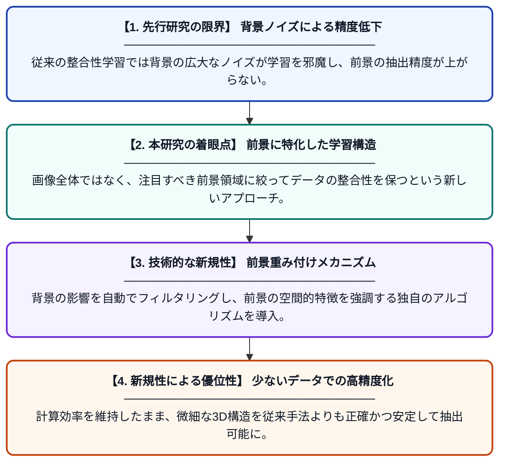

# ForeMatch：効率的な半教師あり3D医学画像セグメンテーションのための前景の一貫性の再考

**Original Title**: *ForeMatch: Rethinking Foreground Consistency for Efficient Semi-Supervised 3D Medical Image Segmentation*

> **💡 一言要約**: 背景ノイズを無視し、前景の整合性に特化して精度を向上

| 項目 | 内容 |
|---|---|
| **著者** | L Zhou, Z Xu, Z Yi, D Xiong, X Xu |
| **掲載誌** | Proceedings of the 34th ACM International … 2026 |
| **アラートキーワード** | Semi supervise |
| **原文リンク** | [https://dl.acm.org/doi/abs/10.1145/3767308.3835252](https://dl.acm.org/doi/abs/10.1145/3767308.3835252) |
| **PDF版要約** | [README.pdf](./README.pdf) |

---

## 📊 新規性の図解（先行研究との違いと本研究のブレークスルー）

## 📝 要約

3D医学画像における半教師あり学習の効率を高めるため、背景ノイズの影響を抑え、前景（対象物）の一貫性に焦点を当てた新手法「ForeMatch」を提案しました。従来の整合性正規化が背景領域の広大さとノイズに弱いという課題を克服し、限られたラベル付きデータで高精度なセグメンテーションを可能にします。

## ❓ どんな問題に取り組んだか

3D医学画像は背景領域が極めて広く、従来の整合性正規化手法では背景のノイズまで学習の一貫性に含めてしまう課題がありました。この結果、モデルが背景に引きずられてしまい、肝心の臓器や病変（前景）の境界を正確に捉えられなくなるという問題が生じていました。

## ✨ 何が新しい？何がすごい？（新規性）

画像全体の一貫性を一律に扱うのではなく、前景領域の整合性に優先順位を置く「ForeMatch」を開発した点が画期的です。具体的には、背景のノイズを効果的に遮断しつつ、前景の空間的特徴に重みを置く新しい一貫性正規化メカニズムを導入しました。これにより、先行研究であるFixMatchなどの枠組みを3D医療データの特性に合わせて最適化し、計算コストを抑えつつ飛躍的な精度向上を達成しました。

## 🎓 大学1年生向けの解説

CTやMRIなどの3D画像からAIでがんや臓器を抜き出す際、実は画像の大部分は「何もない背景」です。これまでのAIは、この無意味な背景の部分まで一生懸命学習しようとして、肝心な病変の見極めがおろそかになることがありました。この研究では、AIに「背景は無視して、大事な中身（前景）だけを集中して見なさい」と教える新しいルールを作りました。その結果、少ない手本データでも、AIがより正確に形を捉えられるようになりました。
