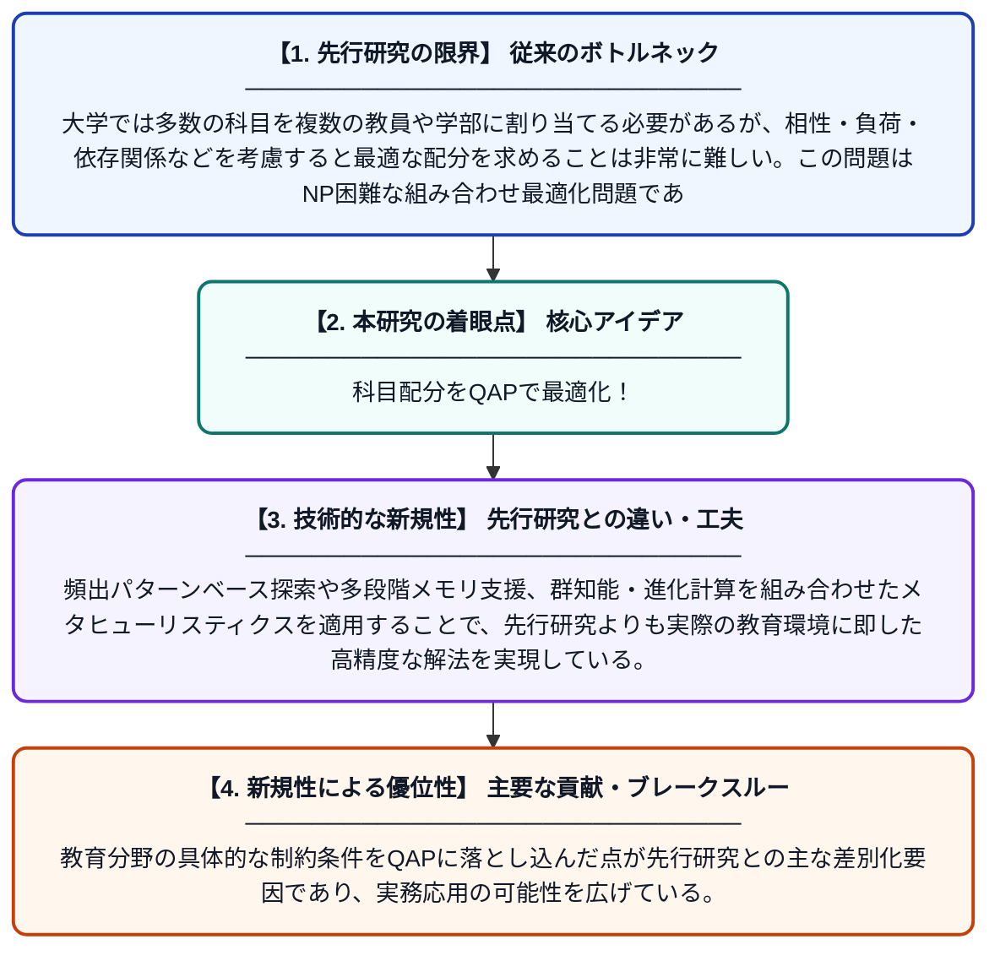

# 二次割り当て問題としての大学における教員への科目配分に関する研究

**Original Title**: *A study of subject allocation to faculties in colleges as a quadratic assignment problem*

> **💡 一言要約**: 科目配分をQAPで最適化！

| 項目 | 内容 |
|---|---|
| **著者** | J Vijayarangam, S Subbarayan, J Viswanath |
| **掲載誌** | Journal of Information and Optimization Sciences 2026 |
| **アラートキーワード** | quadratic assignment problem |
| **原文リンク** | [https://tarupublications.com/journals/jios/volume/47/issue/6/a-study-of-subject-allocation-to-faculties-in-colleges-as-a-quadratic-assignment-problem](https://tarupublications.com/journals/jios/volume/47/issue/6/a-study-of-subject-allocation-to-faculties-in-colleges-as-a-quadratic-assignment-problem) |
| **PDF版要約** | [README.pdf](./README.pdf) |

---

## 📊 新規性の図解（先行研究との違いと本研究のブレークスルー）

## 📝 要約

この論文は、大学において科目を教員（学部）に適切に割り当てる問題を、組み合わせ最適化の古典的難問である「二次割り当て問題（QAP）」としてモデル化し、解法を研究したものである。頻出パターンベース探索や群知能・進化計算などのメタヒューリスティクスを活用して効率的な割り当てを実現する手法を提案している。この研究により、教育機関における時間割編成や教員配置の合理化・効率化への貢献が期待される。

## ❓ どんな問題に取り組んだか

大学では多数の科目を複数の教員や学部に割り当てる必要があるが、相性・負荷・依存関係などを考慮すると最適な配分を求めることは非常に難しい。この問題はNP困難な組み合わせ最適化問題であり、大規模になると従来の手法では現実的な時間内に解を得ることが困難となる。そのため、実用的かつ高品質な解を効率よく求めるアプローチが求められていた。

## ✨ 何が新しい？何がすごい？（新規性）

本研究は、大学の科目・教員配分問題を二次割り当て問題（QAP）として定式化するという新しいモデリングアプローチを提案している。頻出パターンベース探索や多段階メモリ支援、群知能・進化計算を組み合わせたメタヒューリスティクスを適用することで、先行研究よりも実際の教育環境に即した高精度な解法を実現している。教育分野の具体的な制約条件をQAPに落とし込んだ点が先行研究との主な差別化要因であり、実務応用の可能性を広げている。

## 🎓 大学1年生向けの解説

大学では、たくさんの授業をどの先生が担当するかを決める必要があります。これをうまく決めないと、先生への負担が偏ったり、授業の質が下がったりしてしまいます。この論文では、その「誰にどの科目を割り当てるか」という問題を、数学的に解きやすい形（二次割り当て問題）に変換して解く方法を研究しています。コンピュータが賢く組み合わせを探す「メタヒューリスティクス」という技術を使って、なるべく良い割り当てを素早く見つけることを目指しています。この研究により、大学の時間割作りがより効率的になることが期待されます。
