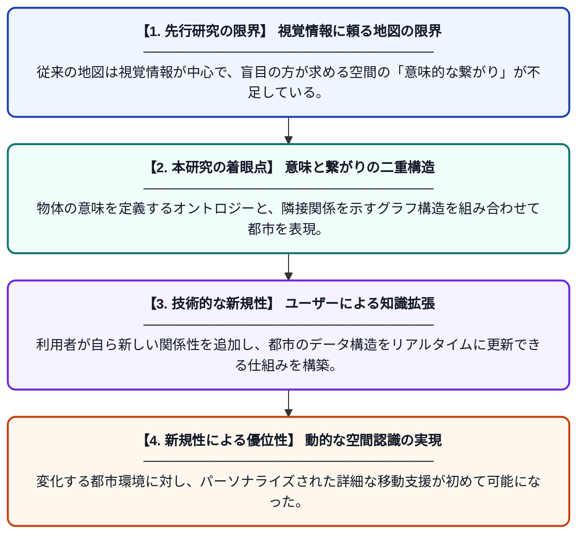

# 視覚障害者の移動を支援するための専用オントロジーと近傍グラフによる都市空間モデリング

**Original Title**: *Modeling a City Space to Support Orientation Skills of the Blind Users with a Dedicated Ontology and a Neighborhood Graph*

> **💡 一言要約**: オントロジーで視覚障害者の自由な歩行を導く

| 項目 | 内容 |
|---|---|
| **著者** | A Rojek, D Mikulowski |
| **掲載誌** | 4th Conference on Intelligent Systems and … 2026 |
| **アラートキーワード** | Ontology |
| **原文リンク** | [https://ieeexplore.ieee.org/abstract/document/11779482/](https://ieeexplore.ieee.org/abstract/document/11779482/) |
| **PDF版要約** | [README.pdf](./README.pdf) |

---

## 📊 新規性の図解（先行研究との違いと本研究のブレークスルー）

## 📝 要約

視覚障害者の空間把握を助けるため、都市空間を意味的に記述する「専用オントロジー」と物理的繋がりを示す「近傍グラフ」を組み合わせたモデルを提案しています。ユーザー自身が新しい関係性を定義してシステムを拡張できる仕組みを備えており、動的で詳細な都市情報の構築が可能です。

## ❓ どんな問題に取り組んだか

視覚障害者にとって、複雑な都市構造を把握し目的地へ安全に移動することは極めて困難です。既存の地図データの多くは健常者向けに作られており、歩行に必要な微細な空間的関係や、特定のユーザーにとって重要な目印の情報が不足しているという課題があります。

## ✨ 何が新しい？何がすごい？（新規性）

本研究の新規性は、都市空間を知識の体系である「オントロジー」と接続関係を示す「近傍グラフ」の二層構造でモデル化した点にあります。さらに、既存の体系を検索するだけでなく、ユーザーが自ら新しい関係性を定義してオントロジー自体を更新できる「共創型」のインフラ構築手法を導入しました。これにより、静的な地図データでは捉えきれない、個人のニーズに即した動的な空間情報の提供が可能になっています。

## 🎓 大学1年生向けの解説

視覚障害者の方が外を歩くとき、どこに何があるかという「物と物のつながり」を知ることがとても大切です。この研究では、街の情報を単なる座標ではなく、「Aの隣にBがある」といった言葉のようなデータ形式（オントロジー）で整理する方法を開発しました。さらに、使う人が自分で「ここに新しい目印がある」と情報を追加して、みんなで協力して使いやすい地図を育てていけるのが大きな特徴です。大学の知識（オントロジー）と実際の道案内（グラフ）を合体させたような仕組みです。
