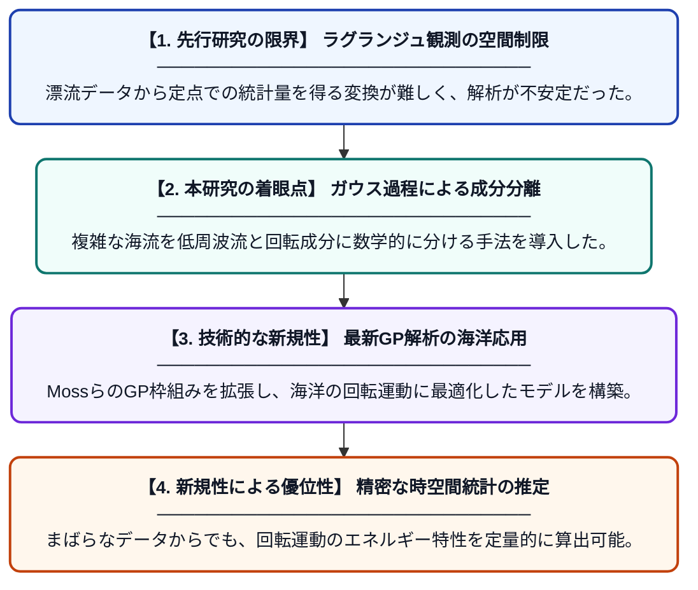

# ガウス過程を用いた漂流ブイ観測データからの回転運動のオイラー時空間統計

**Original Title**: *Eulerian space-time statistics of rotational motions from drifters using Gaussian processes*

> **💡 一言要約**: ガウス過程で海の回転運動を鮮明に解き明かす

| 項目 | 内容 |
|---|---|
| **著者** | WC Edge, MD Rayson, NL Jones, LC Astfalck |
| **掲載誌** | EGUsphere 2026 |
| **アラートキーワード** | gaussian process |
| **PDF** | [https://egusphere.copernicus.org/preprints/2026/egusphere-2026-6450/egusphere-2026-6450.pdf](https://egusphere.copernicus.org/preprints/2026/egusphere-2026-6450/egusphere-2026-6450.pdf) |
| **Git リポジトリ** | [https://github.com/williamedge/drifterOI-public](https://github.com/williamedge/drifterOI-public) |
| **原文リンク** | [https://egusphere.copernicus.org/preprints/2026/egusphere-2026-6450/egusphere-2026-6450.pdf](https://egusphere.copernicus.org/preprints/2026/egusphere-2026-6450/egusphere-2026-6450.pdf) |
| **PDF版要約** | [README.pdf](./README.pdf) |

---

## 📊 新規性の図解（先行研究との違いと本研究のブレークスルー）

## 📝 要約

海洋の漂流ブイ（ドリフター）から得られる複雑なデータから、低周波の流れと回転運動を分離・抽出する新しいガウス過程（GP）回帰フレームワークを提案しました。この手法により、これまで困難だった回転運動の時空間的な統計特性を、オイラー的な視点から精密に推定することが可能になりました。

## ❓ どんな問題に取り組んだか

漂流ブイは海流に乗って移動するため、得られるデータは物体を追いかける「ラグランジュ的」な性質を持ち、特定の場所での統計（オイラー的統計）を求めるのが困難でした。また、複雑な海流の中から背景流と特定の回転成分を精度よく分離する標準的な手法も不足していました。

## ✨ 何が新しい？何がすごい？（新規性）

最新のガウス過程回帰フレームワークを活用し、物理的な解釈が容易な形で低周波流と回転運動を数学的に分離した点が画期的です。先行研究では困難だった回転運動の統計的性質を直接モデル化することで、観測密度が低い海域でも高精度な解析を実現しました。これにより、海流のエネルギー構造をより詳細に記述できるようになったことが大きな貢献です。

## 🎓 大学1年生向けの解説

海の動きを調べるために、センサーを積んだ「浮き」を海に流してその軌跡を記録することがあります。しかし、浮きは波や潮の流れに流されて複雑に動くため、そこから「回転する渦」のような特定の動きだけを取り出すのは非常に難しい作業でした。この研究では、最新の数学的な予測モデル（ガウス過程）を使うことで、複雑な動きを整理整頓し、渦の動きをきれいに取り出すことに成功しました。これによって、海のどこでどのような回転が起きているかを正確に知る道が開けました。
