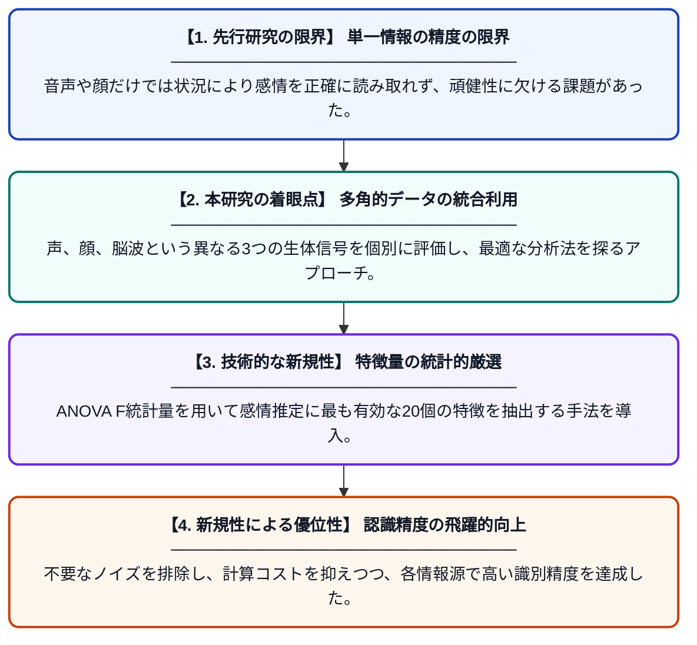

# SelectKBest (ANOVA F統計量, k=20) 特徴量重み付けを用いた音声・顔・脳波ベースの感情認識ディープラーニングパイプラインのベンチマーク評価

**Original Title**: *Benchmarking Deep Learning Pipelines for Speech, Facial, and EEG-Based Emotion Recognition with SelectKBest (ANOVA F-statistic, k= 20) feature weighting*

> **💡 一言要約**: 3つの生体情報とAIで感情を読み解く最適手法を確立

| 項目 | 内容 |
|---|---|
| **著者** | JC Vasquez, R PriyaDarsini, C Paramasivam… |
| **掲載誌** | Informatics 2026 |
| **アラートキーワード** | affective computing |
| **原文リンク** | [https://vbn.aau.dk/en/publications/benchmarking-deep-learning-pipelines-for-speech-facial-and-eeg-ba/](https://vbn.aau.dk/en/publications/benchmarking-deep-learning-pipelines-for-speech-facial-and-eeg-ba/) |
| **PDF版要約** | [README.pdf](./README.pdf) |

---

## 📊 新規性の図解（先行研究との違いと本研究のブレークスルー）

## 📝 要約

音声、顔の表情、脳波（EEG）という3つの異なるデータソースを用いた感情認識において、ディープラーニングの性能を比較・評価した研究です。統計的な特徴選択手法であるSelectKBest（k=20）を導入することで、膨大なデータから感情推定に最も寄与する要素を特定し、精度の向上を図っています。

## ❓ どんな問題に取り組んだか

従来の感情認識システムは、音声のみや顔画像のみといった単一のデータに頼ることが多く、ノイズや環境変化に対する頑健性が低いことが課題でした。また、多種多様な生体データからどの情報を優先すべきかという標準的な指標が不足していました。

## ✨ 何が新しい？何がすごい？（新規性）

本研究の新規性は、音声・顔・EEGの3つのモダリティに対して、ANOVA F統計量を用いたSelectKBest（k=20）という特徴選択手法を一貫して適用し、ディープラーニングとの組み合わせをベンチマーク化した点にあります。これにより、各モダリティの特性に応じた最適な特徴量サブセットを特定しました。複数の生体情報を独立して評価することで、将来的なマルチモーダル統合に向けた具体的な技術基盤を構築したことが主要な貢献です。

## 🎓 大学1年生向けの解説

私たちが「嬉しい」や「怒っている」とき、それは声、表情、そして脳の活動に同時に現れます。この研究は、その3つのデータをAIに読み込ませて、どれが一番正確に感情を当てられるかを比べたものです。たくさんのデータの中から、特に重要な20個のポイントだけを絞り込む工夫をすることで、AIがより賢く、素早く感情を判断できるようになりました。将来、AIが私たちの気持ちをより正確に察してくれる技術につながります。
