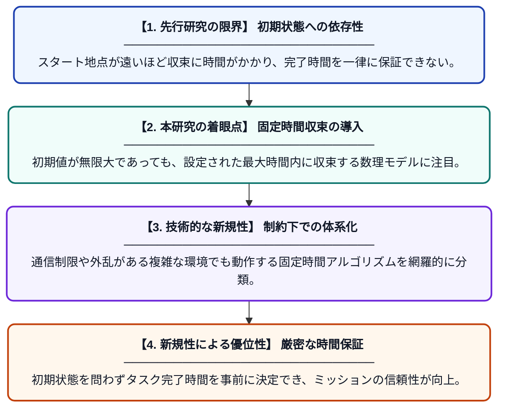

# マルチエージェントシステムにおける固定時間制御のレビュー

**Original Title**: *A Review of Fixed-Time Control for Multi-Agent Systems*

> **💡 一言要約**: 初期位置に関わらず、指定時間内に必ず収束。

| 項目 | 内容 |
|---|---|
| **著者** | K Zhang, H Duan |
| **掲載誌** | Mathematics 2026 |
| **アラートキーワード** | multi agent |
| **原文リンク** | [https://www.mdpi.com/2227-7390/14/22/4200](https://www.mdpi.com/2227-7390/14/22/4200) |
| **PDF版要約** | [README.pdf](./README.pdf) |

---

## 📊 新規性の図解（先行研究との違いと本研究のブレークスルー）

## 📝 要約

複数のロボットやドローンが協調するシステムにおいて、初期状態に関わらず一定時間内にタスクを完了させる「固定時間制御」の最新動向をまとめた論文です。時間制約が厳しいミッションにおいて、従来の有限時間制御が抱えていた「初期値に依存する」という限界をいかに克服するかを体系的に解説しています。

## ❓ どんな問題に取り組んだか

従来の有限時間制御では、目標達成にかかる時間がシステムの開始地点（初期状態）に依存するため、スタート地点が遠いほど収束に時間がかかるという課題がありました。これにより、極めて高い時間精度が求められる複雑な協調タスクにおいて、完了時間を事前に保証することが困難でした。

## ✨ 何が新しい？何がすごい？（新規性）

本論文は、初期状態に依存しない収束時間を実現する「固定時間制御」の理論を整理し、最新のマルチエージェントシステムへの適用事例を網羅しています。外乱や通信遅延、ネットワークの制約といった現実的な条件下での制御アルゴリズムを分類し、先行研究に対する優位性を数学的に明示しました。特に、大規模システムにおけるスケーラビリティと時間保証の両立に関する知見を整理した点が重要な貢献です。

## 🎓 大学1年生向けの解説

たくさんのドローンを同時に動かして、ある形に整列させる場面を想像してください。これまでは、ドローンが遠くに散らばっていると集まるのに時間がかかってしまいましたが、「固定時間制御」という技術を使えば、どんなに離れていても『10秒以内に必ず整列する』といった約束ができるようになります。この論文は、そんな魔法のような時間短縮技術の最新のやり方を分かりやすくまとめた解説書です。
