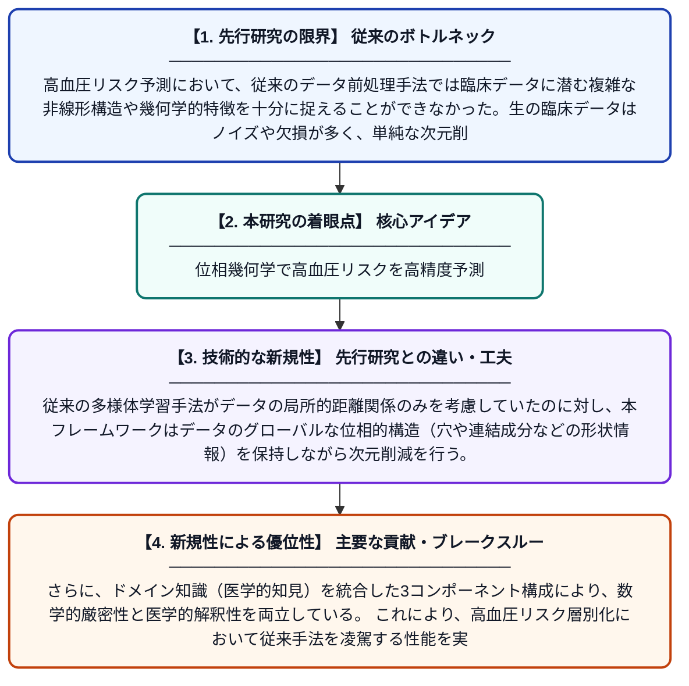

# 高血圧リスク予測のためのトポロジー考慮型多様体学習：永続ホモロジーとドメイン知識を統合した新しいデータ前処理フレームワーク

**Original Title**: *Topology-aware Manifold Learning for Hypertension Risk Prediction: A Novel Data Preprocessing Framework Integrating Persistent Homology and Domain…*

> **💡 一言要約**: 位相幾何学で高血圧リスクを高精度予測

| 項目 | 内容 |
|---|---|
| **著者** | RA Alotaibi, HM Alshammari, SA Alsaggaf, GA Aljaloud |
| **掲載誌** | Journal of Advanced Trends … 2026 |
| **アラートキーワード** | manifold learning |
| **原文リンク** | [https://www.ovid.com/jnls/atmr/abstract/10.4103/atmr.atmr_6_26~topology-aware-manifold-learning-for-hypertension-risk](https://www.ovid.com/jnls/atmr/abstract/10.4103/atmr.atmr_6_26~topology-aware-manifold-learning-for-hypertension-risk) |
| **PDF版要約** | [README.pdf](./README.pdf) |

---

## 📊 新規性の図解（先行研究との違いと本研究のブレークスルー）

## 📝 要約

本研究は、生の臨床データを構造化された解釈可能な表現に変換し、高血圧リスクの層別化精度を向上させるトポロジー考慮型多様体学習フレームワークを開発したものである。永続ホモロジーと呼ばれる数学的手法を活用し、データの幾何学的・位相的特徴を保持しながら前処理を行う3つの主要コンポーネントを提案している。これにより、従来の機械学習手法と比較して、高血圧リスク予測の精度と解釈性を大幅に改善することを目指している。

## ❓ どんな問題に取り組んだか

高血圧リスク予測において、従来のデータ前処理手法では臨床データに潜む複雑な非線形構造や幾何学的特徴を十分に捉えることができなかった。生の臨床データはノイズや欠損が多く、単純な次元削減手法ではデータの本質的な構造が失われてしまうという課題があった。また、予測モデルの解釈性が低く、医療現場での実用化に支障をきたしていた。

## ✨ 何が新しい？何がすごい？（新規性）

本研究の最大の新規性は、位相データ解析の中核手法である「永続ホモロジー」を臨床データの前処理に初めて体系的に組み込んだ点にある。従来の多様体学習手法がデータの局所的距離関係のみを考慮していたのに対し、本フレームワークはデータのグローバルな位相的構造（穴や連結成分などの形状情報）を保持しながら次元削減を行う。さらに、ドメイン知識（医学的知見）を統合した3コンポーネント構成により、数学的厳密性と医学的解釈性を両立している。これにより、高血圧リスク層別化において従来手法を凌駕する性能を実現している。

## 🎓 大学1年生向けの解説

高血圧は世界中で多くの人が患う病気で、早期に発症リスクを予測することがとても重要です。この研究では、患者の血圧や体重などの健康データを分析する際に、「トポロジー（位相幾何学）」という数学の考え方を応用しています。トポロジーとは、ドーナツとコップは穴の数が同じだから「同じ形」と見なすような、形の本質的な特徴を研究する学問です。この手法を使うことで、データの中に隠れた複雑なパターンをうまく取り出し、AIが高血圧リスクをより正確に予測できるようになります。つまり、高度な数学をデータの「お掃除・整理」に使うことで、医療AIの予測精度を上げた研究です。
