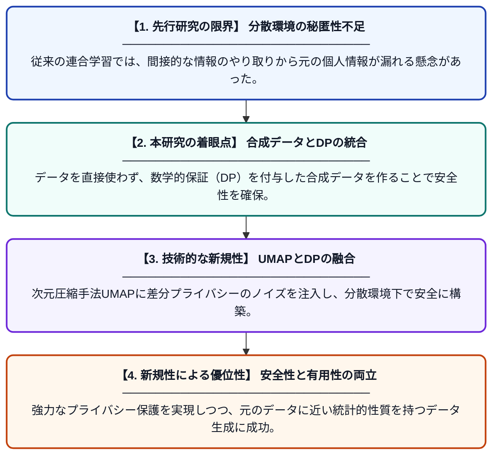

# 連合学習に向けた差分プライバシーを考慮した合成テーブルデータ生成

**Original Title**: *Differential Privacy Synthetic Tabular Data Generation for Federated Learning*

> **💡 一言要約**: 連合学習×差分プライバシーで安全な合成データを作成

| 項目 | 内容 |
|---|---|
| **著者** | AB Mariona, C Lázaro, A Cecilio |
| **掲載誌** | Electronics 2026 |
| **アラートキーワード** | differential privacy |
| **原文リンク** | [https://search.proquest.com/openview/e34c81965b4c2068f11a6df74a402bc1/1?pq-origsite=gscholar&cbl=2032404](https://search.proquest.com/openview/e34c81965b4c2068f11a6df74a402bc1/1?pq-origsite=gscholar&cbl=2032404) |
| **PDF版要約** | [README.pdf](./README.pdf) |

---

## 📊 新規性の図解（先行研究との違いと本研究のブレークスルー）

## 📝 要約

連合学習の枠組みにおいて、プライバシーを数学的に保護しつつ高品質な合成テーブルデータを生成する手法を提案しています。UMAPを活用した生成パイプラインに、ガウスおよびラプラスメカニズムを用いた(ε, δ)-差分プライバシーを統合したことが特徴です。

## ❓ どんな問題に取り組んだか

連合学習では生データの直接的な共有は防げますが、モデルの更新情報から元のデータが推測されるリスクが依然として存在します。また、分散環境下で統計的有用性を保ちつつ、厳格なプライバシー保護を実現する合成データの生成は困難でした。

## ✨ 何が新しい？何がすごい？（新規性）

既存のUMAPベースの合成データ生成手法を連合学習の設定へと拡張し、差分プライバシーを直接パイプラインに組み込みました。先行研究と比較して、分散された各拠点でのプライバシー強度を(ε, δ)-差分プライバシーによって数学的に保証できる点が画期的です。さらに、ガウスとラプラスの各メカニズムを検証し、データの有用性と安全性の最適なバランスを明らかにしました。

## 🎓 大学1年生向けの解説

複数の病院や企業が持つデータを、お互いの秘密を守ったまま共同で分析したいというニーズがあります。この研究では、元のデータと特徴がそっくりで、かつ個人が特定されない「安全な偽データ」を、複数の拠点で協力して作る新しい方法を開発しました。最新の数学的な目隠し技術（差分プライバシー）を使うことで、情報の漏洩を強力に防ぎながら、AIの学習に役立つデータを作成できます。
