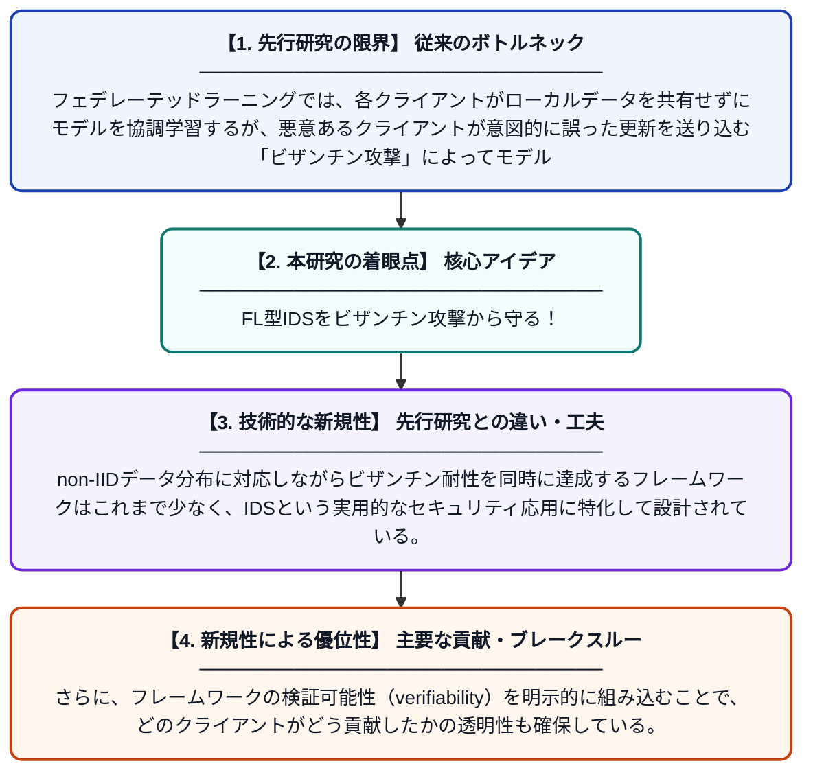

# VARUNA：フェデレーテッドラーニングベースの侵入検知システムにおけるビザンチン攻撃に対する検証可能な適応型耐性統合フレームワーク

**Original Title**: *VARUNA: verifiable adaptive resilient unified framework against byzantine attacks in federated learning-based IDS*

> **💡 一言要約**: FL型IDSをビザンチン攻撃から守る！

| 項目 | 内容 |
|---|---|
| **著者** | SK Jangir, AK Prajapati, A Awasthi, P Vediya |
| **掲載誌** | Scientific Reports 2026 |
| **アラートキーワード** | Federated Learning |
| **PDF** | [https://www.nature.com/articles/s41598-026-61550-2_reference.pdf](https://www.nature.com/articles/s41598-026-61550-2_reference.pdf) |
| **原文リンク** | [https://www.nature.com/articles/s41598-026-61550-2_reference.pdf](https://www.nature.com/articles/s41598-026-61550-2_reference.pdf) |
| **PDF版要約** | [README.pdf](./README.pdf) |

---

## 📊 新規性の図解（先行研究との違いと本研究のブレークスルー）

## 📝 要約

本論文は、フェデレーテッドラーニング（FL）を用いた侵入検知システム（IDS）において、悪意あるクライアント（ビザンチン攻撃者）によるモデル汚染攻撃に対抗するための新しいフレームワーク「VARUNA」を提案している。VARANAは、非独立同分布（non-IID）データ環境下でも頑健に動作し、クライアントの更新を検証・集約する適応型メカニズムを備えている。これにより、セキュリティと学習精度の両立を実現している。

## ❓ どんな問題に取り組んだか

フェデレーテッドラーニングでは、各クライアントがローカルデータを共有せずにモデルを協調学習するが、悪意あるクライアントが意図的に誤った更新を送り込む「ビザンチン攻撃」によってモデル全体が汚染されるリスクがある。特にネットワーク侵入検知システムへの応用では、データが非均一（non-IID）に分布しているため、攻撃の検出と正当なクライアントの識別がより困難になる。

## ✨ 何が新しい？何がすごい？（新規性）

VARANAは、従来の単純な集約手法（FedAvgなど）と異なり、クライアントの更新を統計的に検証し、異常な更新を動的に排除する適応型の耐障害集約メカニズムを組み合わせた点が新しい。non-IIDデータ分布に対応しながらビザンチン耐性を同時に達成するフレームワークはこれまで少なく、IDSという実用的なセキュリティ応用に特化して設計されている。さらに、フレームワークの検証可能性（verifiability）を明示的に組み込むことで、どのクライアントがどう貢献したかの透明性も確保している。

## 🎓 大学1年生向けの解説

フェデレーテッドラーニングとは、多くのデバイスがデータを共有せずに協力してAIモデルを作る仕組みです。しかし、悪意あるデバイスが嘘の情報を送ると、AIが正しく動かなくなる「ビザンチン攻撃」という問題があります。VARANAはこのような攻撃を見破って排除しながら、ネットワークへの不正侵入を検知するAIを安全に学習させるフレームワークです。各参加者のデータが偏っていても（non-IID）うまく機能するよう設計されており、セキュリティシステムの信頼性を高めることができます。
