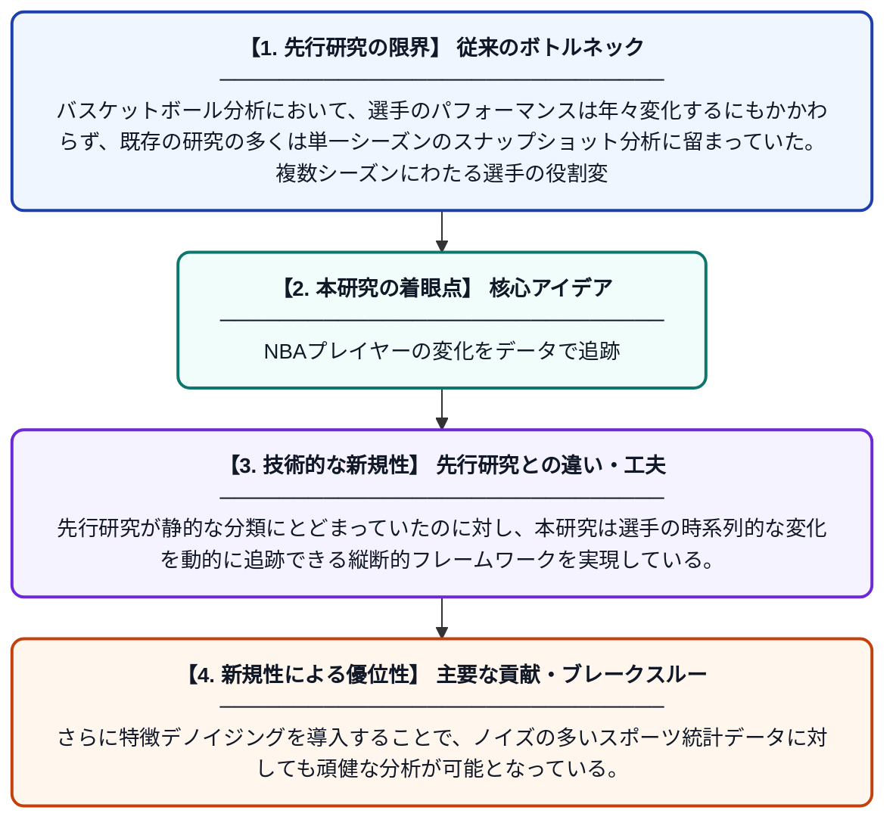

# TeMPO: NBAプレイヤープロファイルの長期的マッピングのためのフレームワーク

**Original Title**: *TeMPO: A framework for longitudinal mapping of NBA player profiles*

> **💡 一言要約**: NBAプレイヤーの変化をデータで追跡

| 項目 | 内容 |
|---|---|
| **著者** | MTM Madeira, L Vassio, AM Sousa, CHG Ferreira |
| **掲載誌** | Journal of Big Data 2026 |
| **アラートキーワード** | manifold learning |
| **原文リンク** | [https://link.springer.com/article/10.1186/s40537-026-01488-4](https://link.springer.com/article/10.1186/s40537-026-01488-4) |
| **PDF版要約** | [README.pdf](./README.pdf) |

---

## 📊 新規性の図解（先行研究との違いと本研究のブレークスルー）

## 📝 要約

本研究は、NBAプレイヤーの選手特性をキャリア全体にわたって時系列で追跡・分類するためのフレームワーク「TeMPO」を提案する。相関ベースの特徴選択、統計的モーメント抽出、UMAPによる次元削減、K-Meansクラスタリングなどを統合した手法により、選手のプロファイルを動的に可視化する。これにより、選手の成長・変化のパターンをデータ駆動的に把握することが可能となる。

## ❓ どんな問題に取り組んだか

バスケットボール分析において、選手のパフォーマンスは年々変化するにもかかわらず、既存の研究の多くは単一シーズンのスナップショット分析に留まっていた。複数シーズンにわたる選手の役割変化やスタイルの進化を体系的に捉える手法が不足していた。

## ✨ 何が新しい？何がすごい？（新規性）

TeMPOは、複数シーズンにわたる統計データからシーズンごとの特徴的なモーメントを抽出し、UMAPによる非線形次元削減とK-Meansクラスタリングを組み合わせることで、選手プロファイルの「軌跡」を低次元空間上に可視化する点が新しい。先行研究が静的な分類にとどまっていたのに対し、本研究は選手の時系列的な変化を動的に追跡できる縦断的フレームワークを実現している。さらに特徴デノイジングを導入することで、ノイズの多いスポーツ統計データに対しても頑健な分析が可能となっている。

## 🎓 大学1年生向けの解説

NBAの選手は毎年プレースタイルや得意なことが変わることがあります。この研究では、選手の複数年分の成績データをコンピュータに学習させ、選手のタイプや変化の流れを地図のように見える形で表示する仕組みを作りました。例えば、若い頃はシューターだった選手がゲームメーカーに変化していく過程をデータで追えるようになります。難しい数学的な技術（UMAPやクラスタリング）を使って、大量のデータをわかりやすい図として整理しています。これにより、コーチやチーム担当者が選手の成長を客観的に評価しやすくなります。
