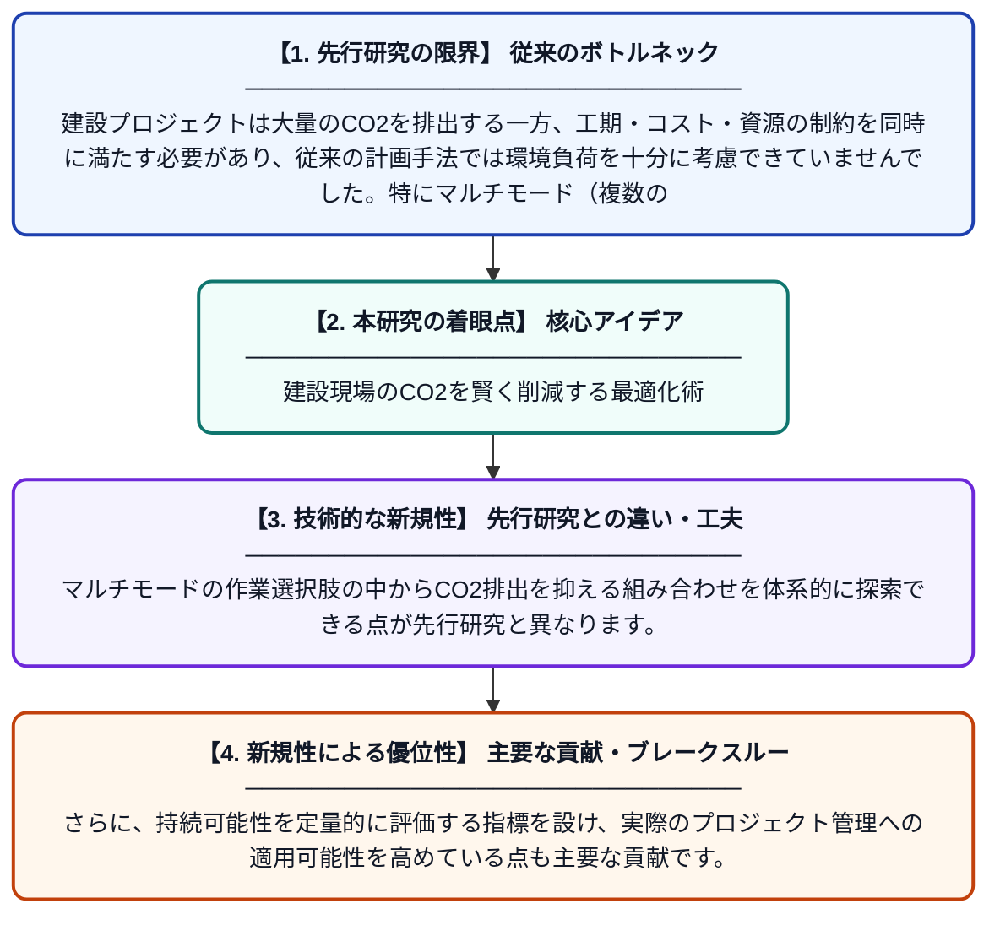

# マルチモード建設プロジェクトにおけるプロジェクト持続可能性評価とスケジュール最適化のフレームワーク

**Original Title**: *A framework for project sustainability assessment and schedule optimization in multi-mode construction projects*

> **💡 一言要約**: 建設現場のCO2を賢く削減する最適化術

| 項目 | 内容 |
|---|---|
| **著者** | A Hussain, QS Khalid, I Hussain, M Omair, MS Habib |
| **掲載誌** | International Journal of Management Science and Engineering Management 2026 |
| **アラートキーワード** | rcpsp |
| **原文リンク** | [https://www.tandfonline.com/doi/abs/10.1080/17509653.2026.2706585](https://www.tandfonline.com/doi/abs/10.1080/17509653.2026.2706585) |
| **PDF版要約** | [README.pdf](./README.pdf) |

---

## 📊 新規性の図解（先行研究との違いと本研究のブレークスルー）

## 📝 要約

本論文は、建設プロジェクトにおけるCO2排出量を最小化しつつ、工期やコストも考慮したリソース制約付きプロジェクトスケジューリング問題（RCPSP）モデルを提案しています。複数の作業実施方法（マルチモード）から最適な組み合わせを選択することで、環境負荷と経済性を両立するフレームワークを構築しています。これにより、建設業界における持続可能なプロジェクト管理の実現を目指しています。

## ❓ どんな問題に取り組んだか

建設プロジェクトは大量のCO2を排出する一方、工期・コスト・資源の制約を同時に満たす必要があり、従来の計画手法では環境負荷を十分に考慮できていませんでした。特にマルチモード（複数の作業方法が選択可能）な環境では、最適な組み合わせを求めることが計算上非常に困難です。持続可能な開発目標（SDGs）が重視される中、建設業界における環境・経済・社会の三側面を統合した意思決定手法が求められていました。

## ✨ 何が新しい？何がすごい？（新規性）

本研究は、RCPSP（リソース制約付きプロジェクトスケジューリング問題）にCO2排出量最小化を組み込んだ点が新しく、従来の工期・コスト最適化に「環境持続可能性」の軸を加えた統合フレームワークを提案しています。マルチモードの作業選択肢の中からCO2排出を抑える組み合わせを体系的に探索できる点が先行研究と異なります。さらに、持続可能性を定量的に評価する指標を設け、実際のプロジェクト管理への適用可能性を高めている点も主要な貢献です。

## 🎓 大学1年生向けの解説

建設工事では、同じ作業でも「人手を多くして早く終わらせる方法」や「機械を使って効率よくやる方法」など、複数のやり方があります。この論文は、そのたくさんの選択肢の中から、二酸化炭素（CO2）の排出量をなるべく少なくしながら、工期やお金の制約も守れる最善の組み合わせを見つける方法を研究しています。地球温暖化が問題になっている今、建設現場でも環境に優しい計画を立てることがとても重要です。コンピューターを使って膨大な組み合わせを計算し、環境にも経済にも良いスケジュールを自動的に導き出す仕組みを作りました。
