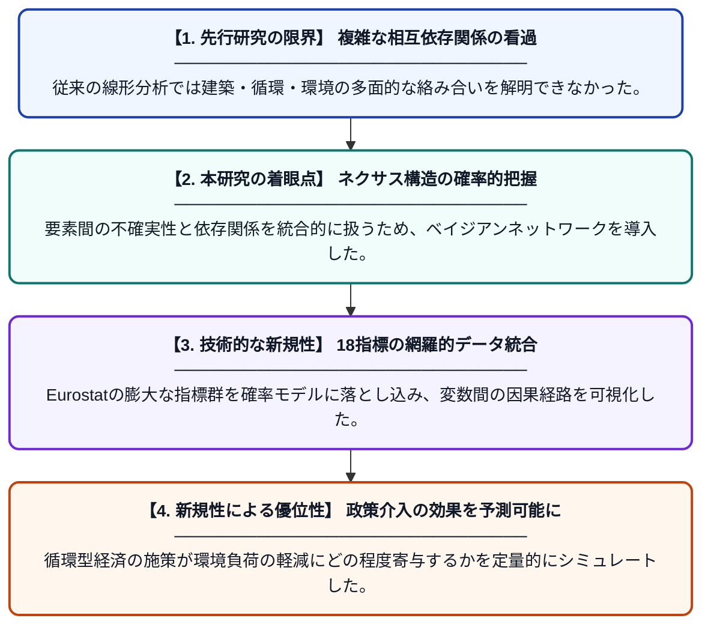

# 建築環境・サーキュラーエコノミー・環境負荷の連関探索：ベイジアンネットワークによるアプローチ

**Original Title**: *Exploring the Built Environment–Circular Economy–Environmental Pressure Nexus: A Bayesian Network Approach*

> **💡 一言要約**: 建築と循環経済の複雑な関係をAIで解明

| 項目 | 内容 |
|---|---|
| **著者** | EN Cinicioglu, T Tambovceva, EC Madenli |
| **掲載誌** | International Conference ReShaping the … 2026 |
| **アラートキーワード** | bayesian network |
| **原文リンク** | [https://link.springer.com/chapter/10.1007/978-3-032-34930-9_144](https://link.springer.com/chapter/10.1007/978-3-032-34930-9_144) |
| **PDF版要約** | [README.pdf](./README.pdf) |

---

## 📊 新規性の図解（先行研究との違いと本研究のブレークスルー）

## 📝 要約

欧州連合（EU）における建築環境、循環型経済、そして環境負荷の相互依存関係を、ベイジアンネットワークを用いて分析した研究です。18のEurostat指標を基に、都市開発がどのように環境ストレスに影響し、循環型経済がそれをどう緩和するかを定量的に明らかにしています。

## ❓ どんな問題に取り組んだか

建築環境と循環型経済、環境への影響は互いに複雑に絡み合っていますが、これまでの研究ではそれらの多面的な相互依存関係を統合的に捉えることが困難でした。特に、不確実性を伴う複雑なシステムの中で、どの要因が最も環境負荷に寄与しているかを特定する手法が求められていました。

## ✨ 何が新しい？何がすごい？（新規性）

本研究は、不確実性を扱うのに適したベイジアンネットワークを採用し、EUの公式統計データを用いて建築・循環・環境の「ネクサス（連関）」を可視化した点が革新的です。従来の線形モデルでは捉えきれなかった変数間の複雑な因果関係や依存構造を、確率的なネットワークとして構築しました。これにより、特定の政策介入がシステム全体に与える波及効果を予測可能にしたことが大きな貢献です。

## 🎓 大学1年生向けの解説

私たちが住む建物や道路などの「建築環境」は、資源を多く使い、環境に大きな負担をかけます。この研究では、資源を再利用する「循環型経済」が、どれくらい環境を守るのに役立っているかを、数学的な手法を使って調べました。ヨーロッパの実際のデータから、建物とリサイクル、そして地球への影響がどうつながっているかを地図のように描き出しています。これにより、どうすれば効率よく地球に優しい街づくりができるかがわかります。
