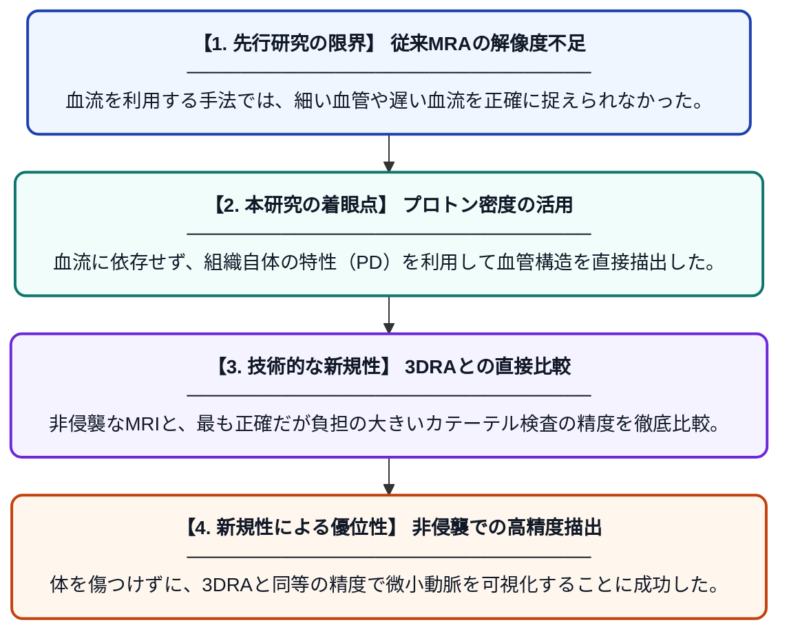

# ウィリス動脈輪の微小動脈描出における高解像度プロトン密度画像とTOF-MRAの比較：3D回転血管造影との対照研究

**Original Title**: *High-resolution proton-density MRI versus time-of-flight MRA for visualizing small circle-of-Willis arteries: Comparison with three-dimensional rotational angiography*

> **💡 一言要約**: HR-PDが脳の微小血管描出の新たな標準へ

| 項目 | 内容 |
|---|---|
| **著者** | D Lee, B Kwon, SC Jung, J Lee, Y Song, JS Ahn… |
| **掲載誌** | European Journal of … 2026 |
| **アラートキーワード** | ICA |
| **原文リンク** | [https://www.sciencedirect.com/science/article/pii/S0720048X26006844](https://www.sciencedirect.com/science/article/pii/S0720048X26006844) |
| **PDF版要約** | [README.pdf](./README.pdf) |

---

## 📊 新規性の図解（先行研究との違いと本研究のブレークスルー）

## 📝 要約

脳の微小動脈を非侵襲的に観察する手法として、高解像度プロトン密度画像（HR-PD）の有用性を評価しました。従来のTOF-MRAと比較した結果、HR-PDはカテーテルを用いる3D回転血管造影（3DRA）に匹敵する高い精度で微小動脈を描出できることが示されました。

## ❓ どんな問題に取り組んだか

従来のTOF-MRAでは、脳内の非常に細い血管や血流の遅い部位を正確に描出することが難しく、診断精度に限界がありました。また、最も正確とされる3DRAはカテーテルを使用する侵襲的な検査であり、患者への身体的負担が大きいという課題がありました。

## ✨ 何が新しい？何がすごい？（新規性）

本研究は、主に血管壁の診断に用いられてきたHR-PDを微小血管自体の可視化に応用し、その精度をゴールドスタンダードである3DRAと直接比較した点に新規性があります。TOF-MRAでは消失しがちな末梢の微小枝を、HR-PDは非侵襲でありながら極めて鮮明に描き出すことを証明しました。これにより、脳動脈瘤の術前評価などにおいて、より安全で高精度な画像診断が可能となります。

## 🎓 大学1年生向けの解説

脳の病気を見つけるとき、これまでは「血液の流れ」を利用して画像を作るMRIが一般的でしたが、細すぎる血管は見えにくいという弱点がありました。この研究では、血液の流れに関係なく、組織そのものの特徴を捉える「プロトン密度」という別の撮影方法を試しました。その結果、体に管を通すような負担の大きい検査と同じくらい、脳の細い血管をくっきりと映し出すことに成功したのです。これにより、患者さんに優しく、かつ正確に脳の状態を調べられるようになります。
