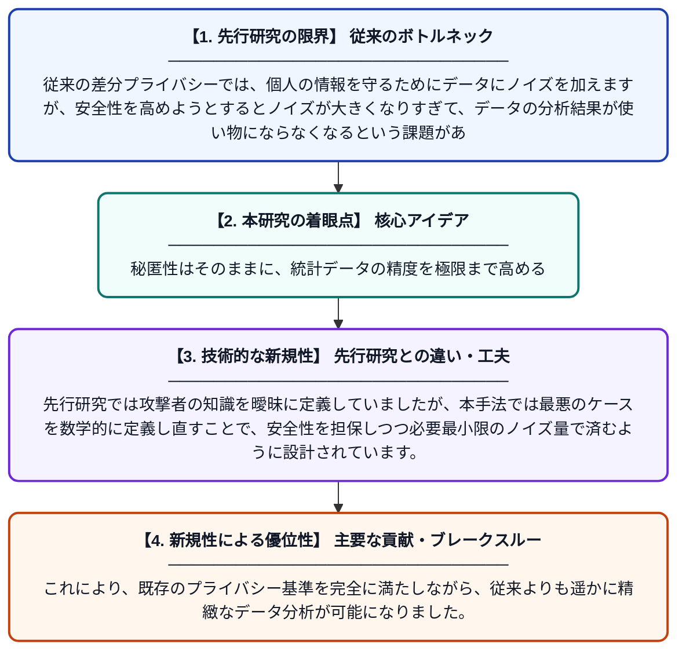

# プライバシーを損なわずに差分プライバシーの有用性を向上させる：最大知識仮定

**Original Title**: *Boosting Utility in Differential Privacy Without Losing Privacy: The Maximum-Knowledge Assumption*

> **💡 一言要約**: 秘匿性はそのままに、統計データの精度を極限まで高める

| 項目 | 内容 |
|---|---|
| **著者** | J Soria-Comas, D Sanchez, J Domingo-Ferrer… |
| **掲載誌** | … and Secure Computing 2026 |
| **アラートキーワード** | Secure Computing |
| **原文リンク** | [https://www.computer.org/csdl/journal/tq/5555/01/11746040/2kNpb0XyzHG](https://www.computer.org/csdl/journal/tq/5555/01/11746040/2kNpb0XyzHG) |
| **PDF版要約** | [README.pdf](./README.pdf) |

---

## 📊 新規性の図解（先行研究との違いと本研究のブレークスルー）

## 📝 要約

差分プライバシーにおいて、プライバシー保護の強度を維持したままデータの精度（有用性）を高める新しいアプローチを提案しています。攻撃者が持ちうる背景知識を最大限に想定する「最大知識仮定」を導入することで、過剰なノイズ付加を抑制しています。

## ❓ どんな問題に取り組んだか

従来の差分プライバシーでは、個人の情報を守るためにデータにノイズを加えますが、安全性を高めようとするとノイズが大きくなりすぎて、データの分析結果が使い物にならなくなるという課題がありました。この「プライバシーと有用性のトレードオフ」をいかに解消するかが大きな問題でした。

## ✨ 何が新しい？何がすごい？（新規性）

本論文の新規性は、攻撃者が標的以外の全データを知っているという最悪の状況を仮定する「最大知識仮定」に基づき、ノイズの生成メカニズムを最適化した点にあります。先行研究では攻撃者の知識を曖昧に定義していましたが、本手法では最悪のケースを数学的に定義し直すことで、安全性を担保しつつ必要最小限のノイズ量で済むように設計されています。これにより、既存のプライバシー基準を完全に満たしながら、従来よりも遥かに精緻なデータ分析が可能になりました。

## 🎓 大学1年生向けの解説

インターネット上のデータを集計する際、個人の秘密を守るためにデータに「わざとらしい間違い（ノイズ）」を混ぜることがあります。しかし、間違いを増やしすぎると、せっかくのデータがデタラメになってしまいます。この研究は、「もし犯人がデータの内容をほとんど知っているすごく賢い人だったとしても、秘密がバレない最小限の間違いの付け方」を計算で導き出しました。その結果、個人のプライバシーはガッチリ守ったまま、分析結果をより本物に近い正確なものにすることができたのです。
