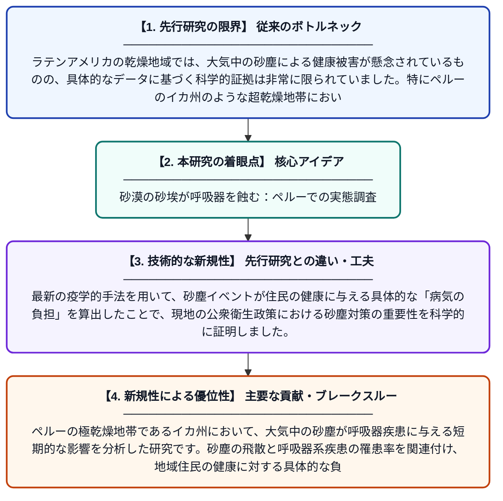

# ペルー、イカ州における大気浮遊砂塵の短期的呼吸器への影響と寄与負荷

**Original Title**: *Short-Term Respiratory Effects and Attributable Burden of Atmospheric Dust in Ica, Peru*

> **💡 一言要約**: 砂漠の砂埃が呼吸器を蝕む：ペルーでの実態調査

| 項目 | 内容 |
|---|---|
| **著者** | A Hernández-Vásquez, D Vizcarra-Díaz… |
| **掲載誌** | Epidemiologia 2026 |
| **アラートキーワード** | ICA |
| **原文リンク** | [https://www.mdpi.com/2673-3986/7/6/149](https://www.mdpi.com/2673-3986/7/6/149) |
| **PDF版要約** | [README.pdf](./README.pdf) |

---

## 📊 新規性の図解（先行研究との違いと本研究のブレークスルー）

## 📝 要約

ペルーの極乾燥地帯であるイカ州において、大気中の砂塵が呼吸器疾患に与える短期的な影響を分析した研究です。砂塵の飛散と呼吸器系疾患の罹患率を関連付け、地域住民の健康に対する具体的な負担（寄与負荷）を明らかにしました。

## ❓ どんな問題に取り組んだか

ラテンアメリカの乾燥地域では、大気中の砂塵による健康被害が懸念されているものの、具体的なデータに基づく科学的証拠は非常に限られていました。特にペルーのイカ州のような超乾燥地帯において、砂塵がどの程度呼吸器疾患の増加に寄与しているかを特定することが大きな課題でした。

## ✨ 何が新しい？何がすごい？（新規性）

本研究は、これまで先行研究が少なかったラテンアメリカの超乾燥地域を対象に、砂塵と呼吸器疾患の因果関係を詳細に定量化した点が画期的です。最新の疫学的手法を用いて、砂塵イベントが住民の健康に与える具体的な「病気の負担」を算出したことで、現地の公衆衛生政策における砂塵対策の重要性を科学的に証明しました。

## 🎓 大学1年生向けの解説

砂漠が多い地域では、強い風で舞い上がる砂やホコリが原因で、喘息などの呼吸器の病気が増えることが心配されています。この研究は、ペルーの砂漠地帯で実際にどれだけの人が砂埃のせいで病院にかかっているのかを詳しく調べました。その結果、砂塵がひどい日には呼吸器のトラブルが明らかに増えることが分かり、砂埃から身を守るための対策が重要であることが示されました。
