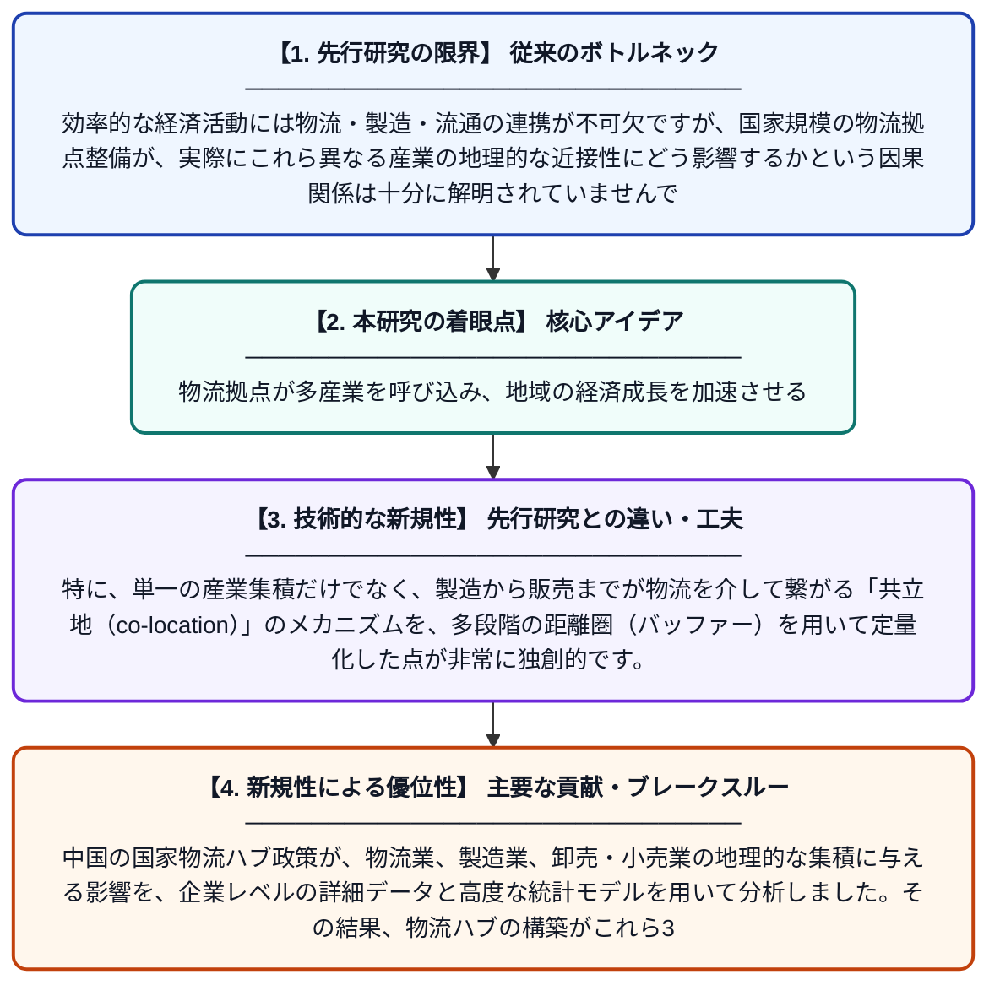

# 集積から協調的成長へ：国家物流ハブが物流・製造・卸売・小売企業の空間的共立地をいかに形成するか

**Original Title**: *From agglomeration to coordinated growth: How national logistics hubs shape the spatial co-location of logistics, manufacturing, and wholesale–retail firms*

> **💡 一言要約**: 物流拠点が多産業を呼び込み、地域の経済成長を加速させる

| 項目 | 内容 |
|---|---|
| **著者** | H Yao, M Kahalimoghadam, H Mao, R Thompson |
| **掲載誌** | Journal of Transport Geography 2026 |
| **アラートキーワード** | logistics |
| **原文リンク** | [https://www.sciencedirect.com/science/article/pii/S0966692326003339](https://www.sciencedirect.com/science/article/pii/S0966692326003339) |
| **PDF版要約** | [README.pdf](./README.pdf) |

---

## 📊 新規性の図解（先行研究との違いと本研究のブレークスルー）

## 📝 要約

中国の国家物流ハブ政策が、物流業、製造業、卸売・小売業の地理的な集積に与える影響を、企業レベルの詳細データと高度な統計モデルを用いて分析しました。その結果、物流ハブの構築がこれら3つの産業が同じ場所に集まる「共立地」を促進し、地域経済の効率的な成長に寄与していることを明らかにしました。

## ❓ どんな問題に取り組んだか

効率的な経済活動には物流・製造・流通の連携が不可欠ですが、国家規模の物流拠点整備が、実際にこれら異なる産業の地理的な近接性にどう影響するかという因果関係は十分に解明されていませんでした。特に、単なる企業の集まりを超えて、産業間の相互作用がどのように強化されるかを特定することが課題でした。

## ✨ 何が新しい？何がすごい？（新規性）

本研究は、中国全土の膨大な企業位置データと「連続型差の差分析（Continuous DID）」を組み合わせ、物流拠点の設置が周辺産業を呼び寄せる因果効果を厳密に証明しました。特に、単一の産業集積だけでなく、製造から販売までが物流を介して繋がる「共立地（co-location）」のメカニズムを、多段階の距離圏（バッファー）を用いて定量化した点が非常に独創的です。

## 🎓 大学1年生向けの解説

大きなAmazonの倉庫や港のような「物流センター」ができると、その周りには製品を作る工場や、物を売るお店も集まりやすくなります。なぜなら、物流が便利な場所の近くにいれば、材料を運んだり商品を届けたりするコストが安くなるからです。この研究は、国が計画的に作った物流拠点が磁石のように色々な会社を引き寄せ、バラバラだった産業が協力して成長する様子をデータで明らかにしました。
