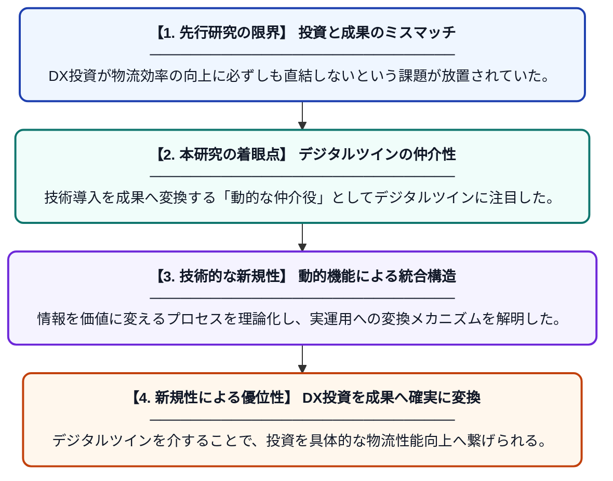

# 港湾運営におけるサプライチェーンのデジタルトランスフォーメーションと物流パフォーマンスを結ぶ動的な仲介メカニズムとしてのデジタルツイン機能

**Original Title**: *Digital twin capabilities as a dynamic mediating mechanism between supply chain digital transformation and logistics performance in seaport operations*

> **💡 一言要約**: デジタルツインが港湾のDX投資を成果に変える！

| 項目 | 内容 |
|---|---|
| **著者** | D Alahmari, MR Afia, MA Aref |
| **掲載誌** | The International Journal of Logistics Management 2026 |
| **アラートキーワード** | logistics |
| **原文リンク** | [https://www.emerald.com/ijlm/article-abstract/doi/10.1108/IJLM-02-2026-0230/1409137](https://www.emerald.com/ijlm/article-abstract/doi/10.1108/IJLM-02-2026-0230/1409137) |
| **PDF版要約** | [README.pdf](./README.pdf) |

---

## 📊 新規性の図解（先行研究との違いと本研究のブレークスルー）

## 📝 要約

港湾運営におけるデジタル変革（DT）への投資が、必ずしも物流パフォーマンスの向上に直結しない「翻訳のギャップ」を調査した研究です。デジタルツイン機能が、デジタル化による基盤を実際の運用効率へと変換する重要な動的仲介役を果たすことを明らかにしました。

## ❓ どんな問題に取り組んだか

多くの港湾がデジタル変革（DT）に多額の投資を行っていますが、その投資が期待通りの物流パフォーマンス向上に繋がらない「翻訳のギャップ」が存在しています。デジタル技術を導入するだけでは不十分であり、具体的にどのようなプロセスを経て成果が生み出されるのかというメカニズムが不明確でした。

## ✨ 何が新しい？何がすごい？（新規性）

本研究は、デジタルツイン（DTw）を単なる技術的ツールではなく、DT投資を物流の成果へと変換する「動的な仲介メカニズム」として理論化した点が革新的です。先行研究ではDTの直接的な影響に焦点が当てられがちでしたが、本研究はDTwが情報を統合・可視化し、意思決定を最適化するプロセスを介することで初めてパフォーマンスが向上することを実証しました。これにより、デジタル投資を価値に繋げるためのミッシングリンクを特定しました。

## 🎓 大学1年生向けの解説

大きな港では荷物を効率よく運ぶためにIT化が進んでいますが、実は高いシステムを買っただけでは仕事が速くなるとは限りません。この研究は、港の様子をコンピューターの中にそっくり再現する「デジタルツイン」という技術が、IT投資を実際の成果に変える「橋渡し役」になることを発見しました。デジタル技術をただ導入するだけでなく、それを使いこなしてシミュレーションする力が、港の効率を上げる鍵になるということです。
