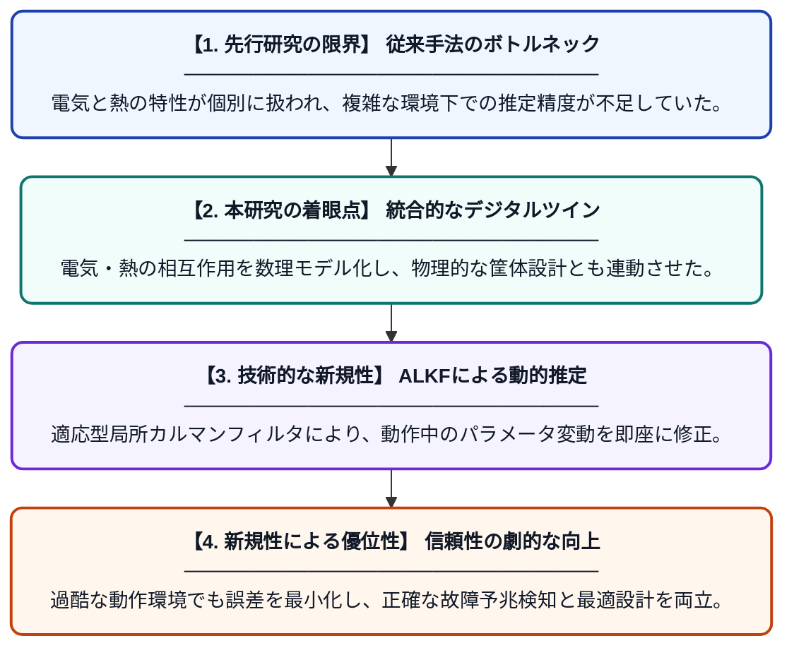

# アルミ電解コンデンサの電気・熱連成デジタルツイン：動的な状態推定とパッケージングの共同設計

**Original Title**: *A Coupled Electro-Thermal Digital Twin for Aluminum Electrolytic Capacitors: Dynamic State Estimation and Packaging Co-Design*

> **💡 一言要約**: 電気と熱を統合し、コンデンサの寿命を正確に予測

| 項目 | 内容 |
|---|---|
| **著者** | MI Alamayreh, A Alamayreh |
| **掲載誌** | IEEE Journal of Emerging and Selected Topics in … 2026 |
| **アラートキーワード** | kalman filter |
| **原文リンク** | [https://ieeexplore.ieee.org/abstract/document/11806696/](https://ieeexplore.ieee.org/abstract/document/11806696/) |
| **PDF版要約** | [README.pdf](./README.pdf) |

---

## 📊 新規性の図解（先行研究との違いと本研究のブレークスルー）

## 📝 要約

アルミ電解コンデンサの寿命予測と状態監視を高度化するため、電気と熱の挙動を統合したデジタルツイン手法を提案しています。適応型局所カルマンフィルタ（ALKF）を用いることで、リアルタイムのデータ計測とハードウェアの設計最適化を融合し、高精度な状態推定を実現しました。

## ❓ どんな問題に取り組んだか

アルミ電解コンデンサは電源システムの故障原因になりやすく、その状態を正確に把握することが重要です。しかし、電気的特性と熱的挙動は互いに複雑に影響し合っており、これらを個別にモデル化する従来の手法では、実動作中の精度に限界がありました。

## ✨ 何が新しい？何がすごい？（新規性）

電気回路モデルと熱等価回路を密結合させたデジタルツインを構築し、適応型局所カルマンフィルタ（ALKF）を導入してリアルタイムのパラメータ推定を可能にした点が画期的です。さらに、単なるソフトウェア上の改善に留まらず、センサー配置などの物理的なパッケージ設計までを最適化に含める「ハードウェア・コデザイン」を採用しています。これにより、先行研究よりも過酷な動作条件下での推定誤差を大幅に低減することに成功しました。

## 🎓 大学1年生向けの解説

電化製品に使われる「コンデンサ」は、熱に弱く寿命が短い部品ですが、いつ壊れるかを外から判断するのは困難です。この研究では、コンピュータの中に「仮想のコンデンサ」を作り、電気の動きと温度変化をセットで計算して、本物のコンデンサが今どんな状態かをリアルタイムで当てる技術を開発しました。さらに、測りやすいように部品の詰め方も工夫することで、より正確に「あとどれくらい使えるか」を予測できるようになります。
