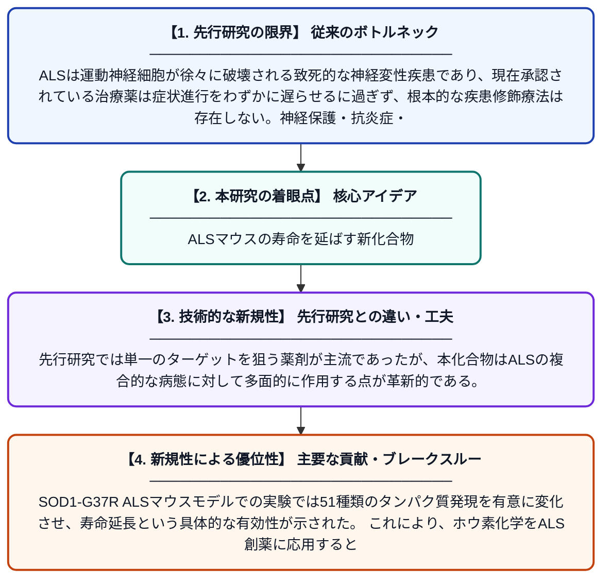

# ボルサントラゾールの紹介：筋萎縮性側索硬化症マウスの寿命を延長する三機能性ホウ素系ピラゾール化合物

**Original Title**: *Introducing Borsantrazole: A Trifunctional Boron‐Based Pyrazole That Extends the Lifespan of Amyotrophic Lateral Sclerosis Mice*

> **💡 一言要約**: ALSマウスの寿命を延ばす新化合物

| 項目 | 内容 |
|---|---|
| **著者** | N Sanghai, R Kelley, Y Lao, MIR Madlangsakay |
| **掲載誌** | Advanced Science 2026 |
| **アラートキーワード** | ALS |
| **PDF** | [https://advanced.onlinelibrary.wiley.com/doi/pdf/10.1002/advs.76432](https://advanced.onlinelibrary.wiley.com/doi/pdf/10.1002/advs.76432) |
| **原文リンク** | [https://advanced.onlinelibrary.wiley.com/doi/pdf/10.1002/advs.76432](https://advanced.onlinelibrary.wiley.com/doi/pdf/10.1002/advs.76432) |
| **PDF版要約** | [README.pdf](./README.pdf) |

---

## 📊 新規性の図解（先行研究との違いと本研究のブレークスルー）

## 📝 要約

本研究では、ALS（筋萎縮性側索硬化症）の治療に向けて、ホウ素を含む新規化合物「ボルサントラゾール」が開発された。この化合物はSOD1-G37R ALSマウスモデルにおいて疾患修飾効果を示し、51種類のタンパク質の発現を有意に変化させることが確認された。ボルサントラゾールはALSの疾患修飾薬候補として概念実証的な有効性を示した。

## ❓ どんな問題に取り組んだか

ALSは運動神経細胞が徐々に破壊される致死的な神経変性疾患であり、現在承認されている治療薬は症状進行をわずかに遅らせるに過ぎず、根本的な疾患修飾療法は存在しない。神経保護・抗炎症・タンパク質恒常性維持など複数の病態メカニズムに同時に対処できる多機能性薬剤の開発が急務となっている。

## ✨ 何が新しい？何がすごい？（新規性）

ボルサントラゾールは三つの異なる生物活性機能を一つの分子に統合した、ホウ素を含む全く新しいクラスの化合物である。先行研究では単一のターゲットを狙う薬剤が主流であったが、本化合物はALSの複合的な病態に対して多面的に作用する点が革新的である。SOD1-G37R ALSマウスモデルでの実験では51種類のタンパク質発現を有意に変化させ、寿命延長という具体的な有効性が示された。これにより、ホウ素化学をALS創薬に応用するという新たな研究方向性が切り開かれた。

## 🎓 大学1年生向けの解説

ALS（筋萎縮性側索硬化症）は、体を動かす神経が壊れていく難病で、現在ほぼ有効な治療法がありません。研究者たちはホウ素という元素を含む特殊な化合物「ボルサントラゾール」を新たに作り出しました。この化合物は三つの異なる働きを一つで担える「三刀流」の薬で、ALSを再現したマウスに投与したところ、寿命が延びることが確認されました。体の中で51種類ものタンパク質の量が変化したことも分かり、病気の根本に働きかける可能性があります。将来的にはALSの進行そのものを抑える薬として発展することが期待されています。
