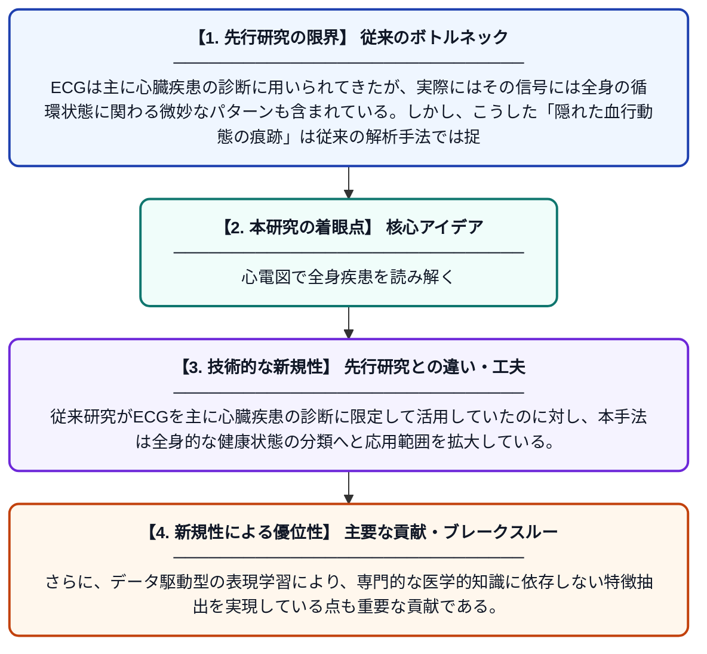

# 血行動態の痕跡を解明する：ECG信号を用いた全身疾患分類のための多様体学習アプローチ

**Original Title**: *Unveiling Hemodynamic Footprints: A Manifold Learning Approach for Systemic Disease Classification using ECG Signals*

> **💡 一言要約**: 心電図で全身疾患を読み解く

| 項目 | 内容 |
|---|---|
| **著者** | JVPB Avanzini, MM Raimundo |
| **掲載誌** | IJCNN / WCCI 2026 2026 |
| **アラートキーワード** | manifold learning |
| **PDF** | [http://linklings.s3.amazonaws.com/organizations/WCCI/wcci2026/submissions/stype114/tagfP-ijcnn_pap4109s2.pdf](http://linklings.s3.amazonaws.com/organizations/WCCI/wcci2026/submissions/stype114/tagfP-ijcnn_pap4109s2.pdf) |
| **原文リンク** | [http://linklings.s3.amazonaws.com/organizations/WCCI/wcci2026/submissions/stype114/tagfP-ijcnn_pap4109s2.pdf](http://linklings.s3.amazonaws.com/organizations/WCCI/wcci2026/submissions/stype114/tagfP-ijcnn_pap4109s2.pdf) |
| **PDF版要約** | [README.pdf](./README.pdf) |

---

## 📊 新規性の図解（先行研究との違いと本研究のブレークスルー）

## 📝 要約

心電図（ECG）信号には、心臓疾患だけでなく全身の健康状態を反映する微細な生理学的パターンが含まれている。本研究では、多様体学習という機械学習手法を用いて、ECGに隠された血行動態の痕跡を抽出し、全身疾患の分類に活用する手法を提案する。これにより、ECGという非侵襲的・低コストな検査から、より幅広い疾患情報を引き出すことが可能になる。

## ❓ どんな問題に取り組んだか

ECGは主に心臓疾患の診断に用いられてきたが、実際にはその信号には全身の循環状態に関わる微妙なパターンも含まれている。しかし、こうした「隠れた血行動態の痕跡」は従来の解析手法では捉えにくく、全身疾患の分類への応用は十分に進んでいなかった。高次元かつノイズを含むECGデータから有意義な特徴を効率的に抽出する手法の開発が求められていた。

## ✨ 何が新しい？何がすごい？（新規性）

本研究は、多様体学習（Manifold Learning）をECG解析に適用し、高次元信号の中に潜む低次元の幾何学的構造を捉えることで、全身疾患に関連する特徴を効果的に抽出する点が新しい。従来研究がECGを主に心臓疾患の診断に限定して活用していたのに対し、本手法は全身的な健康状態の分類へと応用範囲を拡大している。さらに、データ駆動型の表現学習により、専門的な医学的知識に依存しない特徴抽出を実現している点も重要な貢献である。

## 🎓 大学1年生向けの解説

心電図（ECG）とは、心臓の電気的な活動を記録した波形のグラフです。この研究では、その波形の中に「心臓以外の病気のサイン」が隠れていることに着目しました。「多様体学習」という、複雑なデータの本質的な構造を見つけ出すAI技術を使って、その隠れたサインを取り出します。これにより、体への負担が少なく安価な心電図検査だけで、さまざまな全身の病気を発見できる可能性があります。
