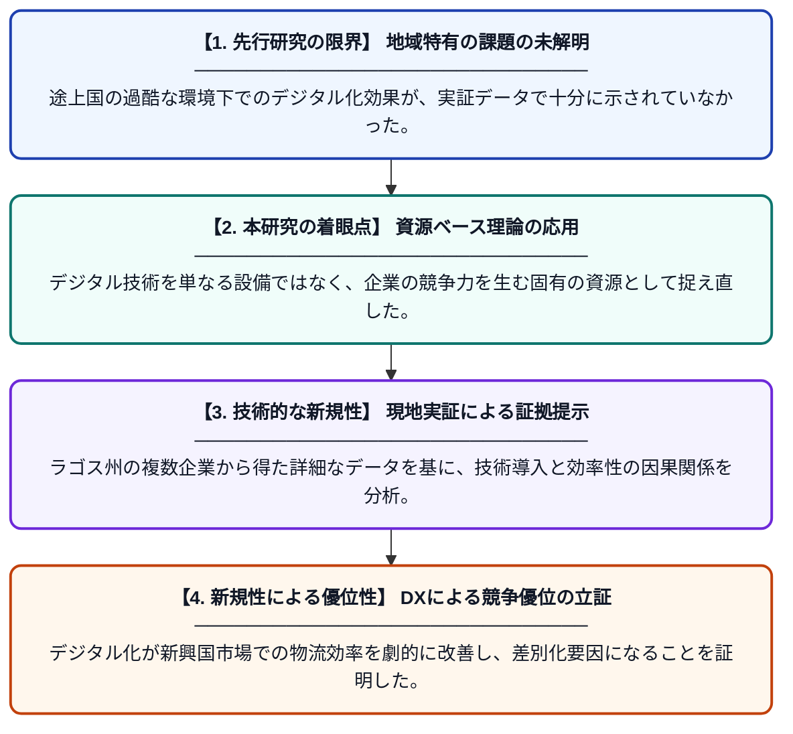

# デジタル技術と物流効率：ナイジェリア・ラゴス州の物流企業における実証的証拠

**Original Title**: *Digital Technologies and Logistics Efficiency: Empirical Evidence from Selected Logistics Firms in Lagos State, Nigeria*

> **💡 一言要約**: デジタル化がナイジェリアの物流を変える

| 項目 | 内容 |
|---|---|
| **著者** | J Olamoju Taiwo, OM Gegeleso |
| **掲載誌** | International Journal of Research and Innovation … 2026 |
| **アラートキーワード** | logistics |
| **原文リンク** | [https://ideas.repec.org/a/bjf/ijriss/v10y2026i10p2780-2789.html](https://ideas.repec.org/a/bjf/ijriss/v10y2026i10p2780-2789.html) |
| **PDF版要約** | [README.pdf](./README.pdf) |

---

## 📊 新規性の図解（先行研究との違いと本研究のブレークスルー）

## 📝 要約

本研究は、ナイジェリア・ラゴス州の物流企業を対象に、デジタル技術の導入が物流効率に与える影響を調査しました。資源ベース理論（RBV）に基づき、従業員や経営層への調査を通じて、デジタル化が業務の最適化に果たす役割を明らかにしています。

## ❓ どんな問題に取り組んだか

ナイジェリアの物流業界はインフラの未整備や管理の非効率性に悩まされており、経済成長の妨げとなっています。特に、新興国の都市部において、どのデジタル技術が具体的に現場の効率向上に寄与しているのかという実証的な知見が不足していました。

## ✨ 何が新しい？何がすごい？（新規性）

本研究は、アフリカ有数の経済都市であるラゴスの物流現場に深く踏み込み、資源ベース理論を用いてデジタル技術と効率性の相関を証明した点に新規性があります。先行研究が理論的な側面に偏る中、実際の企業データに基づき、デジタルツールが企業の内部資源として競争優位性を生むプロセスを具体化しました。これにより、途上国における物流DX（デジタルトランスフォーメーション）の重要性を実証的な根拠をもって示したことが大きな貢献です。

## 🎓 大学1年生向けの解説

物流とは、荷物を目的地まで効率よく届ける仕組みのことです。この論文は、アフリカの大きな都市であるラゴスで、ITツールを使うことでどれくらい仕事がスムーズになるかを調査しました。実際に働いている人たちにアンケートを行い、デジタル技術が単なる「道具」ではなく、会社を強くするための「大切な資源」であることを明らかにしています。ITを導入することが、どのようにして無駄な時間やコストを減らすことに繋がるのかを分かりやすく説明しています。
