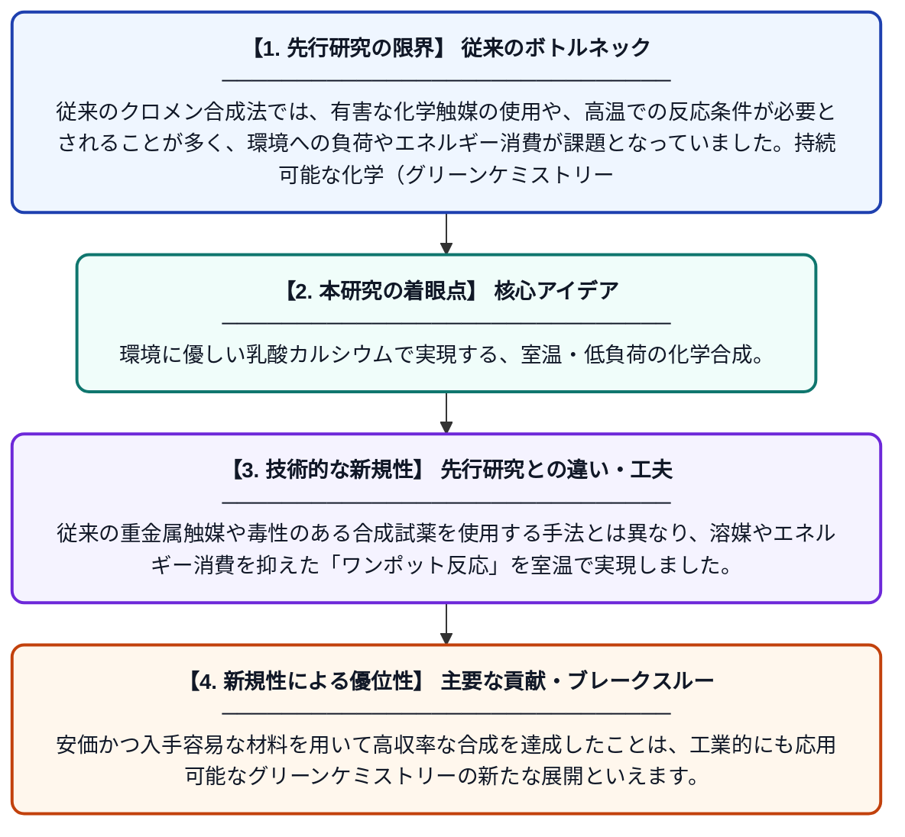

# 室温下における環境に優しい触媒「乳酸カルシウム」を用いたテトラヒドロ-4H-クロメンのグリーン合成

**Original Title**: *Calcium lactate as an environmentally benign catalyst for the green synthesis of tetrahydro-4H-chromenes at ambient temperature*

> **💡 一言要約**: 環境に優しい乳酸カルシウムで実現する、室温・低負荷の化学合成。

| 項目 | 内容 |
|---|---|
| **著者** | S Roy, U Ghosh, D Paul, T Sultana, SA Salim, S Sikder… |
| **掲載誌** | Inorganica Chimica Acta 2026 |
| **アラートキーワード** | ICA |
| **原文リンク** | [https://www.sciencedirect.com/science/article/pii/S0020169326004378](https://www.sciencedirect.com/science/article/pii/S0020169326004378) |
| **PDF版要約** | [README.pdf](./README.pdf) |

---

## 📊 新規性の図解（先行研究との違いと本研究のブレークスルー）

## 📝 要約

本研究では、アルデヒド、環状1,3-ジカルボニル化合物、マロノニトリルを原料とし、乳酸カルシウムを触媒とする効率的かつ持続可能なクロメン誘導体の合成手法を報告しています。この手法は室温という穏やかな条件下で進行し、環境負荷を最小限に抑えた化学合成を実現しました。

## ❓ どんな問題に取り組んだか

従来のクロメン合成法では、有害な化学触媒の使用や、高温での反応条件が必要とされることが多く、環境への負荷やエネルギー消費が課題となっていました。持続可能な化学（グリーンケミストリー）の観点から、より安全で再利用可能な触媒を用いた、穏やかな条件下でのプロセス開発が求められていました。

## ✨ 何が新しい？何がすごい？（新規性）

最大の特徴は、食品添加物としても利用される安全な「乳酸カルシウム」を環境に優しい触媒として採用した点です。従来の重金属触媒や毒性のある合成試薬を使用する手法とは異なり、溶媒やエネルギー消費を抑えた「ワンポット反応」を室温で実現しました。安価かつ入手容易な材料を用いて高収率な合成を達成したことは、工業的にも応用可能なグリーンケミストリーの新たな展開といえます。

## 🎓 大学1年生向けの解説

化学の実験では、物質を作るために環境に悪い強力な薬品を使うことがよくあります。この研究は、私たちが普段口にする食品にも含まれる「乳酸カルシウム」を薬品の代わりに使うことで、地球に優しい方法で新しい物質を作り出すことに成功しました。特別な熱を加える必要もなく、室温で混ぜ合わせるだけで反応が進むため、とても効率的です。環境を守りながら有用な物質を作る、これからの化学の理想的な形を示した研究です。
